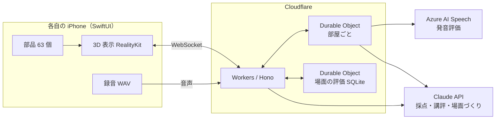

# ScenEnglish（シーングリッシュ）

**同じ 3D の場面を、みんなで同時に見て、英語で描写して競う。**
AI が「何を言えたか・どう言えたか・どう話せたか」を採点し、次に伸ばす一つを教えてくれる、話す英語のゲームです。

| 公園 | 教室 | 駅前 |
| --- | --- | --- |
|  |  |  |
| **雨のバス停** | **海辺** | **カフェ** |
|  |  |  |

↑ アプリで遊べる 3D の場面。

## 製品概要

**英語 × ゲーム × 3D**: 同じ場面を見て、自分の言葉で英語を話し、比べ合うスピーキングゲーム

### 背景(製品開発のきっかけ、課題等）

**英語を「話す」場がない**

単語帳で何千語も覚え、文法の問題も解けるのに、いざ話そうとすると言葉が出てこない。私たちはその一番の理由を、**話す機会そのものが足りないこと**だと考えました。

- **既存の英会話アプリは、決まった文（定型文）をなぞる練習が中心**です。自分で文を組み立てる練習になりにくく、何より面白くないので続きません。
- **「見たものを英語で説明する力（描写力）」は、英検の面接や実際の会話で求められます。** それなのに、練習して点数で振り返れる場がほとんどありません。
- **一人で練習しても、自分の言い方が良いのか分かりません。** 他の人ならどう言うかを知る機会もありません。

**「同じものを見ても、人によって言い方が違う」**

ある人は「犬が走っている」と言い、別の人は「男の子が犬とボールで遊んでいる」と言う。友達の描写を聞くと、「そこを見るのか」「そう言えばいいのか」と発見があります。

私たちはこの **「比べる面白さ」** に注目しました。友達と同じ場面を同時に見て、それぞれの言葉で描写し、AI の採点で競い合う。そうすれば、**楽しみながら、自分の言葉で話す量を増やせる**と考えました。

**対象ユーザ**

- 単語や文法は学んだが、**英語を話す機会が少ない**中高生・大学生
- 英検の面接やスピーキングの試験に向けて、**描写の練習をしたい**人
- 友達と**ゲームとして**英語を練習したい人

**既存のサービスとの違い**

| | 定型文を練習するアプリ | 一人で場面を描写して練習するアプリ | **ScenEnglish** |
| --- | --- | --- | --- |
| 話す内容 | 決まった文をなぞる | 自分の言葉で話す | **自分の言葉で話す** |
| 遊び方 | 一人 | 一人 | **友達と同時に対戦** |
| 他の人の言い方から学ぶ | できない | できない | **全員の描写を並べて比べる** |
| 次に何をすればいいか | 分かりにくい | 点数だけのことが多い | **「次はこれ（+N 点）」と言い換えを示す** |

### 製品説明（具体的な製品の説明）

ScenEnglish は、友達と iPhone で同時に遊ぶ、英語のスピーキングゲームです。1 ラウンドは約 1 分です。

| # | ステップ | 内容 |
| --- | --- | --- |
| 1 | 部屋に集まる | ホストが部屋を作り、ほかの人は 4 桁のコードか QR コードで入ります |
| 2 | 場面を決める | ホストが場面を選びます。用意した 3D の場面（★ の評価つき）・「おまかせ」・**「AI で作る」**（一言のお題から新しい場面を作る）の 3 通りです |
| 3 | 同時に見る | 全員の iPhone に同じ 3D のジオラマが**同じ時刻に**現れ、くるっと 1 周します。指で回して見回せます |
| 4 | 同時に話す | 見たものを英語で描写します（最長 20 秒） |
| 5 | AI が採点 | 内容・表現・話し方の 3 つの観点で、1 人ずつ採点します |
| 6 | 結果発表 | 順位と全員の描写を並べて見比べます |
| 7 | 振り返り | 「できたこと」「次はこれ（+N 点）」「こう言い換える」「話し方のコツ」と、自分の声の聞き直し |

<!-- TODO: アプリの実際の画面（スクリーンショット）を並べる。例: | ホーム | 待合 | プレイ | 結果発表 | 振り返り | -->

### 特長

#### 1. 全員が「同時に」同じ場面を描写する、公平な対戦

順番に話すと、後の人は前の人の言い方を真似できてしまい、後の人ほど有利になります。

ScenEnglish では、サーバーが**開始時刻**を全員に配ります。各 iPhone はその時刻に合わせて 3D を回し、録音を始めます。**全員が同時に見て、同時に話す**ので真似ができず、一人ひとりの見方と言い方をそのまま比べられます。

結果発表では、他の人の描写と点数が並びます。「そこに気づかなかった」「その単語を使えばよかった」という発見が、次のラウンドの描写を変えます。

#### 2. 納得できる AI 採点と、「次の一歩」が分かる講評

| 観点（重み） | 何を見るか | どう採点するか |
| --- | --- | --- |
| 内容（50%） | 場面の要素をどれだけ言えたか | 要素ごとの加点（Claude） |
| 表現（25%） | 語彙・文の組み立て | Claude |
| 話し方（25%） | 発音・流暢さ・抑揚 | Azure AI Speech の発音評価 |

- **「例文と同じか」では採点しません。** 場面を要素に分け（例: 公園の場面なら「犬」15 点、「犬がボールに向かって走っている」25 点）、要素ごとに満点・半分・なしを、**根拠になった本人の発言つきで**判定します。言い回しが違うだけで点が下がることはありません。
- **「次に伸ばす一つ」は、AI ではなくプログラムが計算します。** 言えなかった要素のうち、言えば合計点が最も伸びるものを選び、「次はこれ（+25 点）」のように示します。採点と講評が食い違いません。
- **やる気をそがない講評にしました。** 「できたこと」は本人の発言を引用してほめます。発音のアドバイスでは、点の低い単語を全部並べず、**最も低い一語だけ**を名指しします。

#### 3. 描写したくなる 3D の場面を、選ぶことも AI で作ることもできる

| 難易度 | 場面 | 描写してほしい要素 |
| --- | --- | --- |
| かんたん | 公園・教室・駅前 | 8 個。目立つ人や動物が 1〜2 組で、基本の単語で言える |
| ふつう | 雨のバス停・海辺・カフェ | 10 個。人と人のやりとりやハプニングがあり、`on` / `under` / `next to` などの位置の言い方も要る |
| AI で作る | お題しだい | ホストが入れた一言から、部品を組み合わせて作る |

- **「ふつう」の場面には、思わず描写したくなる出来事を仕込みました。** 車が水たまりの水をはね上げる、カモメがピクニックのサンドイッチを奪っていく、男性がコーヒーを倒して床にこぼれる、などです。
- **一言のお題から、AI が新しい場面を作ります。** 日常でよく使う動詞・名詞の部品（63 個）を先に作り置き、AI には「どの部品を、何の上に・何の隣に置くか」だけを書かせます。遊ぶたびに新しい場面で練習できます。

### 解決出来ること

- **話す量が増える**: ゲームとして友達と遊ぶので、1 ラウンドごとに必ず自分の言葉で話します。
- **描写力が鍛えられる**: 「何が・どこで・何をしているか」を自分で組み立てて話す練習になります。暗記した定型文では対応できません。
- **伸びしろが具体的に分かる**: 点数だけでなく、「次はこれを言えば +N 点」「この一文はこう言い換える」「この単語の発音に気をつける」まで分かるので、次のラウンドですぐ試せます。
- **他の人から学べる**: 同じ場面への他の人の描写を並べて見られるので、自分に無かった語彙や見方に自然と出会えます。
- **飽きずに続けられる**: 友達と競う楽しさがあり、AI が新しい場面を作るので、同じ場面の繰り返しになりません。

### 今後の展望

### 注力したこと（こだわり等）

* **「同時」と「公平さ」を最後まで守った**
  * 順番に遊ぶと後の人ほど有利になるので、「全員が同時に遊ぶ」を最初に決め、開発が遅れても**最後まで削らない機能**として守りました。
  * 部屋の状態は Cloudflare の Durable Objects で 1 部屋 1 つ持ちます。通信が切れたときの自動のつなぎ直し、ホストが抜けたときの引き継ぎ、マイクが使えない人の扱いまで作り込みました。
* **AI の採点を「信頼できる」ものにした**
  * LLM に「100 点満点で採点して」と頼むと、同じ発話でも点がぶれ、なぜその点なのかも分かりません。
  * そこで、**AI には「どの要素を言えたか」と根拠の発言だけを返させ、点の合計と「次の一手」はプログラムが計算する**形にしました。AI が返した引用は、実際の文字起こしに含まれるかを確かめてから出します。
* **採点の待ち時間を半分にした**
  * 実機で遊ぶと、採点の待ち時間の大半を Claude が占めていました。同じ発話で、モデルと思考の深さ（effort）を変えて測り、**点数の傾向を保ったまま、待ち時間を約半分にできる設定**を選びました。

    | モデル・effort | Claude の時間（3 回） | 内容の点 | 表現の点 |
    | --- | --- | --- | --- |
    | Claude Haiku 5.5・high | 7.6 / 6.2 / 6.2 秒 | 88〜89 | 75 / 80 / 50 |
    | **Claude Sonnet 5.5・low（採用）** | **4.3 / 3.1 / 3.0 秒** | 91〜93 | 72 / 78 / 70 |

* **AI で作る場面の速さと確かさ**
  * 場面をまるごと AI に作らせると、待ち時間が長く、品質も読めません。そこで AI には座標を書かせず、**部品どうしの関係だけを書かせる**ことで、待ち時間を短くし、部品が重なる・浮くといった崩れを防ぎました。
  * 部品は、学習者が言いそうな文 300 本を調べ、場面にできる割合が大きく伸びるものから作っています。
* **描写したくなる場面のつくり込み**
  * 人物のポーズ・小物・光まで、「何を言おうか」と考えたくなる要素を詰め込みました。雨の日は暗い空と濡れた路面と水しぶき、海辺は透き通った海、カフェは窓からの日差しとつり下げランプです。
  * 拡大した画像で 1 つずつ確かめ、重なりや見えにくさを直しました。
* **公開しても安全なお金の設計**
  * API キーは iPhone に一切置かず、外部 API（Azure・Claude）はすべてサーバーから呼びます。
  * 部屋の人数の上限（5 人）と「1 人 1 ラウンド 1 回だけ採点」を設け、外部 API を呼ばずに固定の点数を返すモードも用意しました。PR ごとのプレビュー環境はこのモードで動かし、料金を抑えています。
* **5 人で速く・壊さずに作るチーム開発**
  * Hack Day の 2 日間で 35 本を超える PR を merge しました。変更はすべて PR を通し、`main` には直接 push できない設定にしています。
  * API の型は 1 か所（zod）で定義し、OpenAPI を経由して iOS の Swift の型を自動生成します。バックエンドと iOS を並行して作っても食い違いません。
  * 決めたことは ADR と仕様書（[`docs/`](docs/)）に残し、AI エージェント（Claude Code）も同じ文書を読んで開発しました。

## 開発技術

### 活用した技術

#### API・データ

* **Azure AI Speech（発音評価 REST API）**
  * 録音した英語の文字起こしと、発音・流暢さ・抑揚の点数を得ます。単語ごとの発音の点も、「話し方のコツ」に使っています。
* **Claude API（本番は Claude Sonnet 5.5・effort low）＋ @anthropic-ai/sdk**
  * 内容と表現の採点、講評の文に使用しました。出力の形を JSON Schema で決める構造化出力で受け取り、要素ごとの判定と根拠の発言を返させています。
  * モデルと effort は設定で変えられます。お題の一言から場面を作るときにも使います。

#### フレームワーク・ライブラリ・モジュール

**iOS アプリ**

* **SwiftUI**
  * iOS アプリのフレームワーク。ホームから結果発表・振り返りまでの画面を作りました。
* **RealityKit**
  * 3D のジオラマ（USDZ）の表示に使用しました。指で回して見回す操作や、部品を並べて場面を組み立てる処理も RealityKit で作っています。
* **AVFoundation**
  * 録音（16 kHz・モノラルの WAV、最長 20 秒）と、振り返りでの自分の声の再生に使用しました。
* **VisionKit**
  * 部屋の QR コードの読み取りに使用しました。
* **swift-openapi-generator**
  * バックエンドの `openapi.json` から、API の型と通信のコードを自動で作ります。バックエンドが API を変えても、次のビルドで iOS の型が追従するので、食い違いが起きません。
* **XcodeGen**
  * 設定ファイル（`ios/project.yml`）から Xcode のプロジェクトを作ります。複数人で開発しても、プロジェクトのファイルが衝突しません。

**バックエンド**

* **TypeScript + Hono**
  * Cloudflare Workers の上で動く API のフレームワーク。
* **Cloudflare Durable Objects**
  * 部屋ごとに 1 つ置き、参加者・進行・点数と WebSocket の接続を持たせました。全員の同時プレイを、常に立てておくサーバー無しで実現しています。
  * 場面の ★ 評価とコメントは、全体で 1 つの Durable Object の SQLite に保存しています。
* **zod**
  * API の型と入力の検査。ここで定義した型から OpenAPI を作り、iOS の型の元にしています。

**3D**

* **Blender 4.5（Python API の bpy・bmesh）**
  * 場面と部品を、すべて Python のスクリプトから生成しました。外部の 3D 素材は使っていません。
* **Cycles**
  * Blender のレンダラー。README と発表に使う場面の画像を描きました。
* **USDZ**
  * アプリで表示する 3D の形式。場面と部品を USDZ で書き出し、アプリに同梱しています。

**インフラ**

* **Cloudflare Workers**
  * バックエンドの本番環境。バックエンドを変える PR ごとに専用のプレビュー環境も立ち、iPhone から merge 前の版を試せます。
* **GitHub Actions**（https://github.com/jphacks/ng_2622/actions）
  * pr-checks で、PR のタイトルとブランチ名がチームの規約に沿っているかを検査
  * format-check で、TypeScript・JSON の整形し忘れを検査
  * backend-checks で、バックエンドの型を検査
  * backend-preview で、PR ごとのプレビュー環境を作って URL を PR にコメント
  * deploy-backend で、main に入ったら本番へ自動でデプロイ
  * discord-pr-notify で、PR ができたら Discord に通知
  * CI/CD を整えたことで、5 人が並行して PR を出しても、本番が壊れずに開発を進められました。

**その他ツール**

| ツール | 用途 | 詳細 |
| --- | --- | --- |
| Claude Code | AI エージェントによる開発 | 共有の skill（issue からの着手、commit メッセージ、ADR、仕様の詰め）をリポジトリに置き、AI もチームの決まりに沿って実装しました。 |
| lefthook | git hook | commit のときに整形と、commit メッセージ・ブランチ名の検査を自動で行います。 |
| Biome | 整形・lint | TypeScript と JSON の書き方をチームでそろえました。 |
| pnpm | パッケージ管理 | JavaScript の道具とバックエンドの依存を管理しました。 |
| ADR・設計書（`docs/`） | 意思決定と仕様の記録 | 技術選定や仕様の決定を、理由つきで残しました。チームと AI が同じ文書を読んで開発しています。 |
| Discord | チーム内の連絡 | PR の作成を通知し、レビューを早く回しました。 |

#### デバイス

* **iPhone（iOS 26）**: プレイヤーの端末。3D の表示、録音、結果
* **Mac**: Xcode でのアプリのビルドと、Blender での 3D の生成

### 独自技術

#### ハッカソンで開発した独自機能・技術

アプリ・バックエンド・3D は、すべて Hack Day（10/24・25）に実装しました。事前に用意したのは、仕様書とリポジトリの規約だけです。

* **独自で開発したもの**

  | 技術 | 概要 | 仕様書 |
  | --- | --- | --- |
  | 要素ごとの加点採点 | Claude が要素ごとに満点・半分・なしと根拠の発言を返し、合計はプログラムが計算する | [使い方](docs/design/usecase.md) |
  | 「次に伸ばす一つ」の自動選択 | 言えなかった要素のうち、言えば合計点が最も伸びるものを選ぶ | [使い方](docs/design/usecase.md) |
  | 開始時刻の配布による同時プレイ | 1.5 秒先の開始時刻を全員に配り、3D と録音をそろえる | [アーキテクチャ](docs/design/architecture.md) |
  | 自動のつなぎ直しとホストの引き継ぎ | 切れたら同じ合言葉で入り直す（0.5 秒から倍に待ち、最大 10 回）。ホストが抜けたら残った人が引き継ぐ | [アーキテクチャ](docs/design/architecture.md) |
  | コードだけで作る 3D ジオラマ | 地面・建物・人物・小物のすべてを Blender の Python で生成。アプリ用の USDZ と発表用の画像を同時に書き出す | [3D シーン](assets/scenes/README.md) |
  | AI で場面を作る仕組み | 部品 63 個と配置のプロトコル。AI は部品どうしの関係だけを書き、座標はプログラムが計算する | [プロトコル](docs/design/scene-protocol.md) |
  | API の型の自動生成 | zod → OpenAPI → Swift の型。null の扱いの違いも吸収 | [アーキテクチャ](docs/design/architecture.md) |

* **特に力を入れた部分**（課題と工夫、ファイルリンクと commit_id）

  **① 要素ごとの加点で採点し、「次に伸ばす一つ」を計算で選ぶ**

  commit: [`ea8e157`](https://github.com/jphacks/ng_2622/commit/ea8e157)・[`c48d660`](https://github.com/jphacks/ng_2622/commit/c48d660)・[`f754b52`](https://github.com/jphacks/ng_2622/commit/f754b52)

  課題
  - LLM に点数を直接付けさせると、同じ発話でも点がぶれ、理由も分からない。
  - 例文との一致で採点すると、言い回しが違うだけで点が下がる。
  - AI が講評で「次はこれを言おう」と勧めた内容と、実際の点数が食い違うことがある。

  工夫
  1. 人が場面を要素に分けて点を付け、「満点になる言い方」と「半分になる言い方」を書いておく。
  2. Claude には要素ごとに `full` / `partial` / `none` と根拠の発言だけを、構造化出力で返させる。
  3. 点の合計はバックエンドが計算する。一覧にない正しい描写は上限 10 点で加点する。
  4. 「次に伸ばす一つ」は、言えなかった要素のうち `満点 − いまの点` が最も大きいものをプログラムが選ぶ（[`feedback.ts`](backend/src/scoring/feedback.ts) の `pickMissingElement`）。
  5. 「話し方のコツ」は、Azure の 3 つの点のうち最も低いものから作る。発音が最も低いときは、単語ごとの点から最も低い一語だけを名指しする（`speechTip`）。
  6. AI が返した引用は、文字起こしに含まれるかを確かめてから出す（`quotedFrom`）。

  詳しくは [`backend/src/scoring/`](backend/src/scoring/) をご覧ください。

  **② 全員の「同時」をそろえる部屋の仕組み**

  commit: [`773f298`](https://github.com/jphacks/ng_2622/commit/773f298)・[`8d914c8`](https://github.com/jphacks/ng_2622/commit/8d914c8)・[`038ef7f`](https://github.com/jphacks/ng_2622/commit/038ef7f)・[`0c5185c`](https://github.com/jphacks/ng_2622/commit/0c5185c)

  課題
  - 「スタート」の合図をそのまま送ると、通信の遅れの分だけ端末ごとに開始がずれる。
  - 1 人でも採点が終わらないと、全員が結果発表を待ち続ける。
  - スマホの通信は切れやすく、切れた人が部屋から消えてしまう。

  工夫
  - 部屋ごとに 1 つの Durable Object が状態を持ち、WebSocket で全員につながる。
  - `start` を受けたら、**1.5 秒先の開始時刻**を全員に配る。各端末はその時刻から 3D の回転と録音を始めるので、通信の遅れに左右されずにそろう。
  - 音声が届いた人から 1 人ずつ採点を始め、全員そろったら結果発表に進む。マイクが使えない人は `skip` で「採点できませんでした」にして、待たせない。
  - iOS は、切れたら同じ合言葉でつなぎ直す（0.5 秒から倍に待ち、最大 10 回）。ホストが抜けると、残った人がホストを引き継ぐ。

  詳しくは [`backend/src/durable-objects/room.ts`](backend/src/durable-objects/room.ts)・[`backend/src/domain/round.ts`](backend/src/domain/round.ts)・[`ios/NG2622/Backend/`](ios/NG2622/Backend/) をご覧ください。

  **③ コードだけで作る 3D ジオラマ**

  commit: [`24ab870`](https://github.com/jphacks/ng_2622/commit/24ab870)・[`358c991`](https://github.com/jphacks/ng_2622/commit/358c991)

  課題
  - 既存の 3D 素材は、権利の確認が難しく、場面に合わせた細かい調整もできない。
  - 英語で描写させるには、「何をしているか」が一目で分かる人物の動きと、ハプニングが要る。

  工夫
  - 地面・建物・人物・小物のすべてを、Blender の Python（bmesh）で形から組み立てた。
  - 共通の道具（[`common.py`](scripts/scene/common.py)）を作り、6 つの場面で使い回した。人物のポーズ（立つ・歩く・走る・座る・ひざ立ち・跳ぶ・物を持つ）、砂浜から海へなだらかに下がる起伏、半透明のガラスや水しぶき、場面ごとの天気の光。
  - 1 本のスクリプトから、アプリ用の USDZ（部品ごとに名前つき）と発表用の画像（Cycles）を同時に書き出す。
  - 場面ごとの JSON に、難易度・採点用の場面の説明・描写してほしい要素を持たせた。

  詳しくは [`scripts/scene/`](scripts/scene/)（[`rainy_street.py`](scripts/scene/rainy_street.py)・[`beach.py`](scripts/scene/beach.py)・[`cafe.py`](scripts/scene/cafe.py) など）をご覧ください。

  **④ AI で場面を作る仕組み（部品と配置のプロトコル）**

  commit: [`8f3d29b`](https://github.com/jphacks/ng_2622/commit/8f3d29b)・[`aa30cb7`](https://github.com/jphacks/ng_2622/commit/aa30cb7)・[`be6aec3`](https://github.com/jphacks/ng_2622/commit/be6aec3)・[`e2a3d71`](https://github.com/jphacks/ng_2622/commit/e2a3d71)

  課題
  - 場面をまるごと AI に作らせると、待ち時間が長く、品質も読めない。
  - AI に座標を書かせると、部品が重なったり浮いたりする。

  工夫
  - 日常でよく使う動詞・名詞の**部品 63 個を先に作り置き**、大きさ・向き・語（words）・座る点などのメタデータを持たせた。
  - 学習者が言いそうな文 300 本で「部品で場面にできる割合」を調べ（[調査](docs/design/research/scene-sentence-coverage.md)）、効果の大きい部品から作った。
  - AI には部品どうしの関係（on・under・next_to・sit_on など）と大まかな区画だけを書かせ、**座標はプログラムが部品の大きさから計算する**。
  - アプリは配置の JSON を読み、部品を RealityKit で並べる。落ちる・動く・回る・揺れるの動きも付けられる。
  - 配置の JSON を部品で組んで画像にする道具（[`render_layout.py`](scripts/scene/render_layout.py)）で、アプリを動かさずに確かめられる。

  詳しくは [`docs/design/scene-protocol.md`](docs/design/scene-protocol.md)・[`assets/parts/`](assets/parts/) をご覧ください。

  
