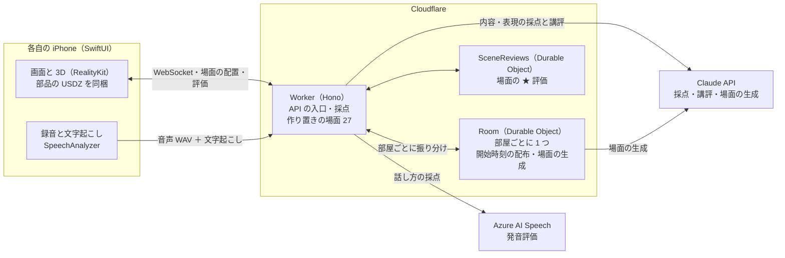

# ScenEnglish（シーングリッシュ）

同じ 3D の場面をみんなで同時に見て、英語で描写して競うスピーキングゲームです。AI が「何を言えたか・どう言えたか・どう話せたか」を採点し、次に伸ばす一つを教えてくれます。

### デモ動画

https://github.com/user-attachments/assets/b51df3fd-1d8b-4c19-bede-7b744261bc7c

2026/10/25（日）15:16 ごろ、Hack Day の会場で撮影しました（このときの main の最新は [`3327599`](https://github.com/jphacks/ng_2622/commit/3327599)）。部屋が AI でその場で場面を作る仕組みなど、撮影の後に入れたものは映っていません（「[いつ作ったか](#いつ作ったか)」）。

## 製品概要

英語 × ゲーム × 3D：同じ場面を見て、自分の言葉で英語を話し、比べ合うスピーキングゲーム

### 背景(製品開発のきっかけ、課題等）

単語や文法を学んでも、いざ話そうとすると言葉が出てきません。これは数字にも表れています。2023 年度の全国学力・学習状況調査（中学 3 年生）では、英語の 4 技能のうち「話すこと」の平均正答率が **12.4%** で、「聞くこと」58.9%・「読むこと」51.7%・「書くこと」24.1% と比べて最も低い結果でした。約 6 割の生徒は「話すこと」の問題に 1 問も正答できませんでした。

（参考: [国立教育政策研究所「令和5年度 全国学力・学習状況調査の結果」](https://www.nier.go.jp/23chousakekkahoukoku/report/data/23summary.pdf)、[リセマム](https://resemom.jp/article/2023/08/01/73230.html)、[時事通信出版局](https://book.jiji.com/information/news/news-9587/)）

私たちは話せない一番の理由を、話す機会そのものが足りないことだと考えました。

- 既存の英会話アプリは、決まった文をなぞる練習が中心です。自分で文を組み立てる練習になりにくく、面白くないので続きません。
- 一人で練習しても、自分の言い方が良いのか、他の人ならどう言うのかが分かりません。

同じ場面を見ても、ある人は「犬が走っている」と言い、別の人は「男の子が犬とボールで遊んでいる」と言います。私たちはこの「比べる面白さ」に注目し、友達と同じ場面を同時に描写して AI の採点で競うゲームを作りました。

|                        | 定型文を練習するアプリ | 一人で場面を描写して練習するアプリ | **ScenEnglish**                           |
| ---------------------- | ---------------------- | ---------------------------------- | ----------------------------------------- |
| 話す内容               | 決まった文をなぞる     | 自分の言葉で話す                   | **自分の言葉で話す**                      |
| 遊び方                 | 一人                   | 一人                               | **友達と同時に対戦**                      |
| 他の人の言い方から学ぶ | できない               | できない                           | **全員の描写を並べて比べる**              |
| 次に何をすればいいか   | 分かりにくい           | 点数だけのことが多い               | **「次はこれ」の一つと言い換えを示す**    |

### 製品説明（具体的な製品の説明）

友達と iPhone で同時に遊ぶ、英語のスピーキングゲームです。1 ラウンドは約 1 分です。

1. 部屋に集まる：ホストが部屋を作り、ほかの人は 4 桁のコードか QR コードで入ります。ホストは難易度（かんたん・ふつう・むずかしい）だけを選びます。
2. 同時に見る：全員の iPhone に同じ 3D の場面が同じ時刻に現れます。場面はその部屋でまだ出ていないものからランダムに選ばれ、始まるまで誰にも分かりません。指で回して見回せます。
3. 同時に話す：見たものを英語で描写します（最長 20 秒）。話し終えたら、ほかの人を待つ間に場面の正答例が出ます。
4. 結果発表：AI の採点で順位を出し、全員の描写を並べて見比べます。
5. 振り返り：「できたこと」「次はこれ」「こう言い換える」「話し方のコツ」が出て、自分の声も聞き直せます。場面を ★ で評価することもできます。

<!-- TODO: アプリの実際の画面（スクリーンショット）を並べる。例: | ホーム | 待合 | プレイ | 結果発表 | 振り返り | -->

### 特長

#### 1. 全員が同時に同じ場面を描写する、公平な対戦

順番に話すと、後の人は前の人の言い方を真似できてしまいます。ScenEnglish では全員が同時に見て同時に話すので、一人ひとりの見方と言い方をそのまま比べられます。

#### 2. 納得できる AI 採点と、次の一歩が分かる講評

| 観点（重み）  | 何を見るか                   | 採点            |
| ------------- | ---------------------------- | --------------- |
| 内容（50%）   | 場面の中心と細かいことを正しく言えたか | Claude          |
| 表現（25%）   | 語彙・文の組み立て           | Claude          |
| 話し方（25%） | 発音・流暢さ・抑揚           | Azure AI Speech |

例文と同じかどうかでは採点しません。場面に置いた物の名前・位置・向き・動きを正解として AI に渡し、場面の中心を正しく具体的に言えたかを段階の基準で見るので、言い回しが違うだけで点が下がることはありません。場面は回して見られるので、左右・前後はどの向きから見た言い方でも正解にします。振り返りでは、内容・表現・話し方のうち最も伸ばすとよい一つを、短い英語の例と一緒に「次はこれ」と示します。

#### 3. 描写したくなる 3D の場面

AI が 79 個の部品を組み合わせて作った場面を、人が画像で確かめてから作り置きました。難易度ごとに 9 場面、計 27 場面です。かんたんは物が 5〜8 個で stand・run・eat など基本の動き、むずかしいは 10〜15 個で glance・crouch など細かい動きと、難易度が上がるほど描写することが増えます。

さらに、ホストがスタートを押すたびに、部屋が AI でその場で新しい場面を作る仕組みも入れました。10 秒で間に合わない・形が崩れたなどのときは、同じ難易度の作り置きの場面に切り替えるので、遊びは止まりません。待つ間は、全員の画面に 3D の人が走るアニメーションを出します。作り置きの 27 場面は、この切り替え先として使います。

**今の部品だけで、何通りの場面が作れるか**

既存の英会話アプリは、作り手が用意した数のお題で練習します。公式に書かれている数は、多いものでも数千です（アプリ名は伏せます）。

| アプリ | 用意されているもの |
| ------ | ------------------ |
| A      | 8,000 種類以上のレッスン |
| B      | 3,800 フレーズ（決まった文を声に出す） |
| C      | 1,680 レッスン（決まった文を聞いてまねる） |
| D      | 1,000 以上の会話シーン |
| E〜G   | 600〜1,610 フレーズ（決まった文を声に出す） |

（各アプリの公式サイトと App Store の説明による。2026/10/26 時点。A と D には、自由に話す機能もあります）

ScenEnglish の場面は、部品の組み合わせで AI が作ります。今の 79 個の部品と、AI に渡している決まりだけで数えると、次のようになります。

| 難易度     | 置く部品の数（地面と壁を含む） | 部品の選び方            | 置く場所と向きまで数えると |
| ---------- | ------------------------------ | ----------------------- | -------------------------- |
| かんたん   | 4〜6 個                        | 約 5,900 万通り         | 約 2.8 × 10¹⁵ 通り         |
| ふつう     | 6〜10 個                       | 約 2,600 億通り         | 約 1.7 × 10²⁵ 通り         |
| むずかしい | 10〜15 個                      | 約 550 兆通り           | 約 1.9 × 10³⁶ 通り         |

数え方（[`scripts/scene/count_scenes.py`](scripts/scene/count_scenes.py) で出し直せます）:

- 79 個の内訳は、地面 10 枚・室内の背景の壁 4 枚・それ以外 65 個です。
- 地面はちょうど 1 枚。室内（床 4 種）なら背景の壁を 4 種から 1 枚選び、屋外（地面 6 種）なら壁は置きません。
- 室内では窓・壁・時計の部品は使わず（背景の壁に描いてあるため）、電車は駅でだけ使います。そのため、地面と壁のほかに使える部品は、屋外 64 個・駅 65 個・室内 61 個です。
- 同じ部品は 1 場面に 1 回までとし、選ぶ順番は区別しません（並べ方が違っても同じ場面なので、64 × 63 × 62 のような順列ではなく組み合わせ C で数えます）。
- 「置く場所と向き」は、地面と壁のほかの部品 1 個ごとに、3 × 3 の区画のどこか（9 通り）と、向き 4 通りを掛けたものです（36 通り）。「机の上」「2 人の間」のような関係（11 種）と動きは数えていないので、実際にはもっと増えます。
- 一方で、室内に自転車を置くような、意味の通りにくい組み合わせも数に入っています。

手で確かめられる例: 公園の地面に、ほかの部品を 3 個置く場面は C(64, 3) = 64 × 63 × 62 ÷ (3 × 2 × 1) = 41,664 通りです。それぞれの部品を 36 通りに置けるので、置き方まで数えると 41,664 × 36³ = 約 19 億通りになります。

### 解決出来ること

- ゲームとして友達と遊ぶので、1 ラウンドごとに必ず自分の言葉で話し、話す量が増えます。
- 伸びしろが具体的に分かります。点数だけでなく「次はこれ」と英語の例、「この一文はこう言い換える」まで出るので、次のラウンドですぐ試せます。
- 同じ場面への他の人の描写を並べて見られるので、他の人から自分に無かった語彙や見方を学べます。

### 今後の展望

いまは AI が作り置きの部品を組み合わせて場面を作ります。今後は次の 4 つで、場面の幅と学びの深さを広げます。

1. 部品も AI が作る：場面に必要な部品が無ければ、AI が「こういう部品が欲しい」と決めて部品そのものを作り、Cloudflare R2 に保存して配置の JSON と一緒に返します。アプリは部品の ID と配置の JSON から部品を取ってきて組み立てるので、作り置きの部品に無い物が出る場面でも遊べます。
2. 場面を共有する：作った場面（配置の JSON）を R2 に残し、他の人が作った場面でも遊べるようにします。
3. 描写を記録して振り返る：場面と自分の描写を記録として溜め、「この状況ならこう言う」という組で後から見返せるようにします。場面と答えがそろっているので覚えやすくなります。
4. 苦手に合わせて出題する：記録から「室内の様子を説明するのが苦手」のような傾向を見つけ、その状況の場面を AI が作って出します。場面をその場で AI が作れるからこそできる出題です。

### 注力したこと（こだわり等）

- 「同時」と「公平さ」を特に重視しました。開始時刻を全員に配ってそろえ、通信が切れたときのつなぎ直しやホストの引き継ぎまで作り込みました。
- AI の採点を信頼できるものにしました。画像ではなく場面の配置（部品の名前・大きさ・座標・向き・動き）を正解として渡し、0・20・40・60・80・100 の段階ごとの基準で内容と表現を付けさせます。表現の基準は IELTS の語彙・文法の考え方に沿って書きました。
- 採点の待ち時間を約半分にしました。モデルと思考の深さ（effort）を変えて測り、点数の傾向を保ったまま Claude の時間を 6〜8 秒から 3〜4 秒にしました。

### 開発の進め方（ハッカソンで気をつけたこと）

2 日間で完成度を上げるために、ウォーターフォールとアジャイルの良いところを組み合わせました。

リーダーの高橋は、これまでの個人開発で 2 つのやり方を試してきました。

- 仕様駆動開発（SDD）でロジックまで固めてから作る：仕様を読み解くだけで疲れ、作っている途中で仕様との食い違いが起きる。
- 機能や UI を思いついた順に足していく：最終的な着地点がぼやけ、複数人で作ると一人ひとりの作るものがずれていく。

そこで、**画面とその遷移だけは先に固めてチームのゴールにし、裏側のロジックは小さく設計しては作る**ことを繰り返しました。

**1. 先に画面の遷移図と仮の画面を作る**

Hack Day の前に、画面の遷移図を HTML の画面設計書として作り、仮の画面は Codex の画像生成で作りました（[#4](https://github.com/jphacks/ng_2622/pull/4)）。初日の昼過ぎには、3 人が画面のまとまりごとに HTML のモックを作りました（[#12](https://github.com/jphacks/ng_2622/pull/12)・[#15](https://github.com/jphacks/ng_2622/pull/15)・[#18](https://github.com/jphacks/ng_2622/pull/18)）。

ゴールが絵で共有できていたので、アプリとバックエンドを並行して作れました。

- アプリは仮のデータ（Mock）で画面を先につなぎ、初日の 15:57 にはホームから結果まで通して遊べるようになりました（[#25](https://github.com/jphacks/ng_2622/pull/25)）。
- バックエンドは同じ時間に部屋と採点の API を作り（[#17](https://github.com/jphacks/ng_2622/pull/17)・[#20](https://github.com/jphacks/ng_2622/pull/20)・[#27](https://github.com/jphacks/ng_2622/pull/27)）、OpenAPI から作った型でアプリとつなぎました（[#37](https://github.com/jphacks/ng_2622/pull/37)）。
- 初日の 19:13 に、アプリが本物のバックエンドにつながりました（[#40](https://github.com/jphacks/ng_2622/pull/40)）。

**2. 裏側のロジックは、ペアプロで一つずつ設計して部分ごとに作る**

採点・部屋・3D の場面などの裏側は、ペアプロで設計してから小さな PR で作ることを繰り返しました。Hack Day 中に merge した PR は 54 本で、5 人全員が書いています。

- 大きな設計は、先に仕様書か ADR にしてから作りました。例えば、部品と配置のプロトコルを決めてから（[#42](https://github.com/jphacks/ng_2622/pull/42)）部品を作り（[#43](https://github.com/jphacks/ng_2622/pull/43)・[#46](https://github.com/jphacks/ng_2622/pull/46)）、場面の作り置きと採点の方針を決めてから（[#54](https://github.com/jphacks/ng_2622/pull/54)）作り直しました（[#61](https://github.com/jphacks/ng_2622/pull/61)・[#67](https://github.com/jphacks/ng_2622/pull/67)・[#69](https://github.com/jphacks/ng_2622/pull/69)）。
- 54 本のうち 39 本は、実装と同じ PR で仕様書（[`docs/design/`](docs/design/)）か ADR（[`docs/adr/`](docs/adr/)）も直しています。決めたことと作ったものを、そのつど揃えました。

## 開発技術

### 構成

図の元（mermaid）

- iPhone は API のキーを持たず、Cloudflare とだけ話します。外部 API（Azure・Claude）はバックエンドだけが呼びます。
- 部屋の状態（参加者・進行・点数）は部屋ごとの Durable Object が持ち、全員に WebSocket で配ります。
- 音声は Worker が受け取ってすぐ応答し、採点は応答の後に続けて、終わったら部屋に書き込みます。

### 活用した技術

#### 外部API

- Azure AI Speech（発音評価）：発音・流暢さ・抑揚の点数（端末で文字にできなかったときは文字起こしも）
- Claude API（Claude Sonnet 5.5）：内容と表現の採点、講評、場面の生成（作り置きと、部屋でのその場の生成）

#### フレームワーク・ライブラリ・モジュール

- iOS：SwiftUI、RealityKit、AVFoundation、Speech（SpeechAnalyzer で端末の中で文字起こし）、swift-openapi-generator
- バックエンド：TypeScript、Hono、Cloudflare Workers、Durable Objects、zod
- 3D：Blender 4.5（Python で場面と部品を生成）
- 開発：GitHub Actions

#### デバイス

- iPhone（iOS 26）

### 独自技術

#### いつ作ったか

| 時期                                   | 作ったもの                                                                                                                     | PR                                                                                                                                                          |
| -------------------------------------- | ------------------------------------------------------------------------------------------------------------------------------ | ----------------------------------------------------------------------------------------------------------------------------------------------------------- |
| 事前（10/17・10/21）                   | チーム開発の規約と検査、Discord への通知、仕様書と画面設計書（仮の画面の画像）、技術選定の ADR。アプリとバックエンドのコードは無し | [#1](https://github.com/jphacks/ng_2622/pull/1)〜[#4](https://github.com/jphacks/ng_2622/pull/4)                                                          |
| Hack Day 中（10/24 9:00〜10/25 20:00） | アプリ・バックエンド・3D の部品と場面・採点のすべて                                                                            | [54 本](https://github.com/jphacks/ng_2622/pulls?q=is%3Apr+is%3Amerged+merged%3A2026-10-24T00%3A00%3A00Z..2026-10-25T11%3A00%3A00Z)                        |
| Hack Day 後（10/25 20:00〜）           | 部屋がその場で AI で場面を作る仕組みと本番での有効化（#82〜#85）、カウントダウンと同時に指示文を出す（#77）、待合の画面の修正（#78）             | [#77](https://github.com/jphacks/ng_2622/pull/77) ・ [#78](https://github.com/jphacks/ng_2622/pull/78) ・ [#82](https://github.com/jphacks/ng_2622/pull/82) ・ [#83](https://github.com/jphacks/ng_2622/pull/83) ・ [#84](https://github.com/jphacks/ng_2622/pull/84) ・ [#85](https://github.com/jphacks/ng_2622/pull/85) |

#### ハッカソンで開発した独自機能・技術

| 技術                           | 概要                                                                              | 仕様書                                        |
| ------------------------------ | --------------------------------------------------------------------------------- | --------------------------------------------- |
| 配置を正解にした段階の採点     | 場面の配置（部品の名前・座標・向き・動き）を Claude に渡し、内容と表現を段階の基準で付ける | [アーキテクチャ](docs/design/architecture.md) |
| 「次に伸ばす一つ」の提示       | 内容・表現・話し方の点を見て、最も伸ばすとよい一つを英語の例と一緒に返す          | [アーキテクチャ](docs/design/architecture.md) |
| 開始時刻の配布による同時プレイ | 1.5 秒先の開始時刻を全員に配り、3D と録音をそろえる                               | [アーキテクチャ](docs/design/architecture.md) |
| コードだけで作る 3D ジオラマ   | 地面・建物・人物・小物のすべてを Blender の Python で生成する                     | [部品](assets/parts/README.md)                |
| 部品と配置のプロトコル         | 部品 79 個と配置の JSON。AI は部品どうしの関係を書き、座標はプログラムが計算する  | [プロトコル](docs/design/scene-protocol.md)   |
| 部屋がその場で作る AI の場面（Hack Day 後） | スタートのたびに部屋が場面を作り、10 秒で間に合わなければ作り置きに切り替える | [ADR](docs/adr/20261026-generate-scenes-in-room-on-start.md) |

#### 特に力を入れた部分

**① 場面の配置を正解にして、段階の基準で採点する**

commit: [`4251144`](https://github.com/jphacks/ng_2622/commit/4251144)・[`3182d6a`](https://github.com/jphacks/ng_2622/commit/3182d6a)・[`f754b52`](https://github.com/jphacks/ng_2622/commit/f754b52)

LLM に基準を持たせずに点を付けさせると、同じ発話でも点がぶれ、理由も分かりません。そこで場面の配置（部品の名前・英単語・大きさ・座標・向き・動き）を「場面にあるのはこれだけ」という正解として渡し、0・20・40・60・80・100 の段階ごとの基準で内容と表現を付けさせます。内容は、まず場面の中心（誰が何をしているか、主な物の関係）を正しく具体的に言えたかを見て、次に正しい細かいことの数を見ます。左右・前後はどの向きから見た言い方でも正解にします。詳しくは [`backend/src/scoring/`](backend/src/scoring/) をご覧ください。

**② 全員の「同時」をそろえる部屋の仕組み**

commit: [`773f298`](https://github.com/jphacks/ng_2622/commit/773f298)・[`8d914c8`](https://github.com/jphacks/ng_2622/commit/8d914c8)・[`038ef7f`](https://github.com/jphacks/ng_2622/commit/038ef7f)・[`0c5185c`](https://github.com/jphacks/ng_2622/commit/0c5185c)

「スタート」の合図をそのまま送ると、通信の遅れの分だけ端末ごとに開始がずれます。部屋ごとに 1 つの Durable Object が状態を持ち、1.5 秒先の開始時刻を全員に配ることで、各端末が同じ時刻に 3D の回転と録音を始めます。詳しくは [`backend/src/durable-objects/room.ts`](backend/src/durable-objects/room.ts) をご覧ください。

**③ コードだけで作る 3D ジオラマ**

commit: [`24ab870`](https://github.com/jphacks/ng_2622/commit/24ab870)・[`358c991`](https://github.com/jphacks/ng_2622/commit/358c991)

既存の 3D 素材は権利の確認が難しく、場面に合わせた調整もできません。地面・建物・人物・小物のすべてを Blender の Python で組み立て、1 本のスクリプトからアプリ用の USDZ と発表用の画像を書き出します。詳しくは [`scripts/scene/`](scripts/scene/) をご覧ください。

**④ 部品と配置のプロトコルで、AI の場面を作り置く**

commit: [`8f3d29b`](https://github.com/jphacks/ng_2622/commit/8f3d29b)・[`be6aec3`](https://github.com/jphacks/ng_2622/commit/be6aec3)・[`955899a`](https://github.com/jphacks/ng_2622/commit/955899a)・[`7fba1e3`](https://github.com/jphacks/ng_2622/commit/7fba1e3)

場面をまるごと AI に作らせると、待ち時間が長く品質も読めません。そこで部品 79 個を先に作り、学習者が言いそうな文 300 本で調べて効果の大きい部品から作りました。AI には座標を書かせず、「人がベンチに座る」「本が机の上」のような部品どうしの関係だけを書かせ、置く位置はプログラムが計算します。作った場面は画像に描いて人が確かめ、良いものだけを作り置きました。詳しくは [`docs/design/scene-protocol.md`](docs/design/scene-protocol.md) をご覧ください。

**⑤ スタートのたびに部屋が AI で場面を作る（Hack Day 後）**

commit: [`3c5ce0e`](https://github.com/jphacks/ng_2622/commit/3c5ce0e)・[`fd7bd29`](https://github.com/jphacks/ng_2622/commit/fd7bd29)・[`6f89ca7`](https://github.com/jphacks/ng_2622/commit/6f89ca7)

作り置きだけだと、同じ顔ぶれで遊ぶうちに同じ場面が出ます。そこでホストがスタートを押すたびに、部屋（Durable Object）が Claude で新しい場面を作るようにしました。待つのは 10 秒までで、間に合わない・断られた・形が違うときはやり直さず、同じ難易度の作り置きの場面に黙って切り替えます。1 部屋 20 回までにして費用も抑えます。作った配置の JSON は部屋の保存領域に置き、全員に配るのは今までどおり場面の ID だけです。生成は設定 `SCENE_GENERATION` 一つで止められ、止めると作り置きの場面だけで遊べます。詳しくは [`backend/src/durable-objects/room.ts`](backend/src/durable-objects/room.ts) と [ADR](docs/adr/20261026-generate-scenes-in-room-on-start.md) をご覧ください。
