# ScenEnglish（シーングリッシュ）

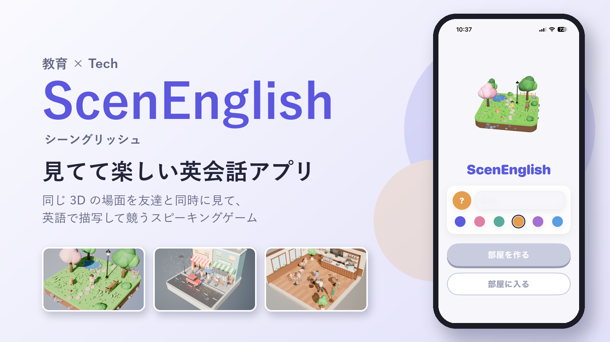

同じ 3D の場面をみんなで同時に見て、英語で描写して競うスピーキングゲームです。AI が「何を言えたか・どう言えたか・どう話せたか」を採点し、次に伸ばす一つを教えてくれます。

### デモ動画

https://github.com/user-attachments/assets/b51df3fd-1d8b-4c19-bede-7b744261bc7c

2026/10/25（日）15:16 ごろ、Hack Day の会場で撮影しました（このときの main の最新は [`3327599`](https://github.com/jphacks/ng_2622/commit/3327599)）。部屋が AI でその場で場面を作る仕組みなど、撮影の後に入れたものは映っていません（「[いつ作ったか](#いつ作ったか)」）。

## 製品概要

英語 × ゲーム × 3D：同じ場面を見て、自分の言葉で英語を話し、比べ合うスピーキングゲーム

### 背景(製品開発のきっかけ、課題等）

#### 誘われたら断らない「対戦」

私たちの世代には、高校時代に話題をさらったクイズ対戦アプリがあります。自分から進んで開くことはあまりなくても、誰かに「やろうぜ」と誘われたら断らない、という人は多いのではないでしょうか。一人で黙々と取り組むより、みんなで競う・協力するほうが、始めるハードルはずっと下がります。

リーダーの高橋は、研究室向けに IELTS の単語テストを簡単な Web アプリで作り、ゼミの後にみんなで対戦しています。英語の勉強は（高橋自身も含めて）誰も進んでやらないのに、「単語テストやろうぜ」と声をかけると、英語が苦手な人まで前のめりで参加してきます。対戦にすると、やる気が出て、心理的なハードルが下がる。これが「英語で対戦したい」と考えた出発点です。

#### なぜ英会話で、なぜ「場面の描写」なのか

英語で対戦する方法はいくつか考えました。単語テストはすでに出尽くしていて、今から作る意味は薄いと考えました。長文の読解は、スマホの小さな画面でたくさんの文字を読ませるのに向きません。英会話なら、入力は声で済み、画面に出す文字もリーディングよりずっと少なくて済みます。

話す力は、数字で見ても一番の弱点です。2023 年度の全国学力・学習状況調査（中学 3 年生）では、英語の 4 技能のうち「話すこと」の平均正答率が **12.4%** で、「聞くこと」58.9%・「読むこと」51.7%・「書くこと」24.1% と比べて最も低い結果でした。約 6 割の生徒は「話すこと」の問題に 1 問も正答できませんでした。

（参考: [国立教育政策研究所「令和5年度 全国学力・学習状況調査の結果」](https://www.nier.go.jp/23chousakekkahoukoku/report/data/23summary.pdf)、[リセマム](https://resemom.jp/article/2023/08/01/73230.html)、[時事通信出版局](https://book.jiji.com/information/news/news-9587/)）

ところが、既存の英会話アプリには、わくわくするものが多くありません。よくある形は 2 つです。

- 例文を復唱する：「I was playing soccer this morning.」のような用意された文をなぞります。何度も同じ文を見るだけで、面白みに欠けます。
- AI と会話する：AI が「大学の教授」などの役になり、こちらは「授業を休みたい」と伝える、といったロールプレイです。けれど、AI に対して話したいことはあまり湧きませんし、何を話すかを頭の中で組み立てるのも難しいものです。

そこで私たちが選んだのが、目の前の場面を説明することです。例えばカフェで女性がコーヒーを注いでいる場面なら、「There is a woman in a cafe. She is pouring coffee into her cup.」のように話します。やることは決まっているので迷いませんが、何をどう言うかは自由です。実際の会話でも、目の前の景色や状況を言葉にする場面は多いので、そのまま練習になります。そして、同じ場面を見ても、ある人は「犬が走っている」と言い、別の人は「男の子が犬とボールで遊んでいる」と言います。この違いを比べられるので、対戦にもよく合います。

|                        | 例文を復唱するアプリ | AI と会話するアプリ          | **ScenEnglish**                              |
| ---------------------- | -------------------- | ---------------------------- | -------------------------------------------- |
| 話す内容               | 決まった文をなぞる   | 何を話すかを自分で考える     | **目の前の場面を、自分の言葉で説明する**     |
| 遊び方                 | 一人                 | 一人（相手は AI）            | **友達と同時に対戦**                         |
| 他の人の言い方から学ぶ | できない             | できない                     | **全員の描写を並べて比べる**                 |
| 次に何をすればいいか   | 分かりにくい         | アプリによる                 | **「次はこれ」の一つと言い換えを示す**       |

#### 追い風：AI が 3D の場面を作れるようになった

最近の LLM は、空間や 3D の配置を理解する力が上がり、部品を組み合わせて 3D の場面を組み立てられるようになりました。AI が毎回場面を作れば、同じ例文を繰り返すことなく、ほぼ無数の状況で遊べます（今の部品だけで作れる場面の数は「[特長 3](#3-描写したくなる-3d-の場面)」）。これが今の形に決めた理由です。

#### 作ってみて

実際に遊んでみると、やはり対戦は楽しく、勝ち負けが出ることが、誰かと続けるモチベーションになると感じました。3D の場面を説明するには普段使わない英語脳を使いますが、3D の場面が可愛くて何度も見られます。可愛いポリゴンの場面を眺めながら話す時間は、私たち自身にとって、とても満足のいくものになりました。

### 製品説明（具体的な製品の説明）

友達と iPhone で同時に遊ぶ、英語のスピーキングゲームです。1 ラウンドは約 1 分です。

1. 部屋に集まる：ホストが部屋を作り、ほかの人は 4 桁のコードか QR コードで入ります。ホストは難易度（かんたん・ふつう・むずかしい）だけを選びます。

   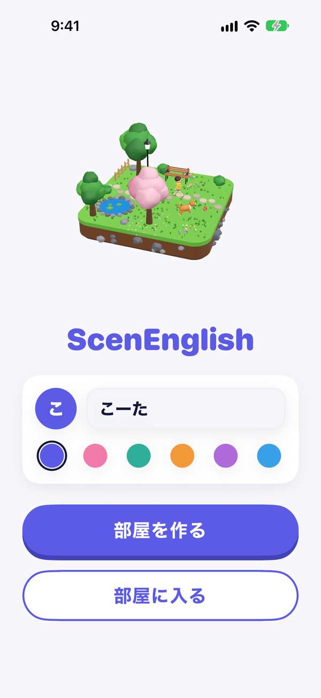 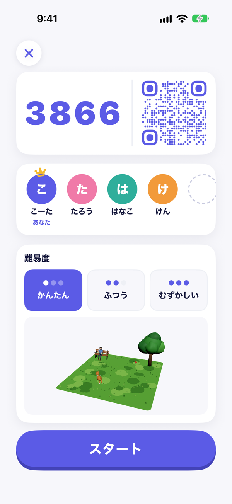

2. 同時に見る：ホストがスタートを押すと、AI がその場で場面を作ります（待つ間は 3D の人が走ります）。全員の iPhone に同じ 3D の場面が同じ時刻に現れ、カウントダウンの間に一周して見せます。場面は始まるまで誰にも分かりません。指で回して見回せます。

   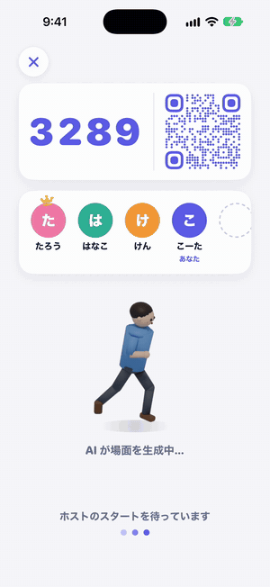 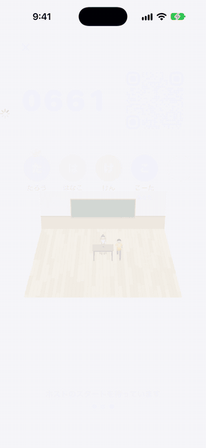

3. 同時に話す：見たものを英語で描写します（最長 20 秒）。話している間は、声の大きさに合わせて下の波が動きます。話し終えたら、ほかの人を待つ間に場面の正答例（AI が場面を作るときに一緒に書いた英語の説明）が出ます。

   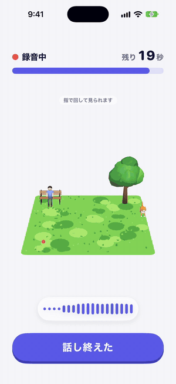 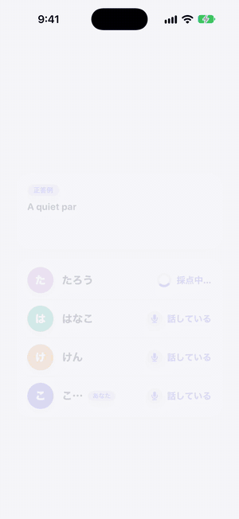

4. 結果発表：AI の採点で、順位を発表します。全員の描写と講評を並べて見比べられます。

   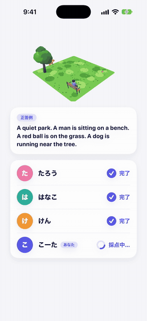 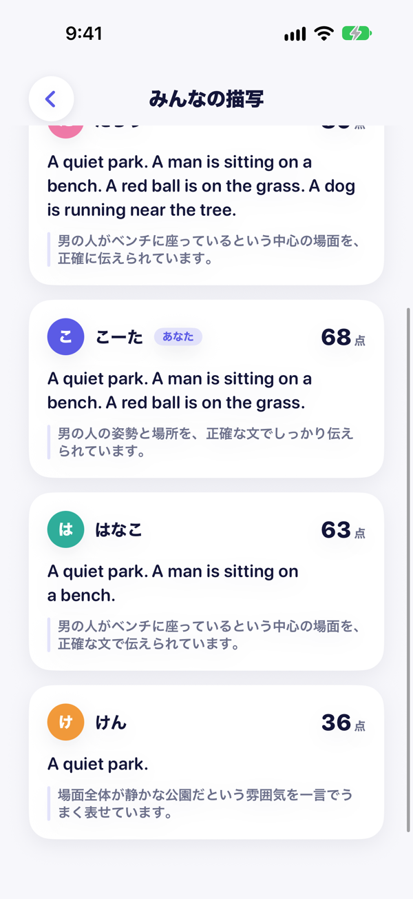

5. 振り返り：「できたこと」「次はこれ」「こう言い換える」「話し方のコツ」が出て、自分の声も聞き直せます。場面を ★ で評価することもできます。

   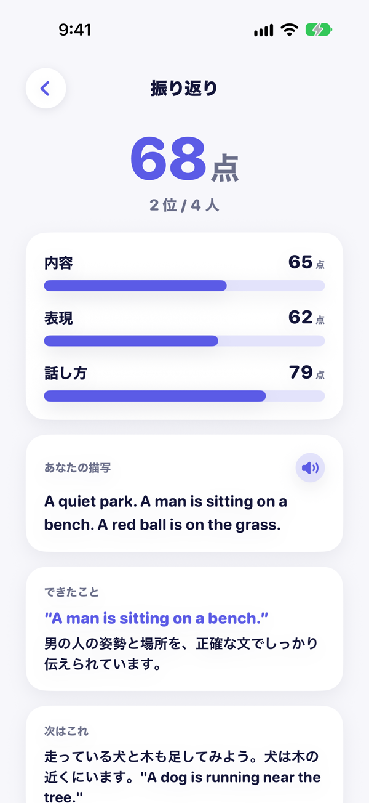 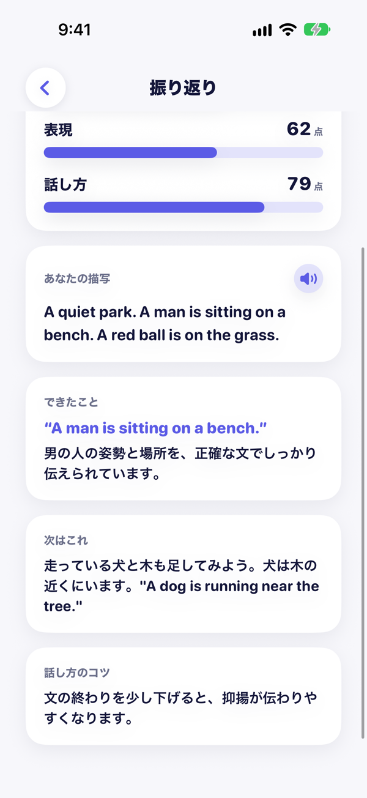

ホームと待合の画面は、シミュレータで限りなく本番に近い仮のデータ（Mock）を使って撮りました。それ以外は本番のバックエンドで 4 人で遊んで撮ったもので、点数と講評は本物の AI の採点です（ほかの 3 人は仮の参加者で、4 人とも声は合成音声です）。

### 特長

#### 1. 全員が同時に同じ場面を描写する、公平な対戦

順番に話すと、後の人は前の人の言い方を真似できてしまいます。ScenEnglish では全員が同時に見て同時に話すので、一人ひとりの見方と言い方をそのまま比べられます。

#### 2. 納得できる AI 採点と、次の一歩が分かる講評

| 観点（重み）  | 何を見るか                   | 採点            |
| ------------- | ---------------------------- | --------------- |
| 内容（50%）   | 場面の中心と細かいことを正しく言えたか | Claude          |
| 表現（25%）   | 語彙・文の組み立て           | Claude          |
| 話し方（25%） | 発音・流暢さ・抑揚           | Azure AI Speech |

例文と同じかどうかでは採点しません。場面に置いた物の名前・位置・向き・動きを正解として AI に渡し、場面の中心を正しく具体的に言えたかを段階の基準で見るので、言い回しが違うだけで点が下がることはありません。場面は回して見られるので、左右・前後はどの向きから見た言い方でも正解にします。振り返りでは、内容・表現・話し方のうち最も伸ばすとよい一つを、短い英語の例と一緒に「次はこれ」と示します。

#### 3. 描写したくなる 3D の場面

AI が 79 個の部品を組み合わせて作った場面を、人が画像で確かめてから作り置きました。難易度ごとに 9 場面、計 27 場面です。かんたんは物が 5〜8 個で stand・run・eat など基本の動き、むずかしいは 10〜15 個で glance・crouch など細かい動きと、難易度が上がるほど描写することが増えます。

さらに、ホストがスタートを押すたびに、部屋が AI でその場で新しい場面を作る仕組みも入れました。10 秒で間に合わない・形が崩れたなどのときは、同じ難易度の作り置きの場面に切り替えるので、遊びは止まりません。待つ間は、全員の画面に 3D の人が走るアニメーションを出します。作り置きの 27 場面は、この切り替え先として使います。

**今の部品だけで、何通りの場面が作れるか**

既存の英会話アプリは、作り手が用意した数のお題で練習します。公式に書かれている数は、多いものでも数千です（アプリ名は伏せます）。

| アプリ | 用意されているもの |
| ------ | ------------------ |
| A      | 8,000 種類以上のレッスン |
| B      | 3,800 フレーズ（決まった文を声に出す） |
| C      | 1,680 レッスン（決まった文を聞いてまねる） |
| D      | 1,000 以上の会話シーン |
| E〜G   | 600〜1,610 フレーズ（決まった文を声に出す） |

（各アプリの公式サイトと App Store の説明による。2026/10/26 時点。A と D には、自由に話す機能もあります）

ScenEnglish の場面は、部品の組み合わせで AI が作ります。今の 79 個の部品と、AI に渡している決まりだけで数えると、次のようになります。

| 難易度     | 置く部品の数（地面と壁を含む） | 部品の選び方            | 置く場所と向きまで数えると |
| ---------- | ------------------------------ | ----------------------- | -------------------------- |
| かんたん   | 4〜6 個                        | 約 5,900 万通り         | 約 2.8 × 10¹⁵ 通り         |
| ふつう     | 6〜10 個                       | 約 2,600 億通り         | 約 1.7 × 10²⁵ 通り         |
| むずかしい | 10〜15 個                      | 約 550 兆通り           | 約 1.9 × 10³⁶ 通り         |

MVP の最小限の部品だけの時点で、想像できないくらいの種類のシーンを生成できることがわかると思います！

数え方（[`scripts/scene/count_scenes.py`](scripts/scene/count_scenes.py) で出し直せます）:

- 79 個の内訳は、地面 10 枚・室内の背景の壁 4 枚・それ以外 65 個です。
- 地面はちょうど 1 枚。室内（床 4 種）なら背景の壁を 4 種から 1 枚選び、屋外（地面 6 種）なら壁は置きません。
- 室内では窓・壁・時計の部品は使わず（背景の壁に描いてあるため）、電車は駅でだけ使います。そのため、地面と壁のほかに使える部品は、屋外 64 個・駅 65 個・室内 61 個です。
- 同じ部品は 1 場面に 1 回までとし、選ぶ順番は区別しません（並べ方が違っても同じ場面なので、64 × 63 × 62 のような順列ではなく組み合わせ C で数えます）。
- 「置く場所と向き」は、地面と壁のほかの部品 1 個ごとに、3 × 3 の区画のどこか（9 通り）と、向き 4 通りを掛けたものです（36 通り）。「机の上」「2 人の間」のような関係（11 種）と動きは数えていないので、実際にはもっと増えます。
- 一方で、室内に自転車を置くような、意味の通りにくい組み合わせも数に入っています。

手で確かめられる例: 公園の地面に、ほかの部品を 3 個置く場面は C(64, 3) = 64 × 63 × 62 ÷ (3 × 2 × 1) = 41,664 通りです。それぞれの部品を 36 通りに置けるので、置き方まで数えると 41,664 × 36³ = 約 19 億通りになります。

### 解決出来ること

- ゲームとして友達と遊ぶので、1 ラウンドごとに必ず自分の言葉で話し、話す量が増えます。
- 伸びしろが具体的に分かります。点数だけでなく「次はこれ」と英語の例、「この一文はこう言い換える」まで出るので、次のラウンドですぐ試せます。
- 同じ場面への他の人の描写を並べて見られるので、他の人から自分に無かった語彙や見方を学べます。

### 今後の展望

ScenEnglish は、ハッカソンの作品で終わらせず、製品として続けられると考えています。

#### 1. 場面をクラウドで管理し、みんなで育てる

いまは部品の 3D データ（USDZ、79 個）をアプリに同梱し、部屋で AI が作った場面の配置は、その部屋の中にだけ置いています（部屋が消えると一緒に消えます）。これをクラウドに移します。

- 部品を Cloudflare R2 に置き、アプリは場面に要る部品だけを取ってくる。部品を増やしてもアプリを配り直す必要がなく、端末の容量も圧迫しません。
- 作った場面の配置の JSON をデータベースに残し、★ 評価（いまも場面ごとに集めています）の高いものを全体のプールに入れる。スタートのたびに「プールから選ぶ」と「新しく作る」を混ぜれば、毎回 AI で作るより費用を抑えられ、待ち時間も減ります。
- 場面に要る部品が無ければ、AI が部品そのものを作って R2 に足す。作り置きの部品に無い物が出る場面でも遊べるようになります。

#### 2. 記録から苦手を見つけて、出題に返す

場面（置いた部品・動き・位置関係）と、自分の描写・点数・講評を記録として残します（いまは残していません）。

- 場面の配置が「正解」として手元にあるので、どの部品・どの動き・どの位置関係を言えなかったかを数えられます。
- 記録を LLM に読ませ、「室内の物の位置関係の説明が苦手」のような傾向を言葉にしてもらいます。
- 見つかった苦手に合う場面を AI が作って出します。場面と自分の答えの組で後から振り返れるので、「この状況ならこう言う」が身につきます。

#### 3. 誰に届けるか

大学生以上なら、留学や大学の留学生との交流、IELTS の対策など、話す練習の選択肢はほかにもあります。私たちが届けたいのは小中高生です。[背景](#背景製品開発のきっかけ課題等)のとおり話す力が一番の弱点で、しかも子どもは楽しくないと続きません。友達と遊ぶ感覚で話す量を増やせる ScenEnglish は、ここに合うと考えています。

#### 4. 費用：AI で場面を作っても 1 回 1〜2 円

部屋がスタートで場面を作るときと同じ呼び方（Sonnet 5.5・effort low）で、難易度ごとに 20 回、計 60 回作って測りました（[計測の記録](docs/design/research/scene-generation-cost.md)）。

| 難易度     | 時間の平均（95% 信頼区間） | 95 パーセンタイル | 1 回の費用 | キャッシュが切れていたとき |
| ---------- | -------------------------- | ----------------- | ---------- | -------------------------- |
| かんたん   | 3.6 ± 0.2 秒               | 4.6 秒            | 約 1.2 円  | 約 4.9 円                  |
| ふつう     | 4.7 ± 0.1 秒               | 5.1 秒            | 約 1.5 円  | 約 5.2 円                  |
| むずかしい | 6.1 ± 0.1 秒               | 6.4 秒            | 約 2.0 円  | 約 5.6 円                  |

- 60 回すべて、部屋での生成の上限（10 秒）以内に返り、失敗は 0 回でした。
- AI に渡す指示文（約 1 万トークン）は誰が作るときも同じなので、5 分以内に誰かが作っていればキャッシュが効き、上の「1 回の費用」で済みます。
- 1 日 10 回・30 日（300 回）作る人でも、ふつうの難易度で月 約 460 円、毎回キャッシュが切れる最悪の場合でも 約 1,600 円です。プールの場面を混ぜればさらに下がるので、月額の課金や学校向けの提供で十分に賄える範囲だと考えています。

（料金は Sonnet 5.5 の 100 万トークンあたり 入力 $2・出力 $10・キャッシュの読み込み $0.20・書き込み $2.50、1 ドル 158 円（2026/10/7 の相場）で計算。採点の費用は含みません）

### 注力したこと（こだわり等）

- 「同時」と「公平さ」を特に重視しました。開始時刻を全員に配ってそろえ、通信が切れたときのつなぎ直しやホストの引き継ぎまで作り込みました。
- AI の採点を信頼できるものにしました。画像ではなく場面の配置（部品の名前・大きさ・座標・向き・動き）を正解として渡し、0・20・40・60・80・100 の段階ごとの基準で内容と表現を付けさせます。表現の基準は IELTS の語彙・文法の考え方に沿って書きました。
- 採点の待ち時間を約半分にしました。モデルと思考の深さ（effort）を変えて測り、点数の傾向を保ったまま Claude の時間を 6〜8 秒から 3〜4 秒にしました。

### 開発の進め方（ハッカソンで気をつけたこと）

2 日間で完成度を上げるために、ウォーターフォールとアジャイルの良いところを組み合わせました。

リーダーの高橋は、これまでの個人開発で 2 つのやり方を試してきました。

- 仕様駆動開発（SDD）でロジックまで固めてから作る：仕様を読み解くだけで疲れ、作っている途中で仕様との食い違いが起きる。
- 機能や UI を思いついた順に足していく：最終的な着地点がぼやけ、複数人で作ると一人ひとりの作るものがずれていく。

そこで、**画面とその遷移だけは先に固めてチームのゴールにし、裏側のロジックは小さく設計しては作る**ことを繰り返しました。

**1. 先に画面の遷移図と仮の画面を作る**

Hack Day の前に、画面の遷移図を HTML の画面設計書として作り、仮の画面は Codex の画像生成で作りました（[#4](https://github.com/jphacks/ng_2622/pull/4)）。初日の昼過ぎには、3 人が画面のまとまりごとに HTML のモックを作りました（[#12](https://github.com/jphacks/ng_2622/pull/12)・[#15](https://github.com/jphacks/ng_2622/pull/15)・[#18](https://github.com/jphacks/ng_2622/pull/18)）。

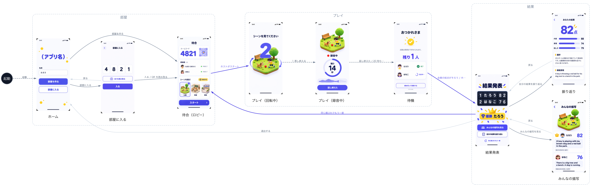

ゴールが絵で共有できていたので、アプリとバックエンドを並行して作れました。

- アプリは仮のデータ（Mock）で画面を先につなぎ、初日の 15:57 にはホームから結果まで通して遊べるようになりました（[#25](https://github.com/jphacks/ng_2622/pull/25)）。
- バックエンドは同じ時間に部屋と採点の API を作り（[#17](https://github.com/jphacks/ng_2622/pull/17)・[#20](https://github.com/jphacks/ng_2622/pull/20)・[#27](https://github.com/jphacks/ng_2622/pull/27)）、OpenAPI から作った型でアプリとつなぎました（[#37](https://github.com/jphacks/ng_2622/pull/37)）。
- 初日の 19:13 に、アプリが本物のバックエンドにつながりました（[#40](https://github.com/jphacks/ng_2622/pull/40)）。

**2. 裏側のロジックは、ペアプロで一つずつ設計して部分ごとに作る**

採点・部屋・3D の場面などの裏側は、ペアプロで設計してから小さな PR で作ることを繰り返しました。Hack Day 中に merge した PR は 54 本で、5 人全員が書いています。

- 大きな設計は、先に仕様書か ADR にしてから作りました。例えば、部品と配置のプロトコルを決めてから（[#42](https://github.com/jphacks/ng_2622/pull/42)）部品を作り（[#43](https://github.com/jphacks/ng_2622/pull/43)・[#46](https://github.com/jphacks/ng_2622/pull/46)）、場面の作り置きと採点の方針を決めてから（[#54](https://github.com/jphacks/ng_2622/pull/54)）作り直しました（[#61](https://github.com/jphacks/ng_2622/pull/61)・[#67](https://github.com/jphacks/ng_2622/pull/67)・[#69](https://github.com/jphacks/ng_2622/pull/69)）。
- 54 本のうち 39 本は、実装と同じ PR で仕様書（[`docs/design/`](docs/design/)）か ADR（[`docs/adr/`](docs/adr/)）も直しています。決めたことと作ったものを、そのつど揃えました。

## 開発技術

### 構成

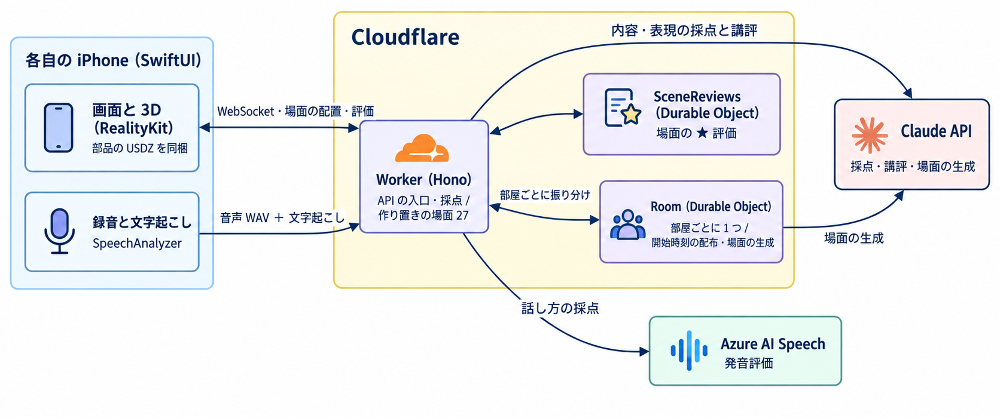

図の元（mermaid）

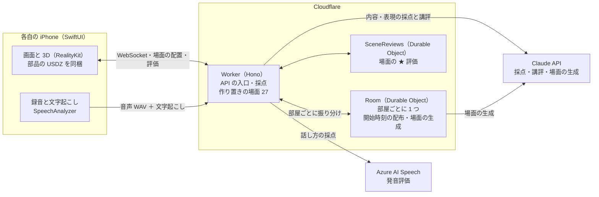

- iPhone は API のキーを持たず、Cloudflare とだけ話します。外部 API（Azure・Claude）はバックエンドだけが呼びます。
- 部屋の状態（参加者・進行・点数）は部屋ごとの Durable Object が持ち、全員に WebSocket で配ります。
- 音声は Worker が受け取ってすぐ応答し、採点は応答の後に続けて、終わったら部屋に書き込みます。

### 活用した技術

#### 外部API

- Azure AI Speech（発音評価）：発音・流暢さ・抑揚の点数（端末で文字にできなかったときは文字起こしも）
- Claude API（Claude Sonnet 5.5）：内容と表現の採点、講評、場面の生成（作り置きと、部屋でのその場の生成）

#### フレームワーク・ライブラリ・モジュール

- iOS：SwiftUI、RealityKit、AVFoundation、Speech（SpeechAnalyzer で端末の中で文字起こし）、swift-openapi-generator
- バックエンド：TypeScript、Hono、Cloudflare Workers、Durable Objects、zod
- 3D：Blender 4.5（Python で場面と部品を生成）
- 開発：GitHub Actions

#### デバイス

- iPhone（iOS 26）

### 独自技術

#### いつ作ったか

| 時期                                   | 作ったもの                                                                                                                     | PR                                                                                                                                                          |
| -------------------------------------- | ------------------------------------------------------------------------------------------------------------------------------ | ----------------------------------------------------------------------------------------------------------------------------------------------------------- |
| 事前（10/17・10/21）                   | チーム開発の規約と検査、Discord への通知、仕様書と画面設計書（仮の画面の画像）、技術選定の ADR。アプリとバックエンドのコードは無し | [#1](https://github.com/jphacks/ng_2622/pull/1)〜[#4](https://github.com/jphacks/ng_2622/pull/4)                                                          |
| Hack Day 中（10/24 9:00〜10/25 20:00） | アプリ・バックエンド・3D の部品と場面・採点のすべて                                                                            | [54 本](https://github.com/jphacks/ng_2622/pulls?q=is%3Apr+is%3Amerged+merged%3A2026-10-24T00%3A00%3A00Z..2026-10-25T11%3A00%3A00Z)                        |
| Hack Day 後（10/25 20:00〜）           | 部屋がその場で AI で場面を作る仕組みと本番での有効化（#82〜#85）、カウントダウンと同時に指示文を出す（#77）、待合の画面の修正（#78）             | [#77](https://github.com/jphacks/ng_2622/pull/77) ・ [#78](https://github.com/jphacks/ng_2622/pull/78) ・ [#82](https://github.com/jphacks/ng_2622/pull/82) ・ [#83](https://github.com/jphacks/ng_2622/pull/83) ・ [#84](https://github.com/jphacks/ng_2622/pull/84) ・ [#85](https://github.com/jphacks/ng_2622/pull/85) |

#### ハッカソンで開発した独自機能・技術

| 技術                           | 概要                                                                              | 仕様書                                        |
| ------------------------------ | --------------------------------------------------------------------------------- | --------------------------------------------- |
| 配置を正解にした段階の採点     | 場面の配置（部品の名前・座標・向き・動き）を Claude に渡し、内容と表現を段階の基準で付ける | [アーキテクチャ](docs/design/architecture.md) |
| 「次に伸ばす一つ」の提示       | 内容・表現・話し方の点を見て、最も伸ばすとよい一つを英語の例と一緒に返す          | [アーキテクチャ](docs/design/architecture.md) |
| 開始時刻の配布による同時プレイ | 1.5 秒先の開始時刻を全員に配り、3D と録音をそろえる                               | [アーキテクチャ](docs/design/architecture.md) |
| コードだけで作る 3D ジオラマ   | 地面・建物・人物・小物のすべてを Blender の Python で生成する                     | [部品](assets/parts/README.md)                |
| 部品と配置のプロトコル         | 部品 79 個と配置の JSON。AI は部品どうしの関係を書き、座標はプログラムが計算する  | [プロトコル](docs/design/scene-protocol.md)   |
| 部屋がその場で作る AI の場面（Hack Day 後） | スタートのたびに部屋が場面を作り、10 秒で間に合わなければ作り置きに切り替える | [ADR](docs/adr/20261026-generate-scenes-in-room-on-start.md) |

#### 特に力を入れた部分

**① 場面の配置を正解にして、段階の基準で採点する**

commit: [`4251144`](https://github.com/jphacks/ng_2622/commit/4251144)・[`3182d6a`](https://github.com/jphacks/ng_2622/commit/3182d6a)・[`f754b52`](https://github.com/jphacks/ng_2622/commit/f754b52)

LLM に基準を持たせずに点を付けさせると、同じ発話でも点がぶれ、理由も分かりません。そこで場面の配置（部品の名前・英単語・大きさ・座標・向き・動き）を「場面にあるのはこれだけ」という正解として渡し、0・20・40・60・80・100 の段階ごとの基準で内容と表現を付けさせます。内容は、まず場面の中心（誰が何をしているか、主な物の関係）を正しく具体的に言えたかを見て、次に正しい細かいことの数を見ます。左右・前後はどの向きから見た言い方でも正解にします。詳しくは [`backend/src/scoring/`](backend/src/scoring/) をご覧ください。

**② 全員の「同時」をそろえる部屋の仕組み**

commit: [`773f298`](https://github.com/jphacks/ng_2622/commit/773f298)・[`8d914c8`](https://github.com/jphacks/ng_2622/commit/8d914c8)・[`038ef7f`](https://github.com/jphacks/ng_2622/commit/038ef7f)・[`0c5185c`](https://github.com/jphacks/ng_2622/commit/0c5185c)

「スタート」の合図をそのまま送ると、通信の遅れの分だけ端末ごとに開始がずれます。部屋ごとに 1 つの Durable Object が状態を持ち、1.5 秒先の開始時刻を全員に配ることで、各端末が同じ時刻に 3D の回転と録音を始めます。詳しくは [`backend/src/durable-objects/room.ts`](backend/src/durable-objects/room.ts) をご覧ください。

**③ コードだけで作る 3D ジオラマ**

commit: [`24ab870`](https://github.com/jphacks/ng_2622/commit/24ab870)・[`358c991`](https://github.com/jphacks/ng_2622/commit/358c991)

既存の 3D 素材は権利の確認が難しく、場面に合わせた調整もできません。地面・建物・人物・小物のすべてを Blender の Python で組み立て、1 本のスクリプトからアプリ用の USDZ と発表用の画像を書き出します。詳しくは [`scripts/scene/`](scripts/scene/) をご覧ください。

**④ 部品と配置のプロトコルで、AI の場面を作り置く**

commit: [`8f3d29b`](https://github.com/jphacks/ng_2622/commit/8f3d29b)・[`be6aec3`](https://github.com/jphacks/ng_2622/commit/be6aec3)・[`955899a`](https://github.com/jphacks/ng_2622/commit/955899a)・[`7fba1e3`](https://github.com/jphacks/ng_2622/commit/7fba1e3)

場面をまるごと AI に作らせると、待ち時間が長く品質も読めません。そこで部品 79 個を先に作り、学習者が言いそうな文 300 本で調べて効果の大きい部品から作りました。AI には座標を書かせず、「人がベンチに座る」「本が机の上」のような部品どうしの関係だけを書かせ、置く位置はプログラムが計算します。作った場面は画像に描いて人が確かめ、良いものだけを作り置きました。詳しくは [`docs/design/scene-protocol.md`](docs/design/scene-protocol.md) をご覧ください。

**⑤ スタートのたびに部屋が AI で場面を作る（Hack Day 後）**

commit: [`3c5ce0e`](https://github.com/jphacks/ng_2622/commit/3c5ce0e)・[`fd7bd29`](https://github.com/jphacks/ng_2622/commit/fd7bd29)・[`6f89ca7`](https://github.com/jphacks/ng_2622/commit/6f89ca7)

場面を作る処理（Claude に部品どうしの関係を書かせ、座標を計算する `POST /scenes/generate`）は Hack Day 中に作り、作り置きの 27 場面もこれで作りました。Hack Day 中は、その場で作ると待ち時間が出て、崩れた場面を人が確かめられないため、部屋は作り置きから選ぶだけにしていました。Hack Day 後に足したのは、部屋がスタートのたびにこの処理を呼ぶ部分です。

作り置きだけだと、同じ顔ぶれで遊ぶうちに同じ場面が出ます。そこでホストがスタートを押すたびに、部屋（Durable Object）が Claude で新しい場面を作るようにしました。待つのは 10 秒までで、間に合わない・断られた・形が違うときはやり直さず、同じ難易度の作り置きの場面に黙って切り替えます。1 部屋 20 回までにして費用も抑えます。作った配置の JSON は部屋の保存領域に置き、全員に配るのは今までどおり場面の ID だけです。生成は設定 `SCENE_GENERATION` 一つで止められ、止めると作り置きの場面だけで遊べます。詳しくは [`backend/src/durable-objects/room.ts`](backend/src/durable-objects/room.ts) と [ADR](docs/adr/20261026-generate-scenes-in-room-on-start.md) をご覧ください。
