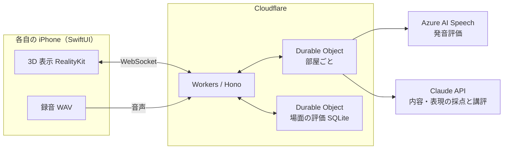

# ScenEnglish（シーングリッシュ）

**見てて楽しい英会話アプリ**

同じ 3D の場面を友達と同時に見て、その様子を英語で描写して競うスピーキングゲームです。AI が「何を言えたか・どう言えたか・どう話せたか」を採点し、順位と、次に伸ばす一つを教えてくれます。

## 製品概要

**教育 × Tech**: 同じ場面を見て、自分の言葉で英語を話し、比べ合うスピーキングゲーム

### 背景(製品開発のきっかけ、課題等）

**英語を何年勉強しても、とっさに口から出てこない**

英語を何年勉強しても、**「目の前の状況を、とっさに英語で言う」機会はほとんどありません。** 単語や文法を知っていても、口から出てこない。私たちはその一番の理由を、**話す機会そのものが足りないこと**だと考えました。

数字にもはっきり表れています。2023 年度の全国学力・学習状況調査（中学 3 年生）では、英語の 4 技能のうち **「話すこと」の平均正答率がわずか 12.4%** で、「聞くこと」58.9%・「読むこと」51.7%・「書くこと」24.1% と比べて最も低い結果でした。**約 6 割の生徒が「話すこと」の問題に 1 問も正答できませんでした。**

（参考: [国立教育政策研究所「令和5年度 全国学力・学習状況調査の結果」](https://www.nier.go.jp/23chousakekkahoukoku/report/data/23summary.pdf)、[リセマム](https://resemom.jp/article/2023/08/01/73230.html)、[時事通信出版局](https://book.jiji.com/information/news/news-9587/)）

- **既存の英会話アプリは、決まった文（定型文）をなぞる練習が中心**です。自分で文を組み立てる練習になりにくく、何より面白くないので続きません。
- **「見たものを英語で説明する力（描写力）」は、英検の面接や実際の会話で求められます。** それなのに、練習して点数で振り返れる場がほとんどありません。
- **一人で練習しても、自分の言い方が良いのか分かりません。** 他の人ならどう言うかを知る機会もありません。

**「同じものを見ても、人によって言い方が違う」**

ある人は「犬が走っている」と言い、別の人は「男の子が犬とボールで遊んでいる」と言う。友達の描写を聞くと、「そこを見るのか」「そう言えばいいのか」と発見があります。

私たちはこの **「比べる面白さ」** に注目しました。友達と同じ場面を同時に見て、それぞれの言葉で描写し、AI の採点で競い合う。そうすれば、**勉強というより、ゲームとして英語を口に出せる**と考えました。

**対象ユーザ**

- 単語や文法は学んだが、**英語を話す機会が少ない**中高生・大学生
- 英検の面接やスピーキングの試験に向けて、**描写の練習をしたい**人
- 友達と**ゲームとして**英語を練習したい人

**既存のサービスとの違い**

| | 定型文を練習するアプリ | 一人で場面を描写して練習するアプリ | **ScenEnglish** |
| --- | --- | --- | --- |
| 話す内容 | 決まった文をなぞる | 自分の言葉で話す | **自分の言葉で話す** |
| 遊び方 | 一人 | 一人 | **友達と同時に対戦** |
| 他の人の言い方から学ぶ | できない | できない | **全員の描写を並べて比べる** |
| 次に何をすればいいか | 分かりにくい | 点数だけのことが多い | **「次はこれ（+N 点）」と言い換えを示す** |

### 製品説明（具体的な製品の説明）

ScenEnglish は、友達と同じ部屋に入り、公園・教室・駅前などの 3D の場面を同時に見て、その様子を英語で描写して競うスピーキングゲームです。1 ラウンドは約 1 分です。

| # | ステップ | 内容 |
| --- | --- | --- |
| 1 | 部屋に集まる | ホストが部屋を作り、ほかの人は 4 桁のコードか QR コードで入ります |
| 2 | 場面を決める | ホストが 3D の場面を選びます（★ の評価つき）。「おまかせ」もできます |
| 3 | 同時に見る | 全員の iPhone に同じ 3D のジオラマが**同じ時刻に**現れます。指で回して、いろいろな角度から見られます |
| 4 | 同時に話す | 見たものを英語で描写します（最長 20 秒） |
| 5 | AI が採点 | 話した声をサーバーで採点し、話し方・内容・表現の 3 つの観点で点数と順位を出します |
| 6 | 結果発表 | 順位と全員の描写を並べて見比べます |
| 7 | 振り返り | 「できたこと」「次はこれ（+N 点）」「こう言い換える」「話し方のコツ」と、自分の声の聞き直し |

### 特長

#### 1. 正解の文がない「自由な描写」を採点できる

自由に話した英語には、決まった正解の文がありません。例文との一致で採点すると、言い回しが違うだけで点が下がってしまいます。

ScenEnglish では、**AI には要素ごとに「言えた／一部言えた／言えていない」だけを判定させ、点数の合計はサーバーで決まった式で計算します。** 判定が同じなら点数は必ず同じになり、なぜその点数なのかも説明できます。

| 観点（重み） | 何を見るか | どう採点するか |
| --- | --- | --- |
| 話し方（25%） | 発音・流暢さ・抑揚 | Azure AI Speech の発音評価 |
| 内容（50%） | 場面の要素をどれだけ言えたか | 要素ごとの加点（Claude が判定） |
| 表現（25%） | 語彙・文の組み立て | Claude が判定 |

- 場面を要素に分け（例: 公園の場面なら「犬」15 点、「犬がボールに向かって走っている」25 点）、要素ごとに、**根拠になった本人の発言つきで**判定します。
- **「次に伸ばす一つ」も、プログラムが計算します。** 言えなかった要素のうち、言えば合計点が最も伸びるものを選び、「次はこれ（+25 点）」のように示します。採点と講評が食い違いません。
- **やる気をそがない講評にしました。** 「できたこと」は本人の発言を引用してほめます。発音のアドバイスでは、点の低い単語を全部並べず、**最も低い一語だけ**を名指しします。

#### 2. 友達と同時に話して、その場で順位が出る対戦型

順番に話すと、後の人は前の人の言い方を真似できてしまい、後の人ほど有利になります。

ScenEnglish では、サーバーが**開始時刻**を全員に配ります。各 iPhone はその時刻に合わせて 3D を回し、録音を始めます。**全員が同時に見て、同時に話す**ので真似ができず、一人ひとりの見方と言い方をそのまま比べられます。

話し終えると、その場で順位が出ます。結果発表では他の人の描写と点数が並び、「そこに気づかなかった」「その単語を使えばよかった」という発見が、次のラウンドの描写を変えます。**勉強というより、ゲームとして英語を口に出せます。**

#### 3. 3D の場面を回して、「何を言うか」を自分で探せる

場面は 3D のジオラマなので、指で回していろいろな角度から見られます。どこに注目して、何を言うかを**自分で探す楽しさ**があります。

| 難易度 | 場面 | 描写してほしい要素 |
| --- | --- | --- |
| かんたん | 公園・教室・駅前 | 8 個。目立つ人や動物が 1〜2 組で、基本の単語で言える |
| ふつう | 雨のバス停・海辺・カフェ | 10 個。人と人のやりとりやハプニングがあり、`on` / `under` / `next to` などの位置の言い方も要る |

- **「ふつう」の場面には、思わず描写したくなる出来事を仕込みました。** 車が水たまりの水をはね上げる、カモメがピクニックのサンドイッチを奪っていく、男性がコーヒーを倒して床にこぼれる、などです。
- 場面はすべて Blender の Python スクリプトから生成していて、外部の 3D 素材は使っていません。

### 解決出来ること

- **英語を口に出す量が増える**: ゲームとして友達と遊ぶので、1 ラウンドごとに必ず自分の言葉で話します。
- **「とっさに言う」力が鍛えられる**: 目の前の場面を見て、「何が・どこで・何をしているか」を自分で組み立てて話す練習になります。暗記した定型文では対応できません。
- **伸びしろが具体的に分かる**: 点数だけでなく、「次はこれを言えば +N 点」「この一文はこう言い換える」「この単語の発音に気をつける」まで分かるので、次のラウンドですぐ試せます。
- **他の人から学べる**: 同じ場面への他の人の描写を並べて見られるので、自分に無かった語彙や見方に自然と出会えます。
- **少しずつ難しくできる**: かんたん・ふつうの 2 つの難易度で、自分に合った場面から練習できます。

### 今後の展望

### 注力したこと（こだわり等）

* **自由な描写の採点の仕組み**: 正解の文がない発話を、AI の判定とプログラムの計算に分けて採点
  * Claude には要素ごとの判定（`full` / `partial` / `none`）と根拠の発言だけを構造化出力（JSON Schema）で返させ、点の合計はサーバーが計算
  * 重みは内容 50%・表現 25%・話し方 25%（`SCORE_WEIGHTS`）。一覧にない正しい描写は上限 10 点で加点
  * 「次に伸ばす一つ」は `満点 − いまの点` が最も大きい要素をプログラムが選択。AI の引用は文字起こしに含まれるかを確かめてから表示
* **AI モデルの選定**:
  * 発音・流暢さ・抑揚: Azure AI Speech の発音評価（REST）
    * 1 回の呼び出しで、文字起こしと 3 つの点数（Accuracy・Fluency・Prosody）がそろう点を評価しました。正解の文を空にしても評価できることを実際のキーで確かめ、呼び出しを 1 段にしています。
    * Cloudflare Workers では Speech SDK が動く保証が無いため、REST で呼んでいます。応答は 2〜4 秒です。
  * 内容・表現の採点と講評: Claude Sonnet 5.5（effort low）
    * 構造化出力（JSON Schema）で、要素ごとの判定と根拠の発言を決まった形で受け取れる点を評価しました。
    * 同じ発話でモデルと effort を変えて実測し、Claude Haiku 5.5・high（6.2〜7.6 秒）から Claude Sonnet 5.5・low（3.0〜4.3 秒）に切り替えました。点数の傾向は変わらず、待ち時間は約半分です。モデルと effort は設定（`CLAUDE_MODEL`・`CLAUDE_EFFORT`）で切り替えられます。
* **同時プレイのエンドツーエンドの実装**:
  * 部屋の作成と確認（`POST /rooms`・`GET /rooms/{roomId}`。部屋のコードは数字 4 桁）
  * WebSocket での参加と進行（`GET /rooms/{roomId}/ws`。`join`・`start`・`skip`・`again`・`leave` ⇄ `room`・`round`・`progress`・`results`）
  * 開始時刻の配布（`start` から 1.5 秒先の時刻を全員に配り、3D の回転と録音をそろえる）
  * 音声の送信（`POST /rooms/{roomId}/rounds/{round}/audio`。16 kHz・モノラルの WAV、最長 20 秒）。届いた人から 1 人ずつ採点し、全員そろったら結果発表
* **通信が切れても止まらない部屋**:
  * 切れたら同じ合言葉で自動でつなぎ直す（0.5 秒から倍に待ち、上限 8 秒・最大 10 回）
  * ホストが抜けたら、残った人がホストを引き継ぐ。マイクが使えない人は `skip` で待たせない
* **コードだけで作る 3D ジオラマ**: Blender 4.5 の Python（bpy・bmesh）で、外部素材ゼロで 6 つの場面を生成
  * 人物のポーズ（立つ・歩く・走る・座る・ひざ立ち・跳ぶ・物を持つ）、砂浜と海の起伏、半透明のガラスや水しぶき、天気ごとの光を共通の道具に
  * 1 本のスクリプトから、アプリ用の USDZ（1 場面 0.9〜2.5 MB）と発表用の画像（Cycles）を同時に書き出し
* **部品で場面を組み立てるプロトコル**: 部品 63 個と、配置を JSON で書く決まりを定義
  * 学習者が言いそうな文 300 本で「部品で場面にできる割合」を調べ、効果の大きい部品（ドア・レジ・棚・皿など）から追加
* **公開しても安全なコスト設計**:
  * API キーは iPhone に置かず、Azure と Claude はサーバーからだけ呼ぶ
  * 部屋は 5 人まで、1 人 1 ラウンド 1 回だけ採点（2 回目は `already_submitted`）
  * PR ごとのプレビュー環境は、外部 API を呼ばない固定の点数のモード（`SCORING_MODE=fixed`）で動かす
* **API の型の一元管理**: zod の型 → OpenAPI → swift-openapi-generator で Swift の型を自動生成。5 人が並行して開発しても、バックエンドと iOS が食い違わない

## 開発技術

### 活用した技術

#### API・データ

* **Azure AI Speech（発音評価 REST API）**
  * 録音した英語の文字起こしと、発音・流暢さ・抑揚の点数を得ます。単語ごとの発音の点も、「話し方のコツ」に使っています。
* **Claude API（本番は Claude Sonnet 5.5・effort low）＋ @anthropic-ai/sdk**
  * 内容と表現の採点、講評の文に使用しました。出力の形を JSON Schema で決める構造化出力で受け取り、要素ごとの判定と根拠の発言を返させています。
  * モデルと effort は設定で変えられます。

#### フレームワーク・ライブラリ・モジュール

**iOS アプリ**

* **Swift / SwiftUI**
  * iOS アプリのフレームワーク。ホームから結果発表・振り返りまでの画面を作りました。
* **RealityKit**
  * 3D のジオラマ（USDZ）の表示と、指で回して見回す操作に使用しました。
* **AVFoundation**
  * 録音（16 kHz・モノラルの WAV、最長 20 秒）と、振り返りでの自分の声の再生に使用しました。
* **VisionKit**
  * 部屋の QR コードの読み取りに使用しました。
* **swift-openapi-generator**
  * バックエンドの `openapi.json` から、API の型と通信のコードを自動で作ります。バックエンドが API を変えても、次のビルドで iOS の型が追従するので、食い違いが起きません。
* **XcodeGen**
  * 設定ファイル（`ios/project.yml`）から Xcode のプロジェクトを作ります。複数人で開発しても、プロジェクトのファイルが衝突しません。

**バックエンド**

* **TypeScript + Hono**
  * Cloudflare Workers の上で動く API のフレームワーク。
* **Cloudflare Durable Objects**
  * 部屋ごとに 1 つ置き、部屋の状態とリアルタイム通信（WebSocket）を持たせました。全員の同時プレイを、常に立てておくサーバー無しで実現しています。
  * 場面の ★ 評価とコメントは、全体で 1 つの Durable Object の SQLite に保存しています。
* **zod**
  * API の型と入力の検査。ここで定義した型から OpenAPI を作り、iOS の型の元にしています。

**3D**

* **Blender 4.5（Python API の bpy・bmesh）**
  * 場面と部品を、すべて Python のスクリプトから生成しました。外部の 3D 素材は使っていません。
* **Cycles**
  * Blender のレンダラー。README と発表に使う場面の画像を描きました。
* **USDZ**
  * アプリで表示する 3D の形式。場面を USDZ で書き出し、アプリに同梱しています。

**インフラ**

* **Cloudflare Workers**
  * バックエンドの本番環境。バックエンドを変える PR ごとに専用のプレビュー環境も立ち、iPhone から merge 前の版を試せます。
* **GitHub Actions**（https://github.com/jphacks/ng_2622/actions）
  * pr-checks で、PR のタイトルとブランチ名がチームの規約に沿っているかを検査
  * format-check で、TypeScript・JSON の整形し忘れを検査
  * backend-checks で、バックエンドの型を検査
  * backend-preview で、PR ごとのプレビュー環境を作って URL を PR にコメント
  * deploy-backend で、main に入ったら本番へ自動でデプロイ
  * discord-pr-notify で、PR ができたら Discord に通知
  * CI/CD を整えたことで、5 人が並行して PR を出しても、本番が壊れずに開発を進められました。

**その他ツール**

| ツール | 用途 | 詳細 |
| --- | --- | --- |
| Claude Code | AI エージェントによる開発 | 共有の skill（issue からの着手、commit メッセージ、ADR、仕様の詰め）をリポジトリに置き、AI もチームの決まりに沿って実装しました。 |
| lefthook | git hook | commit のときに整形と、commit メッセージ・ブランチ名の検査を自動で行います。 |
| Biome | 整形・lint | TypeScript と JSON の書き方をチームでそろえました。 |
| pnpm | パッケージ管理 | JavaScript の道具とバックエンドの依存を管理しました。 |
| ADR・設計書（`docs/`） | 意思決定と仕様の記録 | 技術選定や仕様の決定を、理由つきで残しました。チームと AI が同じ文書を読んで開発しています。 |
| Discord | チーム内の連絡 | PR の作成を通知し、レビューを早く回しました。 |

#### デバイス

* **iPhone（iOS 26）**: プレイヤーの端末。3D の表示、録音、結果
* **Mac**: Xcode でのアプリのビルドと、Blender での 3D の生成

### 独自技術

#### ハッカソンで開発した独自機能・技術

アプリ・バックエンド・3D は、すべて Hack Day（10/24・25）に実装しました。事前に用意したのは、仕様書とリポジトリの規約だけです。

* **独自で開発したもの**

  | 技術 | 概要 | 仕様書 |
  | --- | --- | --- |
  | 自由な描写の採点 | Claude が要素ごとに「言えた／一部言えた／言えていない」と根拠の発言を返し、合計はサーバーが決まった式で計算する | [使い方](docs/design/usecase.md) |
  | 「次に伸ばす一つ」の自動選択 | 言えなかった要素のうち、言えば合計点が最も伸びるものを選ぶ | [使い方](docs/design/usecase.md) |
  | 開始時刻の配布による同時プレイ | 1.5 秒先の開始時刻を全員に配り、3D と録音をそろえる | [アーキテクチャ](docs/design/architecture.md) |
  | 自動のつなぎ直しとホストの引き継ぎ | 切れたら同じ合言葉で入り直す（0.5 秒から倍に待ち、最大 10 回）。ホストが抜けたら残った人が引き継ぐ | [アーキテクチャ](docs/design/architecture.md) |
  | コードだけで作る 3D ジオラマ | 地面・建物・人物・小物のすべてを Blender の Python で生成。アプリ用の USDZ と発表用の画像を同時に書き出す | [3D シーン](assets/scenes/README.md) |
  | 部品で場面を組み立てるプロトコル | 部品 63 個と配置の JSON の決まり。新しい場面を部品の組み合わせで作るための土台 | [プロトコル](docs/design/scene-protocol.md) |
  | API の型の自動生成 | zod → OpenAPI → Swift の型。null の扱いの違いも吸収 | [アーキテクチャ](docs/design/architecture.md) |

* **特に力を入れた部分**（ファイルリンクと commit_id）

  [`backend/src/scoring/claude.ts`](backend/src/scoring/claude.ts)（[`ea8e157`](https://github.com/jphacks/ng_2622/commit/ea8e157)・[`f754b52`](https://github.com/jphacks/ng_2622/commit/f754b52)） 
  **何がすごいのか**: 場面ごとに JSON Schema を組み立て、要素の ID を `enum` で固定した構造化出力で Claude を呼ぶ。AI は場面に無い要素を作れず、判定（`full` / `partial` / `none`）と根拠の発言だけを決まった形で返す。モデルと effort は設定で切り替えられる。

  [`backend/src/scoring/feedback.ts`](backend/src/scoring/feedback.ts)（[`c48d660`](https://github.com/jphacks/ng_2622/commit/c48d660)） 
  **何がすごいのか**: 「次に伸ばす一つ」を AI に選ばせず、言えなかった要素のうち `満点 − いまの点` が最も大きいものを計算で選ぶ（`pickMissingElement`）。話し方のコツは Azure の 3 つの点の最も低いものから作り、発音なら最も低い一語だけを名指しする（`speechTip`）。AI の引用が文字起こしに含まれるかも確かめる（`quotedFrom`）。採点と講評が必ず一致する。

  [`backend/src/durable-objects/room.ts`](backend/src/durable-objects/room.ts)・[`backend/src/domain/round.ts`](backend/src/domain/round.ts)（[`773f298`](https://github.com/jphacks/ng_2622/commit/773f298)・[`8d914c8`](https://github.com/jphacks/ng_2622/commit/8d914c8)・[`038ef7f`](https://github.com/jphacks/ng_2622/commit/038ef7f)） 
  **何がすごいのか**: 部屋ごとに 1 つの Durable Object が状態と WebSocket を持ち、1.5 秒先の開始時刻を全員に配って同時プレイをそろえる。音声が届いた人から 1 人ずつ採点し、全員そろったら結果発表へ。`skip`・もう一度・退出・ホストの引き継ぎまで、ゲームの進行をすべてサーバーで扱う。

  [`ios/NG2622/Game/LiveGameClient.swift`](ios/NG2622/Game/LiveGameClient.swift)・[`ios/NG2622/Backend/LiveRoomTracker.swift`](ios/NG2622/Backend/LiveRoomTracker.swift)（[`0c5185c`](https://github.com/jphacks/ng_2622/commit/0c5185c)） 
  **何がすごいのか**: 通信が切れたら同じ合言葉で自動でつなぎ直す（0.5 秒から倍に待ち、上限 8 秒・最大 10 回）。届いたメッセージを画面のできごとに直す処理は通信から切り離した純粋な処理にし、つなぎ直しで送り直された同じラウンドの通知は無視して、録音がやり直しにならないようにした。

  [`scripts/scene/common.py`](scripts/scene/common.py)・[`rainy_street.py`](scripts/scene/rainy_street.py)・[`beach.py`](scripts/scene/beach.py)・[`cafe.py`](scripts/scene/cafe.py)（[`24ab870`](https://github.com/jphacks/ng_2622/commit/24ab870)・[`358c991`](https://github.com/jphacks/ng_2622/commit/358c991)） 
  **何がすごいのか**: 外部素材ゼロで、地面・建物・人物・小物のすべてを Blender の Python（bmesh）で形から組み立てる。人物のポーズ、砂浜から海への起伏、半透明のガラスや水しぶき、天気ごとの光を共通の道具にまとめ、1 本のスクリプトからアプリ用の USDZ と発表用の画像を同時に書き出す。

  [`docs/design/scene-protocol.md`](docs/design/scene-protocol.md)・[`assets/parts/`](assets/parts/)（[`8f3d29b`](https://github.com/jphacks/ng_2622/commit/8f3d29b)・[`aa30cb7`](https://github.com/jphacks/ng_2622/commit/aa30cb7)・[`be6aec3`](https://github.com/jphacks/ng_2622/commit/be6aec3)・[`e2a3d71`](https://github.com/jphacks/ng_2622/commit/e2a3d71)） 
  **何がすごいのか**: 部品 63 個に大きさ・向き・語（words）・座る点などのメタデータを持たせ、場面を「どの部品を、どこに置くか」の JSON で書ける決まりを定めた。部品は、学習者が言いそうな文 300 本で「部品で場面にできる割合」を調べ、効果の大きいものから作った。

  

## リポジトリガイド

- ディレクトリの構成と開発のコマンドは [`AGENTS.md`](AGENTS.md) をご覧ください。
- 仕様（使い方・画面の流れ・アーキテクチャ・採点）は [`docs/design/`](docs/design/)、技術選定の記録は [`docs/adr/`](docs/adr/) にあります。
