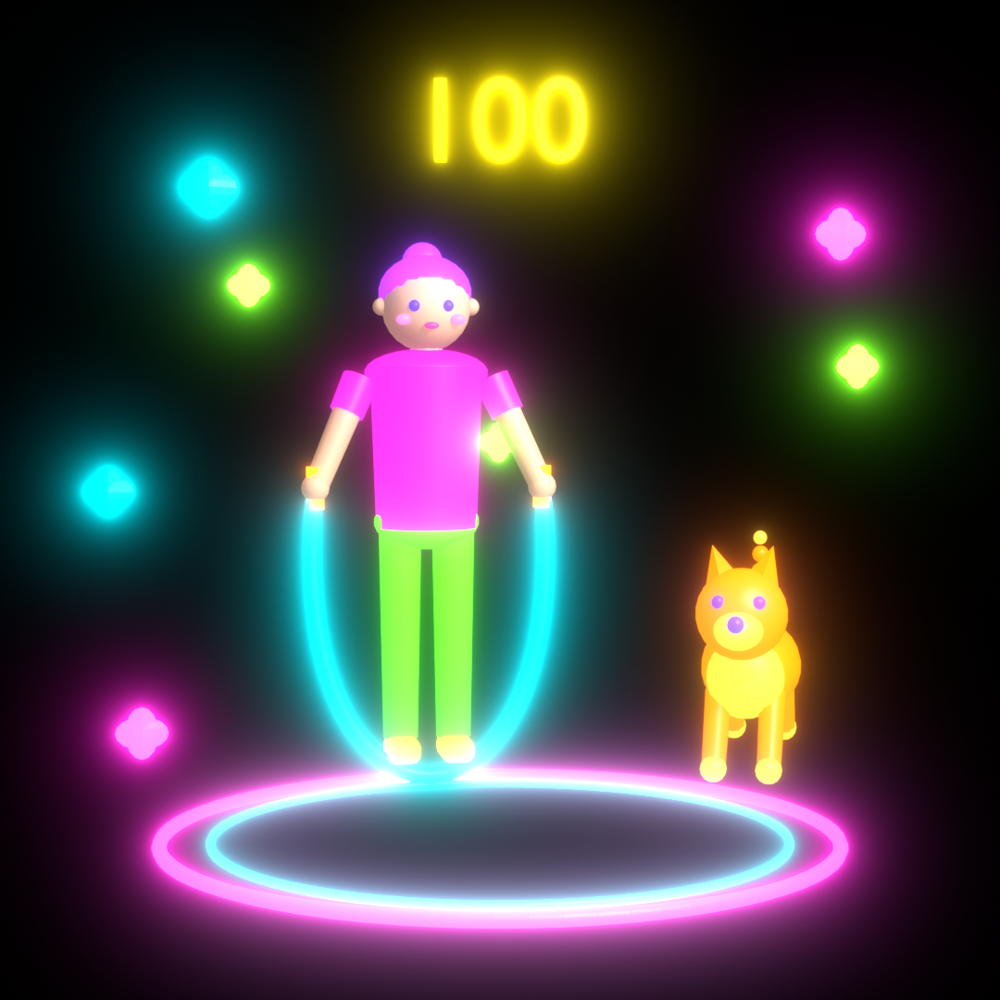

# ホログラム用の映像

ペットボトルや透明の板を 45° に置き、その下の画面の映像を反射させて浮いて見せる「ホログラム」のための映像。待合でホストが「ホログラム」を選んでスタートすると、この中からランダムに 1 つ選んで流す（`ios/NG2622/Play/HologramPlayView.swift`）。採点は `backend/src/scoring/scenes.json` の同じ `id` の場面で行う（`hologram: true`。「おまかせ」では選ばれない）。

| 縄跳び（確認用の 1 枚） |
| --- |
|  |

## アプリでの流れ

1. 待合でホストが「ホログラム」を選んでスタートすると、この中から映像をランダムに 1 つ選ぶ。
2. 画面が真っ黒になり、「3・2・1」のカウントダウンだけを出す（3 秒）。
3. 0 になったら、真ん中にホログラムの映像を出し、同時に 20 秒のカウントダウンと録音を始める。文字やボタンは出さない。
4. 映像は 20 秒の間ずっと動き続ける（動画の長さもちょうど 20 秒）。
5. 20 秒たったら録音を止め、結果へ進む。

- 映像を左右反転して出すのは、「ホログラム」を選んで始めた端末だけ（ペットボトルなどをかぶせる端末）。同じ部屋のほかの人の端末には、同じ映像を反転せずに出す。
- 待機の画面には、3D の代わりにこの映像を出す。

## 作り方の決まり

- 背景は真っ黒にする。黒い所は反射しないので、物だけが浮いて見える。
- 物は 3〜5 個まで。地面や建物は置かず、大きく真ん中に置く。
- 色は蛍光色にして、物そのものを光らせる。光のにじみ（グロー）も付ける。黒や濃い色は見えなくなるので使わない。
- 英語では「同時に起きていること」や数・位置まで言わないと満点にならない場面にする（難易度は `hard`）。
- 全体がゆっくり 1 周する動画にし、繰り返し再生しても継ぎ目が出ない長さにする。

## ファイル

| パス | 中身 |
| --- | --- |
| `<id>.mp4` | アプリが流す動画（1080×1080・30 fps・20 秒。ホログラムで遊ぶ 1 回の長さと同じ）。反転なし（アプリが反転する） |
| `<id>_mirror.mp4` | アプリを使わずにスマホなどで流す用。反射で反転するので、左右を反転してある（アプリには入れない） |
| `<id>.png` | 確認用の 1 枚（反転なし） |
| `<id>.json` | 場面の名前・難易度と、採点に使う場面の説明（英語）・描写してほしい要素 |

置き方によっては、反転の向き（左右か上下か）が合わないことがある。実物で確かめて、合わなければ `LoopingVideoView` の反転を変える。

新しい映像を足すときは、`<id>.json`（`video` に動画のファイル名）と `<id>.mp4` を置き、`backend/src/scoring/scenes.json` に同じ `id` の場面を `hologram: true` で足す。

## 作り直す

`scripts/scene/hologram_<id>.py` を Blender 4.5 LTS で実行する（EEVEE で、2 本の動画と画像を合わせて数分）。

```sh
blender --background --factory-startup --python scripts/scene/hologram_jump_rope.py
blender --background --factory-startup --python scripts/scene/hologram_jump_rope.py -- --still-only   # 確認用の 1 枚だけ
```
