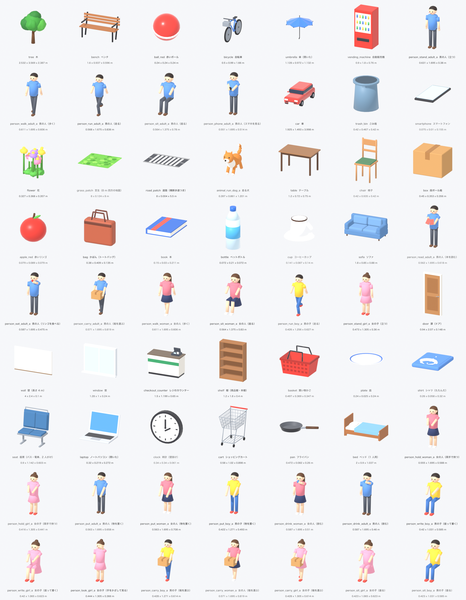

# 3D の部品

シーンを組み立てるための、作り置きの部品（プロトコル v1）。仕様は `docs/design/scene-protocol.md` の「部品」と「最初に作る部品（34 個）」（PR #42）。



## ファイル

| パス | 中身 |
| --- | --- |
| `<id>/1.usdz` | 部品の 3D モデル（どれも 0.2 MB 以下） |
| `<id>/1.json` | メタデータ（`id`・`version`・`file`・`category`・`words`・`pose`・`size`・`label`、一部の部品は `anchors`） |
| `index.json` | 全部品のメタデータの配列 |
| `contact_sheet.png` | 確かめの画像。USDZ を読み直して、正面（+Z）を少し右上から見たもの |

どのファイルも `scripts/scene/parts.py` が生成する。手で編集しない（`size` も作った形の外接箱から、`anchors` も形を作るときの寸法から計算している）。

## 座標と大きさ

- Y が上、単位はメートルで、実物の大きさ。正面は +Z。
- 原点は外接箱の底面の中心。y = 0 に置けば地面に立つ。
- 色は部品に焼き込んである。人や車のライト、自動販売機の窓、スマートフォンの画面は自己発光（emissive）。
- 地面の部品（`grass_patch`・`road_patch`）は厚さ 2 cm の板。上に置く物は y = 0 のままでよい（2 cm 埋まって見えない程度）。`grass_patch` の高さ 0.128 m は草むらの分。
- 子ども（`boy`・`girl`）は大人の 0.75 倍。

### 座るポーズと椅子

座るポーズ（`person_sit_*`）は人だけで、椅子を含まない。座面の高さ 0.46〜0.48 m（`chair`・`sofa` は 0.46 m、`bench` は 0.48 m）に合う。

外接箱の中心を原点にしているので、座る人の腰は原点より奥（-Z）にある。椅子やベンチに座らせるには、人を椅子と同じ向きにして、人の `anchors.hip` が椅子の `anchors.seat` に重なるように置く（人の位置 = 椅子の位置 + `seat` − `hip`）。

### 置き方の手がかり（`anchors`）

座らせる・上に置く座標を計算するための点。座標は部品の中の座標（原点は外接箱の底面の中心、正面は +Z、m）。

| 部品 | `anchors` | 意味 |
| --- | --- | --- |
| `table` | `top`: 0.72 | 天板の上面の高さ |
| `box` | `top`: 0.35 | ふたの上面の高さ（テープの厚みは含めない） |
| `chair` | `seat`: [0, 0.46, 0] | クッションの上面の中心 |
| `bench` | `seat`: [0, 0.482, 0.08] | 座面の板の上面の真ん中 |
| `sofa` | `seat`: [0, 0.46, 0.1] | 2 つの座面のクッションの真ん中の上面 |
| `person_sit_adult_a` | `hip`: [0, 0.48, -0.2] | 腰の点（座面に重ねる点） |
| `person_sit_woman_a` | `hip`: [0, 0.48, -0.175] | 腰の点（座面に重ねる点） |

`hip` の高さ 0.48 m はベンチの座面に合わせてあるので、`chair`・`sofa`（0.46 m）に座らせると足が 2 cm 床に入る。

### 持たせた物

`person_read_adult_a` は開いた本、`person_eat_adult_a` はリンゴ、`person_carry_adult_a` は段ボール箱を持っている。持たせた物は同じ部品に含める。`person_phone_adult_a` は、胸の前に持ったスマートフォンを見ているポーズ（耳に当てて話すポーズではない）。

## 部品の一覧

大きさは `size`（幅 × 高さ × 奥行き、m）。`adult_a` は男の人。

| id | 名前 | カテゴリ | ポーズ | 語 | 大きさ（m） | 作り方 |
| --- | --- | --- | --- | --- | --- | --- |
| `tree` | 木 | plant |  | tree | 2.532 × 3.569 × 2.387 | 今のシーンから流用 |
| `flower` | 花 | plant |  | flower | 0.327 × 0.368 × 0.357 | 今のシーンから切り出し |
| `grass_patch` | 芝生（8 m 四方の地面） | ground |  | grass | 8 × 0.128 × 8 | 今のシーンから切り出し |
| `road_patch` | 道路（横断歩道つき） | ground |  | road, street, crosswalk | 8 × 0.026 × 5.5 | 今のシーンから切り出し |
| `bench` | ベンチ | furniture |  | bench | 1.6 × 0.937 × 0.596 | 今のシーンから流用 |
| `table` | テーブル | furniture |  | table | 1.2 × 0.72 × 0.75 | 新規 |
| `chair` | 椅子 | furniture |  | chair | 0.42 × 0.935 × 0.42 | 新規 |
| `sofa` | ソファ | furniture |  | sofa, couch | 1.8 × 0.85 × 0.88 | 新規 |
| `bicycle` | 自転車 | vehicle |  | bicycle, bike | 0.5 × 0.99 × 1.66 | 今のシーンから流用 |
| `car` | 車 | vehicle |  | car | 1.925 × 1.493 × 3.998 | 今のシーンから切り出し |
| `vending_machine` | 自動販売機 | thing |  | vending machine | 0.9 × 1.8 × 0.76 | 今のシーンから流用 |
| `trash_bin` | ごみ箱 | thing |  | trash can, trash bin | 0.42 × 0.467 × 0.42 | 今のシーンから切り出し |
| `ball_red` | 赤いボール | thing |  | ball | 0.24 × 0.24 × 0.24 | 今のシーンから流用 |
| `umbrella` | 傘（開いた） | thing |  | umbrella | 1.128 × 0.972 × 1.132 | 今のシーンから流用 |
| `smartphone` | スマートフォン | thing |  | smartphone, phone | 0.075 × 0.01 × 0.155 | 今のシーンから切り出し |
| `box` | 段ボール箱 | thing |  | box | 0.45 × 0.353 × 0.356 | 新規 |
| `apple_red` | 赤いリンゴ | food |  | apple | 0.079 × 0.089 × 0.079 | 新規 |
| `bag` | かばん（トートバッグ） | thing |  | bag | 0.38 × 0.409 × 0.135 | 新規 |
| `book` | 本 | thing |  | book | 0.15 × 0.03 × 0.211 | 新規 |
| `bottle` | ペットボトル | thing |  | bottle | 0.072 × 0.21 × 0.072 | 新規 |
| `cup` | コーヒーカップ | thing |  | cup, coffee | 0.141 × 0.087 × 0.14 | 新規 |
| `animal_run_dog_a` | 走る犬 | animal | run | dog, run | 0.397 × 0.861 × 1.201 | 今のシーンから切り出し |
| `person_stand_adult_a` | 男の人（立つ） | person | stand | man, stand | 0.631 × 1.695 × 0.38 | 今のシーンから流用 |
| `person_walk_adult_a` | 男の人（歩く） | person | walk | man, walk | 0.611 × 1.695 × 0.606 | 今のシーンから流用 |
| `person_run_adult_a` | 男の人（走る） | person | run | man, run | 0.568 × 1.675 × 0.836 | 今のシーンから流用 |
| `person_sit_adult_a` | 男の人（座る） | person | sit | man, sit | 0.564 × 1.375 × 0.78 | 今のシーンから流用 |
| `person_phone_adult_a` | 男の人（スマホを見る） | person | phone | man, phone, look | 0.551 × 1.695 × 0.514 | 今のシーンから流用 |
| `person_walk_woman_a` | 女の人（歩く） | person | walk | woman, walk | 0.611 × 1.695 × 0.606 | 見た目違い |
| `person_sit_woman_a` | 女の人（座る） | person | sit | woman, sit | 0.564 × 1.375 × 0.83 | 見た目違い |
| `person_run_boy_a` | 男の子（走る） | person | run | boy, run | 0.426 × 1.256 × 0.627 | 見た目違い |
| `person_stand_girl_a` | 女の子（立つ） | person | stand | girl, stand | 0.473 × 1.305 × 0.36 | 見た目違い |
| `person_read_adult_a` | 男の人（本を読む） | person | read | man, read, book | 0.562 × 1.695 × 0.618 | 新規 |
| `person_eat_adult_a` | 男の人（リンゴを食べる） | person | eat | man, eat, apple | 0.587 × 1.695 × 0.475 | 新規 |
| `person_carry_adult_a` | 男の人（箱を運ぶ） | person | carry | man, carry, box | 0.571 × 1.695 × 0.819 | 新規 |

## 作り直す・確かめる

形や色を変えるときは `scripts/scene/parts.py` を編集して、Blender で実行する（34 個で数秒）。
作り直すと USDZ のバイト列は毎回少し変わる（形は同じ）。同じ版（`1`）の中身は変えない約束なので、配ったあとに形を変えるときは `VERSION` を上げる。

```sh
blender --background --factory-startup --python scripts/scene/parts.py                            # 全部品と index.json
blender --background --factory-startup --python scripts/scene/parts.py -- --only car --only tree  # 一部だけ（index.json も作り直す）
blender --background --factory-startup --python scripts/scene/parts.py -- --meta-only            # USDZ は書かず、JSON だけ作り直す
blender --background --factory-startup --python scripts/scene/check_parts.py                      # プロトコルに合っているかを確かめる
blender --background --factory-startup --python scripts/scene/check_parts.py -- --sheet           # 確かめて、contact_sheet.png も作る
```

`check_parts.py` は USDZ を読み直し、次を確かめる（1 つでも合わなければ終了コード 1）。

- メタデータの形（`id` の文字、`version`・`file`・`category`・`words`・`pose`・`label`）、`index.json` と各部品の JSON が同じこと、34 個がそろっていること
- 2 MB 以下、Y が上でメートル
- 外接箱の最小 y が 0、x と z の中心が 0（2 mm まで）。外接箱の大きさが JSON の `size` と合う（2 mm まで）
- 正面の目印が +Z 側にある（人は目が髪より前、犬は鼻と目、車はヘッドライト、自転車は前かご、自動販売機は商品の窓）。ベンチ・椅子・ソファは背もたれが -Z 側。左右対称の物は確かめない
- `anchors` が付けるはずの部品にあり、外接箱の内側にある。座る人の `hip` を椅子・ベンチ・ソファの `seat` に合わせて置くと、脚が家具の前に出て、足が床に 3 cm より深く入らず、背中が背もたれの後ろへ抜けない（外接箱で見る）

Blender は 4.5 LTS と 4.0 で動く。4.0 は USD の書き出しに向きの変換が無いので、`common.py` の `export_usdz` が pxr で Y を上に直す（4.5 と同じ結果になる）。
