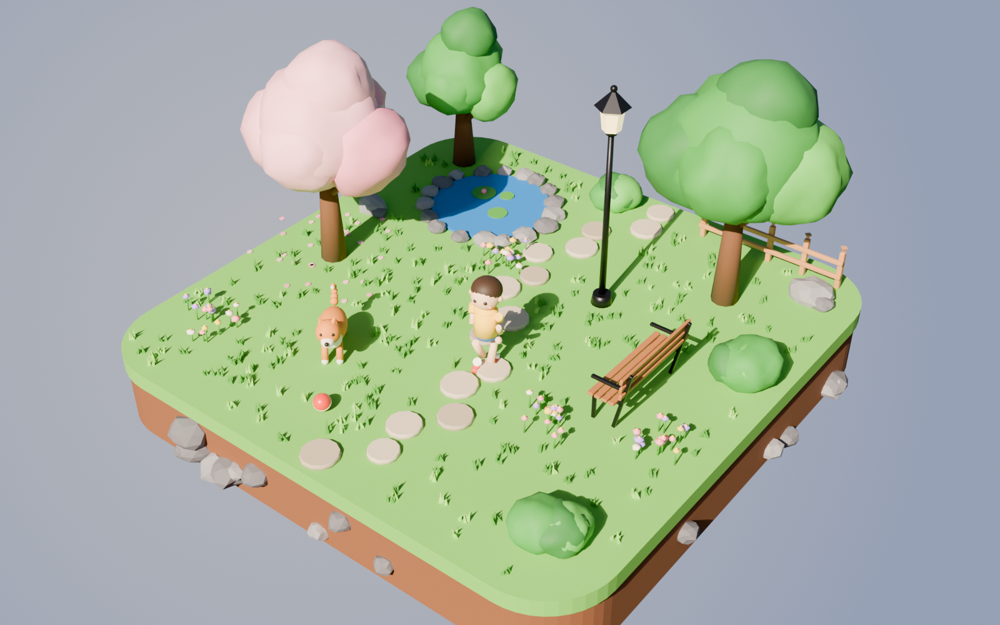
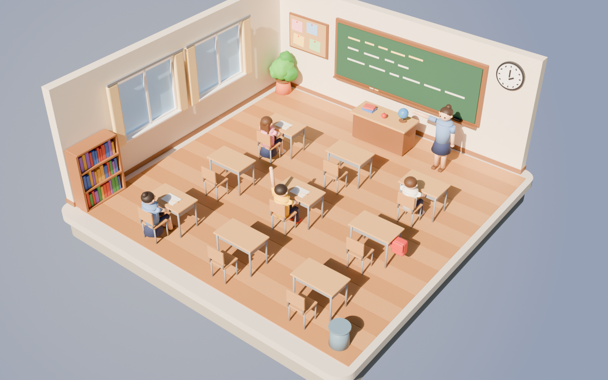
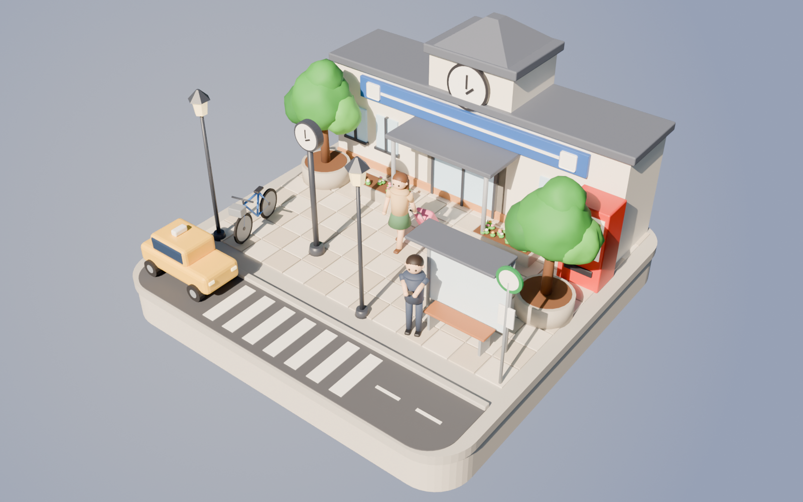
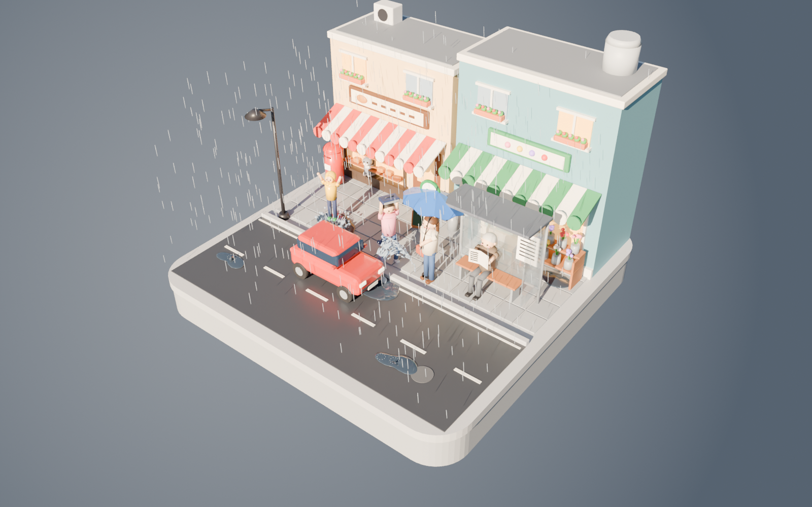
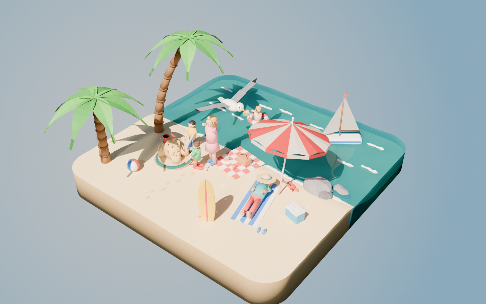
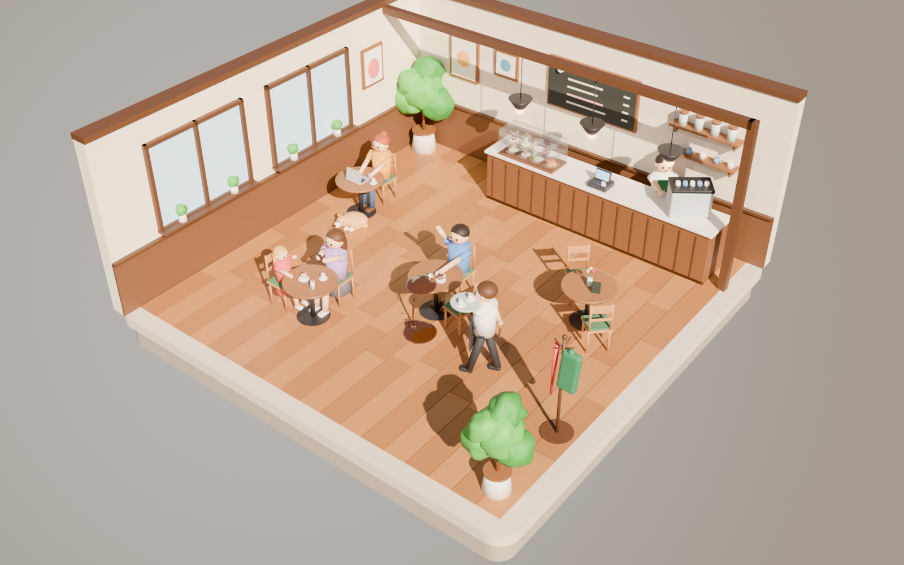

# 3D シーン

アプリに出す 3D シーン（ジオラマ）。仕様は [`docs/design/scene-generation.md`](../../docs/design/scene-generation.md)。

難易度は「かんたん」と「ふつう」の 2 つ。`<id>.json` の `difficulty`（`easy` / `normal`）に書く。

かんたん（`easy`）: 目立つ人や動物が 1〜2 組で、基本の単語で描写できる。描写してほしい要素は 8 個。

| 公園 | 教室 | 駅前 |
| --- | --- | --- |
|  |  |  |

ふつう（`normal`）: 人と人・人と物のやりとりと、ちょっとしたハプニングがあり、位置の言い方（on / under / next to など）も要る。描写してほしい要素は 10 個。

| 雨のバス停 | 海辺 | カフェ |
| --- | --- | --- |
|  |  |  |

## ファイル

シーンごとに 3 つのファイルがある（`<id>` は `park` / `classroom` / `station` / `rainy_street` / `beach` / `cafe`）。

| パス | 中身 |
| --- | --- |
| `<id>.usdz` | アプリ用の 3D モデル（1〜3 MB 程度） |
| `<id>.json` | 難易度と、場面の説明（英語）、描写してほしい要素 |
| `<id>.png` | 発表用の画像（Cycles でレンダリング） |

`.usdz` と `.png` は `scripts/scene/<id>.py` が生成する。手で編集するのは `.json` だけ。

バックエンドはこの `.json` を読まず、採点には [`backend/src/scoring/scenes.json`](../../backend/src/scoring/scenes.json) を使う（おまかせで選ぶシーンもこの一覧から選ぶ）。シーンを足す・変えるときは、そちらも同じ `id` で直す。

## 座標

RealityKit の座標に合わせてある。

- Y が上、単位はメートル。どのシーンも約 8 m 四方で、地面（床）が y = 0、土台は下にある。
- 正面（画面の手前）は +Z。アプリでは全体を縮小して表示する（例: `entity.scale = [0.05, 0.05, 0.05]`）。
- 部品は名前付きの Xform に分けてある。`entity.findEntity(named: "dog")` のように取り出せる。
  - 公園: `island` `path` `pond` `tree_big` `tree_cherry` `bench` `lamp` `fence` `dog` `boy` `ball` など
  - 教室: `room` `blackboard` `clock` `windows` `teacher_desk` `desk_1`〜`desk_9` `teacher` `student_*` など
  - 駅前: `ground` `road` `station_building` `plaza_clock` `bus_stop` `taxi` `vending_machine` `traveler` `commuter` など
  - 雨のバス停: `ground` `road` `puddles` `bakery` `flower_shop` `bus_stop` `car` `splash` `rain` `woman_umbrella` `umbrella` `girl_running` `boy_raincoat` `old_man_reading` `cat` `mailbox` など
  - 海辺: `island` `sea` `waves` `sandcastle` `boy_building` `girl_building` `seagull` `woman_surprised` `picnic` `beach_umbrella` `man_sleeping` `boy_swimming` `float_ring` `sailboat` `crab` `palm_back` など
  - カフェ: `room` `windows` `counter` `cake_case` `espresso_machine` `menu_board` `hanging_lamps` `waiter` `tray` `man_spilling` `spilled_coffee` `woman_laptop` `dog` `girl_cake` `mother_photo` `barista` など
- 街灯や窓、自動販売機、ランプ、ノートパソコンの画面は自己発光（emissive）のマテリアル。
- ガラス（バス停の壁、ケーキのケース）と雨・水しぶきは半透明（opacity）。海は画像では透けるが、USDZ では不透明な水色になる。

## RealityKit での読み込み例

```swift
let scene = try await Entity(named: "park")  // park.usdz をアプリのバンドルに入れておく
scene.scale = [0.05, 0.05, 0.05]
```

## 作り直す

形や色を変えるときは `scripts/scene/<id>.py` を編集して、Blender 4.5 LTS で実行する（画像のレンダリングを含めて 1 シーン 2〜3 分）。共通の道具（形を作る仕組み、人物、書き出し、画像の光とカメラ）は `scripts/scene/common.py` にある。

```sh
blender --background --factory-startup --python scripts/scene/park.py
blender --background --factory-startup --python scripts/scene/classroom.py
blender --background --factory-startup --python scripts/scene/station.py
blender --background --factory-startup --python scripts/scene/rainy_street.py
blender --background --factory-startup --python scripts/scene/beach.py
blender --background --factory-startup --python scripts/scene/cafe.py
blender --background --factory-startup --python scripts/scene/park.py -- --no-render   # USDZ だけ
```

Windows で `blender` に PATH が通っていなければ `"C:\Program Files\Blender Foundation\Blender 4.5\blender.exe"` で呼ぶ。
