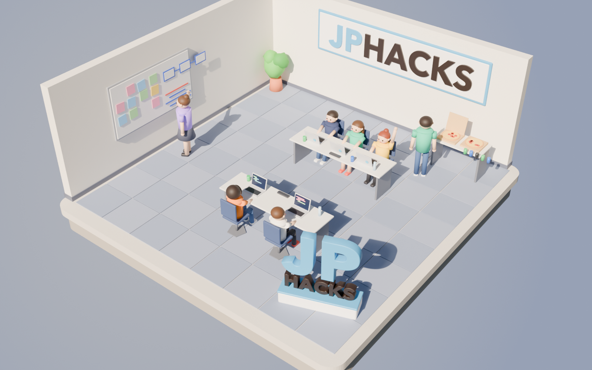

# タイトル画面の 3D

タイトル画面（ホーム）で回す 3D のうち、遊ぶ場面ではないもの。いまは、企業の 3D 広告の見本として作った、ハッカソンの会場のジオラマ 1 つ。

- JPHACKS が提供した場合に見立てた見本（2026-10-26 に README の画像と動画のために作ったものを、スクリプトごと作り直した）。実際の提供ではない。
- 出すのは Award Day 用の TestFlight の版だけで、App Store に出す版のホームは今の場面（作り置きの場面を部品で組んだもの）のまま（2026-11-13 のリーダーの決定）。
- 団体のロゴの画像や SVG は使わない。横断幕と手前右の看板の「JPHACKS」は、フォントの文字に色（JP は水色、HACKS は黒）を付けて立体にしている。



## ファイル

| パス | 中身 |
| --- | --- |
| `hackathon.usdz` | アプリ用の 3D モデル（約 2.4 MB） |
| `hackathon.png` | 確かめの画像（Cycles。アプリとは光の当たり方と色味が少し違う） |

どちらも `scripts/scene/hackathon.py` が生成する。手で編集しない。

## 座標

`assets/scenes/` のシーンと同じ（`scripts/scene/common.py` で書き出す）。

- Y が上、単位はメートル。約 8 m 四方で、床が y = 0、土台は y = -0.65 まで下にある。壁の高さは 3 m。
- 正面（画面の手前）は +Z。奥の壁（横断幕）が -Z 側、左の壁（ホワイトボード）が -X 側にあり、手前右（+X・+Z）に立体の看板がある。
- 光とカメラは入っていない。アプリで光を足す（`SceneLibrary` の場面と同じ斜め上からの光）。
- 部品は名前付きの Xform に分けてある: `room` `banner` `banner_logo` `whiteboard` `monument`（看板。中に `monument_jp` `monument_hacks`）`table_back` `table_front` `snacks` `cans` `plant` `coder_1`〜`coder_5` `presenter` `snacker`。
- ノートパソコンの画面は自己発光（emissive）のマテリアル。

## 作り直す

```sh
blender --background --factory-startup --python scripts/scene/hackathon.py
blender --background --factory-startup --python scripts/scene/hackathon.py -- --no-render   # USDZ だけ
```

Blender 4.5 LTS で、画像を含めて 2 分ほど。看板の字のフォントは、macOS では Avenir Next Bold を使う（無ければ Arial Bold、Windows では Arial Bold、どれも無ければ Blender の内蔵の字）。フォントが変わると字の形が変わる。
