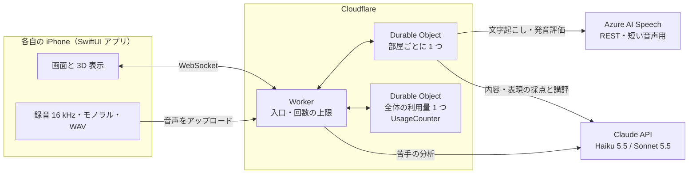
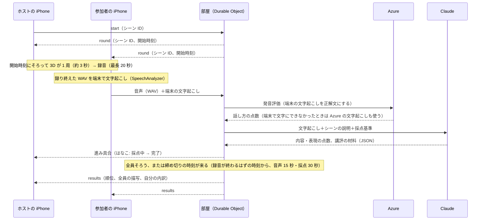

# アーキテクチャ

> Status: **合意済み**（2026-10-21）。[`usecase.md`](./usecase.md) と [`screen-flow.md`](./screen-flow.md) の決定から組み立てたもの。「推測」と書いた箇所と、Open Questions の項目は確認していない。

## 全体像

- iPhone はキーを持たず、Cloudflare の Worker とだけ話す。採点の外部 API（Azure・Claude）は部屋の Durable Object が呼ぶ。部屋の外の口（苦手の分析の `POST /weak-points`、手元だけの `POST /score`・`POST /scenes/generate`）は、Worker が Claude を直に呼ぶ。
- 部屋の状態（参加者、進行、点数）は、部屋ごとの Durable Object がメモリと保存領域に持つ。ThatsFight の `server/rooms.ts` の考え方（部屋の ID、端末ごとの合言葉、切断からの復帰）を移植する。
- 全体の利用量を数える Durable Object `UsageCounter` を 1 つ置く。今は苦手の分析の、IP ごとの 1 時間の回数と全体の 1 日の回数だけを数える（2026-11-13。[`weak-point-analysis.md`](./weak-point-analysis.md) の 8）。採点の 1 日の上限は、まだ乗せていない。

## 1 ラウンドの流れ

- 開始をそろえるため、部屋は「開始時刻」を配り、各端末はその時刻に回転を始める（推測）。
- 採点は 1 人分ずつ、音声が届いたら始める。全員分を待ってから始めるより、発表までの待ちが短くなる。

## API

| 経路 | 方式 | 中身 |
| --- | --- | --- |
| `POST /rooms` | HTTP | 部屋を作る。部屋のコード（数字 4 桁）と、ホストの参加者 ID・合言葉を返す |
| `GET /rooms/:id` | HTTP | 部屋があるか、満員でないかを返す（部屋に入る画面で使う） |
| `GET /rooms/:id/ws` | WebSocket | 部屋に入る。最初に `join`（名前とアバターの色。ホストと復帰する人は参加者 ID と合言葉も）を送る。以後、部屋の状態・開始・進み具合・結果を受け取る |
| `POST /rooms/:id/rounds/:n/audio` | HTTP | 自分の音声（WAV、最長 20 秒、約 0.6 MB）を本文にそのまま載せて送る。参加者 ID と合言葉をヘッダーに付ける。すぐ 202 を返し、採点は裏で続ける |
| `GET /scenes/:id/layout` | HTTP | 作り置きの場面の配置の JSON（`scenenglish.scene/2`）を、`backend/src/scenes/pool/` の JSON のまま返す。round で届いた場面を組み立てるのに使う。部屋が AI で作った場面は `?room=<部屋のコード>` を付けて取る。無い場面は 404 `unknown_scene` |
| `GET /scenes/:id/reviews` | HTTP | シーンの評価（★とコメント）を新しい順に返す（アプリの画面からは呼んでいなかった。2026-11-13 にアプリの評価の口を消した後も、下の `PUT` と同じくサーバーの口は残す） |
| `GET /parts` | HTTP | 部品のメタデータの一覧（Worker に同梱した一覧） |
| `GET /title` | HTTP | タイトル画面（ホーム）に今出す 3D（`{ title: { id, caption, model, sha256, expiresAt } }` か `{ title: null }`）。予定（`backend/src/title/schedule.json`）のうち、環境の変数 `TITLE_CAMPAIGN` に入っていて、サーバーの時刻で期間の中のもの。本番は空で null、staging だけ付ける。id は予定の id と 3D の sha256 の先頭 8 文字。`expiresAt` は秒までの UTC。アプリは起動時と前に戻ったときに毎回呼び、id が変われば取り直し、期限を過ぎたら端末で消す（[ADR](../adr/20261113-decide-title-diorama-on-server-with-expiry.md)） |
| `GET /title/<file>` | HTTP（静的アセット） | タイトル画面の 3D（USDZ）。repo の `assets/title/*.usdz` を Worker の静的アセットとして一緒にデプロイして配る（`assets/.assetsignore` でそれだけに絞る）。`GET /title` の `model` がこの URL を指す |
| `POST /scenes/generate` | HTTP | 作り置きのスクリプト（手元）が使う。級（`difficulty`）とテーマから、Claude が 2 段（見本の答えとチェックリスト → 部品と関係）で書き、バックエンドが裏取りをして座標に直した配置の JSON（`scenenglish.scene/2`）を返す（保存しない）。合言葉が要る。形は [`scene-protocol.md`](./scene-protocol.md) |
| `PUT /scenes/:id/reviews` | HTTP | シーンを評価する（★ 1〜5、コメントは 200 文字までで任意）。端末ごとの ID を付け、同じ ID で送り直すと上書きする（結果発表の下で送る）。2026-11-13 にアプリから評価のカードを外し、アプリは送らなくなった（理由: 結果の画面のノイズ。[`ui/screens/ranking.md`](./ui/screens/ranking.md) の「決定」）。口と、送られた評価は残してあり、戻せる |
| `POST /weak-points` | HTTP | 苦手の分析。端末に残した直近の記録（内容の内訳のある 5〜10 件）の文字（文字起こし・描写の判定・言い直し・次の一つ・級・表現の根拠と、場面の見本の答え・言えなかった項目）と、端末で数えた値を送ると、Claude（Sonnet 5.5 の low）がくり返す癖（最大 3 件、自分の文の実例つき）・前より良くなった点・次の 1 回で試すことを書いて返す。実例の引用はバックエンドが文字起こしと照らして確かめ、無いものは返さない。録音・名前・端末の ID は送らず、サーバーは保存しない。認証は無く、本文の大きさ・IP ごとの 1 時間の回数・全体の 1 日の回数の上限と、止めるスイッチ（`WEAK_POINT_ANALYSIS`）で守る（[`weak-point-analysis.md`](./weak-point-analysis.md)） |
| `POST /score` | HTTP | 配置の JSON（`layout` の `difficulty`・`checklist`・`items`・`description`）と文字起こしを送ると、部屋の採点と同じチェックリストの採点で、内容と表現の点・内容の内訳・講評を返す。話し方の点は付けないが、Azure の 3 つの点（`speech`）を送ると次に伸ばす一つに話し方も選ばれる。手元で試すときだけ開く（`ENABLE_DEV_ROUTES`）（[ADR](../adr/20261111-score-only-with-checklist-and-drop-handmade-scenes.md)） |

API の型の正本は `backend/src/schemas/`（zod）で、そこから生成した `backend/openapi.json` を iOS が読む（2026-10-24 に決定）。WebSocket のメッセージは OpenAPI の `components.schemas` の `ClientMessage`・`ServerMessage` に載せる。

WebSocket のメッセージ（ThatsFight の `src/shared/protocol.ts` に倣う）:

- 端末から: `join`、`start`（ホスト。難易度 `difficulty`（`eiken-3`・`eiken-pre2`・`eiken-2`。古い値は受け付けない）を送ると、部屋が AI で作るか、作り置きの場面から選ぶ。作り置きの場面の ID を送って指定もできる。両方は invalid_message。[`scene-protocol.md`](./scene-protocol.md)）、`again`（ホスト、同じ顔ぶれでもう一度）、`skip`（音声なしで終える。マイクが使えないときなど）、`leave`（退出。ホストが抜けたら次に入った人がホストになる）
- 部屋から: `welcome`（本人にだけ。参加者 ID と合言葉）、`room`（参加者と状態）、`round`（シーン ID と開始時刻）、`progress`（各自の状態）、`results`（順位・点数・文字起こしと、全員分の内容の内訳（描写の一覧・項目ごとの達成・言えたと正しさ）と講評。自分の分は参加者 ID で選ぶ。形は [`usecase.md`](./usecase.md) の「アプリへ送るもの」）、`error`
- 切断した人の扱い（2026-10-25）: `start` のときに切断中の人はそのラウンドに入れない（音声を待ち続けて終わらなくなるため）。ホストが切断したまま 30 秒戻らなければ、つながっている人のうち先に入った人がホストになる（次のラウンドを始められる人がいなくなるため）。前のホストは参加者として戻れる
- 締め切り（2026-11-11 に決定。[ADR](../adr/20261111-score-only-with-checklist-and-drop-handmade-scenes.md)）: ホストが締め切る操作（`close`）は無くし、部屋が時間で締め切る。録音が終わるはずの時刻（round の `startAt` ＋ 回転 3 秒 ＋ 録音の最長 20 秒。アプリの `RoundTiming` と同じ）から 15 秒たっても音声を送っていない人（切断中を含む）は「採点できませんでした」にする。音声を送った人の採点は、同じ時刻から 30 秒まで待つ。全員の採点がそろえば、その時点ですぐ結果を出す。時間が来たら、そろっていなくても結果を出し、後から届いた採点は捨てる。音声の締め切りの後に届いた音声と `skip` は `deadline_passed` で断る。時刻は Durable Object の alarm で見る（ホストの交代・部屋の片付けと同じ alarm で、最も早い時刻に予約する）

## データ

- シーンの定義（ID、名前、Claude に渡す場面の説明、描写してほしい要素の一覧、3D モデルのファイル名）は、リポジトリに JSON で置き、Worker とアプリの両方が読む（推測）。
- 3D モデルはアプリに同梱する（推測）。会場の回線に左右されないため。
- タイトル画面の 3D だけは、サーバーが期間つきで出すものを決め、アプリは取った 3D を端末のキャッシュ（Caches）に置き、期限（`expiresAt`）を過ぎたら消す（2026-11-13 に決定。[ADR](../adr/20261113-decide-title-diorama-on-server-with-expiry.md)）。送る情報は無い。
- サーバーは、音声を保存しない（採点が終われば捨てる）。部屋の中の採点の結果は、部屋が閉じたら消す。長く保存しない。
- 端末には、遊んだ本人の記録を残す（2026-11-12 に決定。[ADR](../adr/20261112-keep-play-records-on-device-one-file-per-round.md)）。自分の採点の結果が届いたら、場面の配置の JSON・自分の結果・自分の録音を、アプリ用の領域に 1 ラウンド 1 ファイルで置く。順位とほかの人の結果は入れない。サーバーへは、苦手の分析（`POST /weak-points`）のときだけ、直近の記録の文字（録音は除く）を送り、サーバーには残さない（2026-11-13。[`weak-point-analysis.md`](./weak-point-analysis.md)）。形と消し方は [`play-record.md`](./play-record.md)。
- シーンの評価（★とコメント）は、全体で 1 つの Durable Object `SceneReviews` の SQLite に残す（[ADR](../adr/20261024-store-scene-reviews-in-a-global-durable-object.md)）。今後のユーザーが作るシーンも同じ表に足す。2026-11-13 にアプリから評価を外した（結果の画面のノイズになるため）。表と口は残してあり、戻せる。評価のためだけに端末で作っていた ID（`sceneReviews.reviewerID`）も、アプリは作らなくなった。

## コスト破産への備え（[`cost-safety.md`](./cost-safety.md) の具体化）

| 層 | 対策 |
| --- | --- |
| 端末 | キーを持たない。音声は最長 20 秒で切る |
| Worker | 音声の大きさ（1 MB 程度まで）と形式を確かめてから受け取る。苦手の分析（`POST /weak-points`）は、本文の大きさ（64 KB）と、IP ごとの 1 時間の回数を `UsageCounter`（Durable Object）で数えて絞る。Cloudflare の Rate Limiting の binding は期間が 10 秒か 60 秒だけで、場所ごとの近似の数なので使わない（2026-11-13 に Cloudflare の文書で確かめた） |
| 部屋 | 1 人 1 ラウンド 1 回だけ採点する。部屋の人数の上限と、1 時間あたりのラウンド数の上限を置く |
| 全体 | 1 日あたりの採点回数の上限を置く。超えたら固定の点数を返すモードに切り替える（まだ無い）。苦手の分析は、Claude を呼んだ回数を 1 日ごとに `UsageCounter` で数え、上限で 429 にする |
| スイッチ | 環境変数ひとつで外部 API の呼び出しを止める（採点は `SCORING_MODE`、場面の生成は `SCENE_GENERATION`、苦手の分析は `WEAK_POINT_ANALYSIS`） |
| 外部 | Claude は専用のワークスペースのキーで、月の支出上限とレート上限を掛ける。Azure for Students はクレジットが尽きると止まる |

- 本物のアプリからの呼び出しかを確かめる仕組み（Apple の App Attest など）は入れない（2026-10-21 に決定）。青天井の課金は起きにくく（Azure も Claude もクレジットが尽きると止まる）、守るべきは本番の前にクレジットを使い切られないことで、それは回数の上限で足りるため。

### 上限の初期値

設定値（環境変数）として持ち、遊びながら調整する。数は仮置き。

| 上限 | 初期値 | 根拠 |
| --- | --- | --- |
| 1 部屋の人数 | 5 人 | チームの人数に合わせた（2026-10-24 に決定）。本番は 2 人 |
| 1 部屋の 1 時間あたりのラウンド数 | 20 | 1 ラウンド約 1 分なので、普通に遊ぶ分には届かない |
| 全体の 1 日あたりの採点回数 | 300 回 | 2 段の呼び方でも Azure は約 300 × 40 秒 ≈ 3.3 時間 ≈ 4.3 USD、Claude は Haiku 5.5 で約 0.15 USD |
| 1 回の音声 | 20 秒・1 MB まで | 16 kHz・16 bit・モノラルの WAV で 20 秒 ≈ 0.64 MB |
| 苦手の分析の IP ごとの 1 時間の回数 | 10 回（Award Day 当日は 60 回） | `wrangler.jsonc` の `WEAK_POINT_IP_PER_HOUR`。EXPO の会場は同じ Wi-Fi（同じ IP）から使うので当日は増やす |
| 苦手の分析の全体の 1 日の回数 | 200 回（当日は 500 回） | `WEAK_POINT_DAILY_LIMIT`。Claude を呼んだ回数（呼び直しも 1 回）。1 回約 0.05 USD なので約 10 USD（当日は約 25 USD） |
| 苦手の分析の本文 | 64 KB | `WEAK_POINT_MAX_BODY_BYTES`。測定の記録の組（10 件）は 11〜20 KB。大きいほど 1 回の費用が上がるので、余裕は少なめにした |

## Workers の無料プランで足りるか（2026-10-21 に確認）

- Durable Objects は無料プランでも使える（SQLite の保存方式に限る）。1 日あたり 10 万リクエスト、13,000 GB 秒、保存 5 GB。WebSocket で受け取ったメッセージは 20 通で 1 リクエストと数える。WebSocket Hibernation API を使うと時間の課金を大きく減らせる。
  - 出典: https://developers.cloudflare.com/durable-objects/platform/pricing/ （2026-10-18 更新）
- Worker の CPU 時間は、無料プランで 1 リクエスト 10 ms まで。ただし外部 API の応答待ちは CPU 時間に数えない。音声は変換せずにそのまま Azure へ送るので、足りる見込み（推測）。足りなければ有料プラン（月 5 USD〜、CPU 時間は既定 30 秒）にする。
- 1 リクエストの本文は 100 MB まで、外部へのリクエストは 1 回の呼び出しで 50 本まで（無料プラン）。
  - 出典: https://developers.cloudflare.com/workers/platform/limits/ （2026-10-12 更新）

## Open Questions

- 3D の表示に使う仕組みは RealityKit、モデルの形式は USDZ を既定にする（推測。確認していない）。シーンは Blender のスクリプトで作って同梱する（2026-10-21 に決定）。自動生成の構成は [`scene-generation.md`](./scene-generation.md)。
