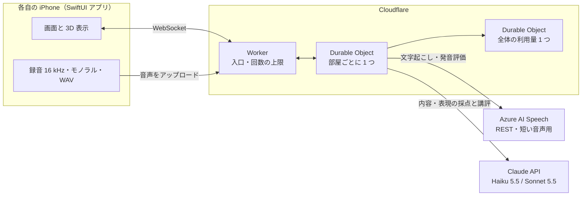
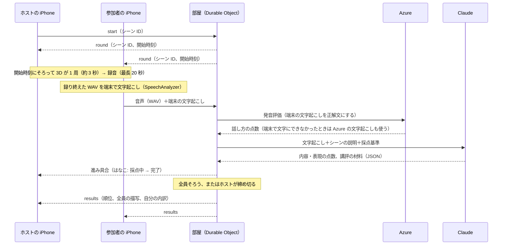

# アーキテクチャ

> Status: **合意済み**（2026-10-21）。[`usecase.md`](./usecase.md) と [`screen-flow.md`](./screen-flow.md) の決定から組み立てたもの。「推測」と書いた箇所と、Open Questions の項目は確認していない。

## 全体像

- iPhone はキーを持たず、Cloudflare の Worker とだけ話す。外部 API（Azure・Claude）は部屋の Durable Object が呼ぶ。
- 部屋の状態（参加者、進行、点数）は、部屋ごとの Durable Object がメモリと保存領域に持つ。ThatsFight の `server/rooms.ts` の考え方（部屋の ID、端末ごとの合言葉、切断からの復帰）を移植する。
- 全体の利用量を数える Durable Object を 1 つ置き、1 日あたりの採点回数の上限を効かせる（推測）。

## 1 ラウンドの流れ

- 開始をそろえるため、部屋は「開始時刻」を配り、各端末はその時刻に回転を始める（推測）。
- 採点は 1 人分ずつ、音声が届いたら始める。全員分を待ってから始めるより、発表までの待ちが短くなる。

## API

| 経路 | 方式 | 中身 |
| --- | --- | --- |
| `POST /rooms` | HTTP | 部屋を作る。部屋のコード（数字 4 桁）と、ホストの参加者 ID・合言葉を返す |
| `GET /rooms/:id` | HTTP | 部屋があるか、満員でないかを返す（部屋に入る画面で使う） |
| `GET /rooms/:id/ws` | WebSocket | 部屋に入る。最初に `join`（名前とアバターの色。ホストと復帰する人は参加者 ID と合言葉も）を送る。以後、部屋の状態・開始・進み具合・結果を受け取る |
| `POST /rooms/:id/rounds/:n/audio` | HTTP | 自分の音声（WAV、最長 20 秒、約 0.6 MB）を本文にそのまま載せて送る。参加者 ID と合言葉をヘッダーに付ける。すぐ 202 を返し、採点は裏で続ける |
| `GET /scenes` | HTTP | シーンの一覧と、それぞれの★の平均・評価した人数（待合のシーン選びに出す） |
| `GET /scenes/:id/layout` | HTTP | 作り置きの場面（`gen-…`）の配置の JSON を、`backend/src/scenes/pool/` の JSON のまま返す。round で届いた場面を組み立てるのに使う。無い場面と手作りの場面は 404 `unknown_scene` |
| `GET /scenes/:id/reviews` | HTTP | シーンの評価（★とコメント）を新しい順に返す |
| `GET /parts` | HTTP | 部品のメタデータの一覧（Worker に同梱した一覧） |
| `POST /scenes/generate` | HTTP | 作り置きのスクリプト（手元）が使う。難易度（とテーマ）から Claude が関係を書き、バックエンドが座標に直した配置の JSON を返す（保存しない）。合言葉が要る。形は [`scene-protocol.md`](./scene-protocol.md) |
| `PUT /scenes/:id/reviews` | HTTP | シーンを評価する（★ 1〜5、コメントは 200 文字までで任意）。端末ごとの ID を付け、同じ ID で送り直すと上書きする（結果発表の下で送る） |
| `POST /score` | HTTP | 配置の JSON（`layout` の `items` と `description`）と文字起こしを送ると、内容と表現の点と講評を返す。部品のメタデータと座標・向き・動き、説明文を Claude に渡し、採点基準の段階（0〜100）で付ける。話し方の点は付けないが、Azure の 3 つの点（`speech`）を送ると次に伸ばす一つに話し方も選ばれる（[ADR](../adr/20261025-score-content-with-layout-and-rubric-bands.md)） |

API の型の正本は `backend/src/schemas/`（zod）で、そこから生成した `backend/openapi.json` を iOS が読む（2026-10-24 に決定）。WebSocket のメッセージは OpenAPI の `components.schemas` の `ClientMessage`・`ServerMessage` に載せる。

WebSocket のメッセージ（ThatsFight の `src/shared/protocol.ts` に倣う）:

- 端末から: `join`、`start`（ホスト。シーン ID か難易度 `difficulty`（easy・normal・hard）のどちらか。難易度なら部屋が作り置きの場面から選ぶ。両方は invalid_message。[`scene-protocol.md`](./scene-protocol.md)）、`close`（ホスト、締め切り）、`again`（ホスト、同じ顔ぶれでもう一度）、`skip`（音声なしで終える。マイクが使えないときなど）、`leave`（退出。ホストが抜けたら次に入った人がホストになる）
- 部屋から: `welcome`（本人にだけ。参加者 ID と合言葉）、`room`（参加者と状態）、`round`（シーン ID と開始時刻）、`progress`（各自の状態）、`results`（順位・全員の描写と内訳。自分の分は参加者 ID で選ぶ）、`error`
- 切断した人の扱い（2026-10-25）: `start` のときに切断中の人はそのラウンドに入れない（音声を待ち続けて終わらなくなるため）。ホストが切断したまま 30 秒戻らなければ、つながっている人のうち先に入った人がホストになる（締め切れる人がいなくなるため）。前のホストは参加者として戻れる

## データ

- シーンの定義（ID、名前、Claude に渡す場面の説明、描写してほしい要素の一覧、3D モデルのファイル名）は、リポジトリに JSON で置き、Worker とアプリの両方が読む（推測）。
- 3D モデルはアプリに同梱する（推測）。会場の回線に左右されないため。
- 音声と採点の結果は、部屋が閉じたら消す。長く保存しない（推測）。
- シーンの評価（★とコメント）は、全体で 1 つの Durable Object `SceneReviews` の SQLite に残す（[ADR](../adr/20261024-store-scene-reviews-in-a-global-durable-object.md)）。今後のユーザーが作るシーンも同じ表に足す。

## コスト破産への備え（[`cost-safety.md`](./cost-safety.md) の具体化）

| 層 | 対策 |
| --- | --- |
| 端末 | キーを持たない。音声は最長 20 秒で切る |
| Worker | Cloudflare の回数制限で、IP ごとの呼び出しを絞る。音声の大きさ（1 MB 程度まで）と形式を確かめてから受け取る |
| 部屋 | 1 人 1 ラウンド 1 回だけ採点する。部屋の人数の上限と、1 時間あたりのラウンド数の上限を置く |
| 全体 | 1 日あたりの採点回数の上限を置く。超えたら固定の点数を返すモードに切り替える |
| スイッチ | 環境変数ひとつで外部 API の呼び出しを止める |
| 外部 | Claude は専用のワークスペースのキーで、月の支出上限とレート上限を掛ける。Azure for Students はクレジットが尽きると止まる |

- 本物のアプリからの呼び出しかを確かめる仕組み（Apple の App Attest など）は入れない（2026-10-21 に決定）。青天井の課金は起きにくく（Azure も Claude もクレジットが尽きると止まる）、守るべきは本番の前にクレジットを使い切られないことで、それは回数の上限で足りるため。

### 上限の初期値

設定値（環境変数）として持ち、遊びながら調整する。数は仮置き。

| 上限 | 初期値 | 根拠 |
| --- | --- | --- |
| 1 部屋の人数 | 5 人 | チームの人数に合わせた（2026-10-24 に決定）。本番は 2 人 |
| 1 部屋の 1 時間あたりのラウンド数 | 20 | 1 ラウンド約 1 分なので、普通に遊ぶ分には届かない |
| 全体の 1 日あたりの採点回数 | 300 回 | 2 段の呼び方でも Azure は約 300 × 40 秒 ≈ 3.3 時間 ≈ 4.3 USD、Claude は Haiku 5.5 で約 0.15 USD |
| 1 回の音声 | 20 秒・1 MB まで | 16 kHz・16 bit・モノラルの WAV で 20 秒 ≈ 0.64 MB |

## Workers の無料プランで足りるか（2026-10-21 に確認）

- Durable Objects は無料プランでも使える（SQLite の保存方式に限る）。1 日あたり 10 万リクエスト、13,000 GB 秒、保存 5 GB。WebSocket で受け取ったメッセージは 20 通で 1 リクエストと数える。WebSocket Hibernation API を使うと時間の課金を大きく減らせる。
  - 出典: https://developers.cloudflare.com/durable-objects/platform/pricing/ （2026-10-18 更新）
- Worker の CPU 時間は、無料プランで 1 リクエスト 10 ms まで。ただし外部 API の応答待ちは CPU 時間に数えない。音声は変換せずにそのまま Azure へ送るので、足りる見込み（推測）。足りなければ有料プラン（月 5 USD〜、CPU 時間は既定 30 秒）にする。
- 1 リクエストの本文は 100 MB まで、外部へのリクエストは 1 回の呼び出しで 50 本まで（無料プラン）。
  - 出典: https://developers.cloudflare.com/workers/platform/limits/ （2026-10-12 更新）

## Open Questions

- 3D の表示に使う仕組みは RealityKit、モデルの形式は USDZ を既定にする（推測。確認していない）。シーンは Blender のスクリプトで作って同梱する（2026-10-21 に決定）。自動生成の構成は [`scene-generation.md`](./scene-generation.md)。
