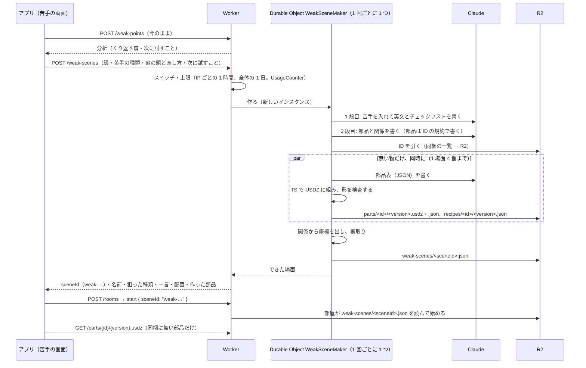

# 部品をその場で作る（苦手の場面）

> 状態: **確定（2026-11-14、リーダーと合意）**。2026-11-14 の 1 時から 2 時の grill で決めた。苦手の画面の出し方（作れなかったときの通知を含む）も、同じ日にリーダーが画像を見て決めた。決めた理由と比べた案は [ADR](../adr/20261114-build-parts-from-ai-part-tables-in-typescript-and-share-on-r2.md) にある。
>
> - 実装は 3 つの PR に分けた。PR 2 `feat/part-builder` が部品の組み立て・形の検査・R2・`GET /parts/{id}/{version}.usdz`、PR 3 `feat/weak-scenes` が `POST /weak-scenes`・苦手を入れた生成・部屋・上限、PR 4 `feat/weak-scene-practice` が iOS の苦手の画面の案 A を受け持つ。上限の数などの細かい値は実装の PR で決め、この文書に写した（2026-11-14 に PR 2〜4 の実装と突き合わせた）。
> - 2026-10-21 の決定（[`scene-generation.md`](./scene-generation.md) の「C で部品を作り、A で並べる」。AI が書いた Blender のスクリプトをコンテナで動かす）のうち、部品の作り方と動かす場所を、この文書と ADR で改めた。部品を R2 に置いて使い回すこと、配置を JSON で決めることは変えない。
> - 前の調べ（repo の外の報告「3D部品の自動生成 ツール比較」、2026-11-13）は、AI に部品表（JSON）だけを書かせ、組み立ては Containers の Blender に置く案を推していた。その決め手は「手作りの部品と AI の部品で、組み立ての実装が 2 つになる」ことだった。既存の部品も TS に写す（決まったこと 9）なら、この理由は消える。

## 何を作るか

苦手の画面（「苦手をぶっとばせ！」）で AI の分析が返ったら、アプリはすぐ `POST /weak-scenes` を呼ぶ。サーバーはその人の苦手を練習する場面を作る。手持ちの部品に無い物は、3D の部品をその場で作る。できた場面は R2 に置いて返す。アプリは「次はここ」のカードの中（UI は案 A）に、作っている間・できた・作れなかったを出す。できたら「この苦手の場面で練習する」で部屋を作り、その場面の ID でラウンドを始める。



## 決まったこと

### 範囲と時期

1. **Award Day（2026-11-15）に間に合わせる。** 2026-11-14 の 1 時に、リーダーが「今やる」と決めた。前の調べの「Award Day には入れず 11/16 以降」を改めた。アプリの変更は TestFlight 1.0.1 (5) の締め切り（11/14 12:00）に縛られる。サーバーは当日の朝まで PR で直せる。
2. **部品を作るのは、苦手の分析から作るオーダーメイドの場面のときだけにする。** ふだんの練習は作り置きの場面（`backend/src/scenes/pool/`）で遊ぶ。注文で作る価値は、苦手に合わせた場面にこそあるため（[`weak-point-analysis.md`](./weak-point-analysis.md) では「次はここ」を押した先として、後で決めることにしていた）。部屋のスタートでの生成（`SCENE_GENERATION`）と作り置きの生成（`POST /scenes/generate`）では、部品を作らない。
3. **TestFlight 1.0.1 (5) はチームの本番（`ng-2622-backend`、main の merge で自動デプロイ）につなぐ。** 当日までの直しも、全部 PR の approve と merge を通す。個人のアカウントの staging は使わない。

### 苦手の場面の作り方

4. **苦手の場面は、AI の分析が返ったらすぐ裏で作り始める。** 分析と生成が直列になるので、待ちを縮めるため。本人が分析を読んでいる間に仕上げる。使われなければ、その分の費用は無駄になる。AI の分析を作り直すのは、内容の内訳のある記録が 5 件ずつ増えたとき（5・10・15 件目…）だけにし、作れた場面は、その 5 件の区切りごとに 1 つだけにする（2026-11-14。下の「苦手の画面の出し方」の 5、[`weak-point-analysis.md`](./weak-point-analysis.md) の 7）。
5. **生成に渡すのは、級・苦手の種類・癖の題と直し方・次に試すことだけにする。** 本人の英文の引用は、アプリから受けないし、Claude にも渡さない。苦手の種類（`kinds`）は、端末が数えた言えた割合の低い順に並べる（分母 0 の種類は除く）。
6. **級はその人の直近の記録の級のまま、苦手は中身で狙う。** 苦手は級を混ぜた記録から出るので、級をまたいでよい。項目の種類の数は変えない。苦手は「何を描くか（苦手の種類の項目を目立つ形にする）」と「どの文法を使うか（表現の癖）」で狙う。苦手の種類がその級に無いとき（3 級の理由・つながり、準 2 級のつながり）は、次に低い種類を使う。実際に狙った種類は、返す `focus` に書く。裏取りは今のまま。
7. **足りない部品は同時に作る。** 場面の 2 段目（部品と関係）で、要る部品が一度に分かる。新しい部品を並べて作れば、待ちは最も遅い 1 個の分で済む。部品ができてから、関係から座標を出す。
   - 新しい部品は **1 場面 4 個まで**にする（費用のヒューズ）。
   - 失敗した部品は 1 回だけ作り直す。それでもだめなら、場面の生成を失敗（502）として返す。
   - サーバーの上限時間は 90 秒。
8. **部屋は `weak-` で始まる ID で始める。** start の `sceneId` が `weak-` で始まれば、部屋は R2 の `weak-scenes/<sceneId>.json` から配置（と作った部品のメタデータ）を読んで始める。無ければ、今の「知らない場面」のエラーにする。部屋からアプリへ送る `room`・`round` には欄を足さない（足すと古いアプリが `room` ごと読めなくなるため）。採点には、作った部品の情報も渡す（今は静的な一覧に無い部品を捨てているため）。

### 部品の作り方

9. **組み立て器は TypeScript 1 つにする。** AI は部品表（JSON）だけを書き、バックエンドの TS がそれを USDZ にする。書き方は、依存の無い自前の TS（USDA の文字列＋64 バイト境界の無圧縮 zip）にする。three.js は使わない（遅いうえ、複数の材質を GeomSubset にする書き方が `usdchecker` に落ちた）。苦手の場面の生成の全部（Claude の呼び出し・部品の組み立て・R2 への書き込み・裏取りと座標の計算）は、PR 3 の Durable Object `WeakSceneMaker`（migration v6。1 回ごとに新しいインスタンス）の中で動く。部品を作る部分（PR 2 の `backend/src/parts/`）は Durable Object を足さず、呼んだ側の CPU で組む。回数の上限は、Worker が `WeakSceneMaker` を呼ぶ前に数える。
   - Durable Object の中に置いたのは、組み立ての 1 回目の CPU（7〜12 ms）と裏取り・座標の計算（PR 3 の見込みで 10〜50 ms）が、Worker の無料プランの 1 回 10 ms を超えうるため。アカウントは 11/14 の昼までに Workers Paid（CPU 1 回 30 秒）に変える（下の「前提」）。
   - 既存の 154 個も、`scripts/scene/parts.py` の基本形の呼び出しを記録して部品表に写し、TS で作り直す。外接箱が 2 mm 以内で一致し、並べた画像で見分けがつかないことを確かめてから切り替える。切り替えの時期は決めていない。Award Day の当日は、同梱の部品は今の Blender の USDZ のまま。Blender は、場面（公園など）と確かめの画像のためだけに残る。
10. **検査は形の検査だけにし、AI の目は入れない。** コードで見るのは次のとおり。値と決めた理由の正本は [`backend/README.md`](../../backend/README.md) の「部品をその場で作る」（`backend/src/parts/check.ts` の `LIMITS`。どちらも PR 2 で入る）。
    - 部品表の語彙（op）と材質の enum
    - 基本形の数・三角形の数・材質の数の上限
    - 頼んだ寸法との差
    - 浮いた基本形が無いか

    落ちたら、落ちた理由を付けて 1 回だけ書き直させる（7）。チームが使ってみて見た目に問題が多ければ、組んだ形を画像にして Claude に見せる検査を考える。
11. **作るのは物だけにする。** category は `thing`・`furniture`・`food`・`plant`・`vehicle`。人（`person`）・動物（`animal`）・地面（`ground`）・建物（`building`。壁・ドア・窓など）は作らない。人と動物は今の部品の中から寄せる（12）。
12. **部品は ID の規約で引き、一覧を prompt に出さない。** 一覧を出す形では、作った部品が増えるたびに prompt が伸びて、いずれ破綻するため。
    - 規約: 物は `名詞` か `名詞_区別`（例 `table_small`・`ball_red`。`_` でつないで 3 語まで。例 `wall_kitchen_tile`）、人は `person_動作_誰_変種`（例 `person_stand_woman_a`）、動物は `animal_動作_種類_変種`（動作は省けることがある。例 `animal_run_dog_a`・`animal_bird_a`）。今の 154 個は、どれもこの形になっている（PR 2 の `backend/src/parts/ids.ts` と、それを確かめる test）。
    - Claude は規約どおりの ID を書き、コードが引く。有ればそのまま使う。人・動物で無ければ、「誰」と「動作」が最も近いものに寄せる。物で無ければ、その ID で作る。作った物は次から使い回す。
    - 物の ID の形は `^[a-z]+(?:_[a-z]+){0,2}$`、32 文字まで。同梱の ID とは重ねない。
    - 同じ物に別の名詞が付くと、二重に作ってしまう。別名の表か検索は後で足す。
    - 今の一覧を出す生成も残す。部屋の生成と作り置きのスクリプトの引き方は、スイッチ `SCENE_PART_LOOKUP` で選ぶ（`convention` なら規約で引く。それ以外は一覧を出す今の道で、既定）。苦手の場面は、いつも規約で引く。
13. **部品の ID は規約の形に縛り、断る物を決める。** 人の名前・武器・暴力・性的な物・憎しみの記号・薬物・たばこ・酒は断る。
    - 断ったときの動き（PR 2・3 の実装どおり）: ID の語で断った物は、その物を使わない場面にする。部品表を書く所（語の確かめ・Claude）で断った物は、場面ごと失敗（502）になり、アプリは作れなかったときのバナーを出す。注文は分析から Claude が作るのでまれと見て、Award Day はこのまま出す。
    - 刃物のうち、料理の道具や文房具（包丁・はさみなど、台所や教室に自然にある物）は作ってよい。剣・銃などの武器は断る（2026-11-14、リーダー）。PR 2 の実測でも、包丁は料理の道具として作り、武器の注文は断った（[`backend/README.md`](../../backend/README.md) の「部品をその場で作る」。PR 2 で入る）。
    - 本人の英文の引用を生成に渡さない（5）こととあわせて、本人の話した中身が部品として残ったり、ほかの人に出たりしないようにする。
14. **作った部品はみんなで使う。** `id@版` で R2 に置き、形の検査を通ればすぐ使う。人の目の確かめは後から行い、悪い部品は版を上げて差し替える。

### 置き場と守り

15. **置き場は R2 にし、チームの Cloudflare（本番の `ng-2622-backend` があるアカウント）に置く。** R2 は 11/14 の夜中に有効にした。
    - binding は `BUCKET`。本番のバケットは `ng-2622-bucket`（#135 で main に入った）。PR のプレビューのバケット `ng-2622-bucket-preview` も 11/14 に作り、binding の名前は同じにした（PR 2 で `previews` に足す）。本番のバケットを PR から書き換えないようにするため、バケットを分けた。
    - 置く物: `parts/<id>/<version>.usdz`（部品）、`parts/<id>/<version>.json`（`index.json` の 1 件と同じ形のメタデータ）、`recipes/<id>/<version>.json`（部品表）、`weak-scenes/<sceneId>.json`（苦手の場面の配置と、作った部品のメタデータ）。
16. **上限は苦手の分析と同じ形にする。** IP ごとの 1 時間の回数と全体の 1 日の回数を上限にし、止めるスイッチは `WEAK_SCENE_GENERATION` にする（`on` のときだけ作る。PR のプレビューは `off`）。値は次のとおり（2026-11-14、リーダー。[`cost-safety.md`](./cost-safety.md)）。
    - 普段: IP ごとの 1 時間 5 回、全体の 1 日 40 回（`wrangler.jsonc` の `WEAK_SCENE_IP_PER_HOUR`・`WEAK_SCENE_DAILY_LIMIT`。受け付けた 1 回で 1 つ数える）。
    - Award Day の当日（11/15）: IP ごとの 1 時間 60 回、全体の 1 日 200 回。会場の Wi-Fi では、デモの端末が同じ IP になるため。当日の値は、当日の vars の PR で入れる。
    - 当日の値は、実測の費用がいくらでも減らさない。足りなければ Claude のクレジットを足す（2026-11-14、リーダー）。クレジットが尽きると採点と苦手の分析も止まるので、当日の朝に残高を確かめて足しておく。
    - Award Day の当日に部屋の生成を止める決まり（`SCENE_GENERATION` を `off`）は、そのまま残す。苦手の場面だけを、別のスイッチで `on` にする。

### 画面

17. **苦手の画面の UI は、Codex の画像生成で案を複数作って選んだ。** 案 A（「次はここ」のカードの中に、苦手の場面の行とボタン）に決めた（2026-11-14）。作っている間・できた・作れなかったとき（行を消して、上に通知のバナー）・分析が失敗したとき・作り直し・閉じたときの出し方も決めた（下）。画面の正本は [`ui/screens/weak.md`](./ui/screens/weak.md)、待合は [`ui/screens/lobby.md`](./ui/screens/lobby.md)。

## 口の形

PR 2・3・4 で共有する。変えるときは、指揮役に知らせてからこの文書を直す。

### `POST /weak-scenes`

本文 `WeakSceneRequest`:

| 欄 | 形 | 中身 |
| --- | --- | --- |
| `difficulty` | GradeId（`eiken-3`・`eiken-pre2`・`eiken-2`） | その人の直近の記録の級 |
| `kinds` | ChecklistKind（`center`・`reason`・`link`・`detail`）の配列、1〜4 個 | 端末が数えた言えた割合の低い順（分母 0 の種類は除く） |
| `habits`（任意） | `{ viewpoint: "content" \| "expression", title: 1〜80 文字, fix: 1〜200 文字 }` の配列、0〜3 個 | AI の分析の癖。実例の引用は送らない |
| `nextTry`（任意） | `{ viewpoint, text: 1〜200 文字 }` | AI の分析の次に試すこと |

200 `WeakSceneResponse`:

| 欄 | 中身 |
| --- | --- |
| `sceneId` | `weak-` ＋ uuid。部屋の start の `sceneId` に使う |
| `name` | 場面の名前（日本語） |
| `difficulty` | GradeId |
| `focus` | ChecklistKind。実際に狙った種類 |
| `pitch` | 一言（日本語。例「because で理由を言いやすい場面です」） |
| `layout` | 配置の JSON（`scenenglish.scene/2`。部屋の round で送るのと同じ型）。作った部品は `id@版` で書く。アプリはこれで小さな絵を出し、部品を先に取っておける |
| `createdParts` | その場で作った部品の `id@版` の配列 |

エラーは `POST /weak-points` と同じ形にそろえる（`backend/src/routes/weakPoints.ts`）。

| 状態 | code | いつ |
| --- | --- | --- |
| 400 | `invalid_message` | 本文の形が違う |
| 413 | `invalid_message` | 本文が大きすぎる（8 KB。PR 3 の `WEAK_SCENE_MAX_BODY_BYTES = 8192`） |
| 429 | `rate_limited` | IP ごとの 1 時間の回数か、全体の 1 日の回数に達した |
| 502 | `generation_failed`・`generation_refused` | 作れなかった（Claude の失敗・断った・時間切れ、部品を作れなかった、作り直しても裏取りを通らなかった） |
| 503 | `generation_unavailable` | `WEAK_SCENE_GENERATION` が `on` でない、Claude のキーや置き場が無い、回数を数える場所が失敗した |

### `GET /parts/{id}/{version}.usdz`

- R2 の `parts/<id>/<version>.usdz` を返す。`content-type: model/vnd.usdz+zip`、`cache-control: public, max-age=31536000, immutable`。無ければ 404。
- 同梱の部品はアプリが持っているので、ここで返すのは R2 の物だけでよい。アプリ（`ios/NG2622/Play/PartLibrary.swift`）は「同梱 → 端末のキャッシュ（Caches）→ この口」の順に探す。

### 部屋

- start の `sceneId` が `weak-` で始まれば、R2 の `weak-scenes/<sceneId>.json` から配置を読んで始める。無ければ、今の「知らない場面」のエラーにする。
- 参加者の端末は、今の部屋の場面と同じく `GET /scenes/{sceneId}/layout` で配置を取る。`weak-` の ID は、`?room=` が無くても R2 から返す（PR 3 で確かめた）。

### PR 2 と PR 3 の間の TS の口（PR 2 が作り、PR 3 が使う）

```ts
// backend/src/parts/workshop.ts
export type PartOrder = {
  id: string;            // 規約の形。同梱の ID と重ねない
  category: "thing" | "furniture" | "food" | "plant" | "vehicle";
  label: string;         // 日本語
  words: string[];       // 英語の名詞（1 つ以上）
  size: [number, number, number]; // m。幅・高さ・奥行き
  description: string;   // 英語 1 文。形と色
  top?: boolean;         // 上に物を置けるか（anchors.top）
};
export type MadePart = PartMeta; // index.json の 1 件と同じ形（id・version・file・category・words・size・label・anchors?）
export function ensureParts(env, orders: PartOrder[], opts: { signal?: AbortSignal; maxNew: number }):
  Promise<{ parts: MadePart[]; failed: { id: string; reason: string }[] }>;
// R2 に既にある ID は作らずにメタデータを返す。無い物だけ Claude に部品表を書かせ、TS で組み、検査し、R2 に置く。並べて作る
export function lookupPart(env, id: string, version?: number): Promise<MadePart | null>;
export const OBJECT_ID = /^[a-z]+(?:_[a-z]+){0,2}$/; // 32 文字まで
```

## 苦手の画面の出し方（案 A）

画面の正本は [`ui/screens/weak.md`](./ui/screens/weak.md)。ここには、出し分けの決まりの要点だけを書く。どれも「次はここ」のカードの中の、区切り線の下の行に出す。2026-11-14 にリーダーと決めた（5 の区切りの決まりは指揮役が決めた）。

1. **作っている:** AI の分析を待つ間と `POST /weak-scenes` を待つ間を、1 つの待ちとして出す。中身は、走る人、「苦手の場面を作っています…」、「1 分ほどかかります」。ボタンは無い。進み具合の棒は出さない（進み具合がサーバーから届かないため。走る人で動きを見せる。PR 4。決める途中の案の画像には棒があった）。「1 分ほど」は測っていない仮の文で、PR 3 の測定で直す。アプリが待つのは 100 秒まで（サーバーの 90 秒に余裕を足した）。
2. **できた（200）:** 場面の小さな 3D、「苦手の場面ができました」、場面の名前、一言（`pitch`）、塗りのボタン「この苦手の場面で練習する」。小さな 3D は、きろくと同じ `RecordSceneView` で返った `layout` を組み、128pt の枠でゆっくり回す。作った部品は、このとき `GET /parts/{id}/{version}.usdz` で取る（PR 4）。押すと部屋を作ってホストの待合へ行き、スタートで `start { sceneId: "weak-…" }` を送る。
3. **作れなかったとき（502・時間切れ・429・503・通信できない・形の違う返り。400・413 も）:** 苦手の場面の行と練習のボタンを消し、画面の上に白い角丸の通知のバナーを出す（左にオレンジの「!」、文は「苦手の場面を作れませんでした」）。モーダルではなく、画面を暗くせず、3 秒で消える。VoiceOver にも読み上げで知らせる。ボタンは付けない。「もう一度作る」と「作り置きの場面で練習する」のボタンも出さない。通知が消えたあとの「次はここ」のカードは、行の無い今の形になる。下に出すトーストの案と比べ、上のバナーにした。
4. **AI の分析が失敗したとき（案 Y）:** 分析の失敗（通信・時間切れ・Claude の失敗）と、分析の上限（429）・休み（503）のどれでも、級と数えた種類（`kinds`）だけで `POST /weak-scenes` を送る（`habits`・`nextTry` は付けない）。「次はここ」は今の決まりのまま（前回の分析があればそれ、無ければ数えた結果の代わり）にし、行は 1〜3 と同じ動きにする。比べた案 X（行を出さない）より、デモの目玉の苦手の場面を、分析が止まっても見せられることを採った。記録が 4 件以下のときは、苦手の画面の入口が出ないので、この画面には来ない。
5. **区切りごとに、作れた場面は 1 つだけ:** 内容の内訳のある記録の数 N を 5 で割った商を「区切り」と呼ぶ（5〜9 件目が 1、10〜14 件目が 2…）。
   - 同じ区切りの中では、覚えている分析と場面（2 のできた）を出し、`POST /weak-scenes` はしない。分析を呼び直しても（分析が失敗して案 Y で場面を作ったあと、開き直して分析が通ったときも）、場面は作り直さない。
   - 場面が作れなかったときだけ、画面を開き直したら（上限の範囲で）もう一度作る。画面を閉じている間に作れなかったときは、通知を出さない。
   - 区切りが変わったら、AI の分析を作り直し（[`weak-point-analysis.md`](./weak-point-analysis.md) の 7）、場面も 1 の「作っている」から作り直す（前回の場面は出さない）。
   - 端末は、最後にできた場面の返りを 1 つだけ、その区切りと一緒に `analysis/weak-scene.json`（`scenenglish.weakscene/1`。欄は `protocol`・`createdAt`・`stage`・`scene`）に覚える。分析のファイルには、作ったときの記録の数 `records` を足した。形の正本は [`weak-point-analysis.md`](./weak-point-analysis.md) の 7。設定の「すべて消す」と、記録が 4 件以下になったときに、分析と一緒に消す。
6. **画面を閉じたとき:** 分析を待っている間でも場面を作っている間でも、要求は画面の外（アプリの中で 1 本だけ）で裏で続け、開き直したら作っている間の続きを出す。
7. **待合:** 苦手の場面の部屋では、ホストの待合に難易度の代わりに苦手の場面の名前と一言（`pitch`）だけを出し、3D は出さない。「同じ顔ぶれでもう一度」で戻っても、同じ苦手の場面でスタートする。ホストが抜けて替わった人の待合は、難易度を選ぶふつうの待合になる（[`ui/screens/lobby.md`](./ui/screens/lobby.md)）。
8. **Mock:** 起動の引数 `-MockWeakScene`（`fail`・`limit`・`off`・`offline`）か、`ios/Config/Local.xcconfig` の `MOCK_WEAK_SCENE` で、作れなかった（502）・上限（429）・止めている（503）・通信できないに切り替えられる。既定は `ok`（作り置きの場面の一つを `weak-` の ID で返す）。

## 前提（確かめた事実）

- 端末の側はある。`ios/NG2622/Play/PartLibrary.swift` は「同梱 → 端末のキャッシュ（Caches）→ `GET /parts/{id}/{version}.usdz`」の順に探し、取ったものを Caches に置く。Caches は、空きが足りないときに OS が消すことがある。それでも `id@版` の中身は変わらないので、取り直せばよい。無いのは、バックエンドの口と置き場だった。
- Workers では文字列からコードを動かせない（`eval` 不可）。だから AI が書くのはデータ（部品表）になる。
- Cloudflare のプランと枠:
  - チームの Cloudflare のアカウントは、11/14 の昼までに Workers Paid（月 5 USD。CPU の上限は 1 回 30 秒）に変える（2026-11-14、リーダーから）。
  - 無料プランの Worker は CPU 1 回 10 ms（外部 API の待ちは数えない。[Workers の limits](https://developers.cloudflare.com/workers/platform/limits/)）。
  - Durable Object の CPU の上限は、[Durable Objects の limits](https://developers.cloudflare.com/durable-objects/platform/limits/) の表では 1 回 30 秒（既定）とあるが、同じページの FAQ は「Durable Objects ... have the same per invocation CPU limits as any Workers do」と書いている。無料プランでの値は確かめないまま、Paid に変えることになった。
  - R2 は 10 GB・書き込み月 100 万回・読み出し月 1,000 万回で、転送は無料。部品の USDZ は中央値約 122 KB なので、10 GB で約 8 万個入る。
- 今の部品で Blender が行う操作は、bmesh の箱・円錐・UV 球・ico 球の作成と bevel、USD の書き出しだけ。
- 手元の測定（2026-11-14、Apple M4）:
  - 依存の無い自前の TS（USDA の文字列＋64 バイト境界の無圧縮 zip）は、中央値くらいの部品を workerd で組むのに、温まった状態で 1.1〜2.6 ms、起動直後の 1 回目で 7〜12 ms かかり、`usdchecker --arkit` を通った。
  - three.js は 7〜14 ms（1 回目 16〜18 ms）かかった。複数の材質を GeomSubset にする標準の書き方は、`usdchecker` に落ちた。
  - 本番機の速さは測っていないので、無料プランの Worker の 10 ms は 1 回目に超えうる。Paid の 30 秒なら足りる。
- 既存の 154 個は、Blender で基本形の呼び出しを記録すると、部品表に写せた。三角形の数は全部一致し、TS で組み直した 5 個は外接箱が 1 mm 以内だった。132 個は box・cyl・sphere・limb・slab だけで書け、残る 22 個は blob（noise）・poly・lathe・作った後の回転を使う。部品表は中央値 26 行・2.4 KB。材質は 248 種。
- R2 は無料枠でも支払い方法の登録が要るとみられる（公式文書は「R2 subscription を checkout で足す」「購入には主な支払い方法が要る」）。チームのアカウントでは有効にした（15）。

## 決まっていないこと

- Workers Paid に変わったことの確かめ（上の「前提」）。変わるまでは無料プランの CPU の上限で、苦手の場面の生成が落ちうる。その前に決めていた「無料プランのまま出し、本番で CPU の上限のエラー（1102 など）を Observability で数え、全体の 1% 以上落ちたら有料プランを考える」は、Paid に変えるので当てはまらなくなった（経緯として残す）。
- 「1 分ほどかかります」の文。PR 3 の測定で、1 場面にかかる時間が分かったら直す。
- 1 場面の費用の実測。新しい部品 1 個は、PR 2 の実測（2026-11-14、16 個）で 0.006〜0.049 USD・平均 0.026 USD、3.6〜16.0 秒だった（[`backend/README.md`](../../backend/README.md)。PR 2 で入る）。1 場面（場面の 2 段の生成と、新しい部品 4 個まで）は約 0.2〜0.4 USD の見込みで、まだ通して測っていない。
- `weak-scenes/` と作った部品を、R2 にいつまで置くか。今は消さない。
- 同じ物に別の名詞が付いたときの、別名の表か検索（12）。
- 既存の 154 個を TS の組み立てに切り替える時期（9）。
- 作った部品を人の目で確かめる手順と、悪い部品の版を上げる手順（14）。
- 亀井さん（2026-10-21 の決定で、部品を作り足す役だった）との合意。PR のレビューで確かめてもらう。

## 剪定した枝

- Containers の Blender（9 で）、three.js（9 で）、AI の目の検査（10 で）
- 練習のたびに部品を作る流れ（2 で）、共有しない案（14 で）
- 部品の一覧を prompt に出す形（12 で。作った部品が増えると prompt が伸びる）
- 人・動物・地面・建物を作ること（11 で）
- 苦手の場面を端末だけに覚え、サーバーに残さない案（8 で。部屋が `weak-` の ID で配置を読むため、R2 に置く）
- 作れなかったときに「もう一度作る」「作り置きの場面で練習する」のボタンを出す案と、分析を作り直す間は前回の場面を出したまま作り直す案（苦手の画面の出し方の 3・5 で。2026-11-14 にリーダーが決めた）
