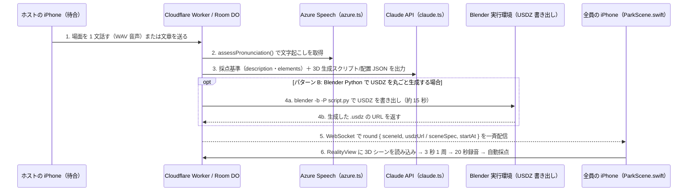

# 3D シーンの用意と自動生成

> Status: **合意済み**（2026-10-21）。MVP の作り方と、将来の自動生成の構成を決めた。自動生成は Hack Day では作らない。

## MVP（2026-10-21 に決定）

- Blender の Python スクリプトで、デモ用のシーンを複数作り、アプリに同梱する。費用がかからず、作り直しも簡単なため。
- 人や動物の出来が足りなければ、そこだけ権利のはっきりした無料素材（CC0）に差し替える。
- 試作: 公園のシーンを Blender 4.5 のスクリプトで組み立て、PNG・USDZ（110 KB）・GLB（263 KB）に書き出せた（画面なしで約 17 秒）。アプリの実機で開けるかは未確認。
- Hack Day の前に作ったシーンは「持ち込み」として使えるが、審査では評価されない（JPHACKS の規約）。

## 理想: シーンの自動生成

ホストが場面を文章で指定する（または「おまかせ」を押す）と、AI が新しいシーンを作る。

Cloudflare Workers で動かせないのは Blender であって、3D の生成そのものではない。構成の候補:

| 構成 | 仕組み | Workers のままでよいか | 長所 | 短所 |
| --- | --- | --- | --- | --- |
| A. 部品の組み合わせ | Claude が「どの部品を、どこに、何色で置くか」を JSON で書く（構造化出力）。iPhone の RealityKit が、同梱した部品からその JSON どおりに組み立てる | よい（Claude を呼ぶだけ） | 速い（数秒）、安い、見た目がそろう。同じ JSON を採点用のシーン定義にも使える | 部品に無いものは出せない |
| B. 3D 生成 API | Meshy などの 3D 生成 API に文章や画像を送り、できたモデル（GLB / USDZ）を iPhone が取りに行く | よい（HTTP で呼ぶだけ） | 部品に無いものも作れる | 生成に時間がかかり（推測で数十秒〜数分）、ラウンドの前に作っておく必要がある。1 回ごとに費用がかかる。利用条件の確認が要る |
| C. Blender をサーバーで動かす | Claude が Blender のスクリプトを書き、別のサーバー（コンテナ）で Blender を動かしてモデルを作る | 移行か追加が要る（Blender を動かせる場所） | 今の作り方をそのまま自動化できる | サーバーが 1 つ増える。生成の待ちが長い。AI が書いたスクリプトを実行するので、安全の対策が要る |

### 選んだ構成: C で部品を作り、A で並べる（2026-10-21 に決定）

将来の自動生成は、Blender を別のサーバーで動かす（C）。ただし Blender は部品作りに特化させ、配置は JSON で決める（A）。

- 部品: サーバーの Blender が、AI の書いたスクリプトで作る。まだ無い部品だけを作り足し、一度作った部品は保存して使い回す（保存先は Cloudflare R2 などを想定。推測）。
- 配置: Claude が配置の JSON を書く。iPhone はその JSON どおりに部品を並べる。並べるだけなので数秒で済む。
- 理由:
  - A 単独の弱点（部品をたくさん用意しておく必要がある）を、C が部品を作り足すことで埋められる。生成を待つのは新しい部品が要るときだけになる。
  - 今の作り方（Blender のスクリプトで部品を作る）をそのまま自動化でき、技術としても面白い。
  - B は割高で品質も読めない。
- Hack Day の 14 時間では作らない。発表で「AI がシーンを自動で生成できるように展開すると、より有用なアプリになる」という今後の展開として示す。
- 作るときの注意（推測）: AI が書いた Python を Blender で実行するので、実行するサーバーはネットワークを切ったコンテナにし、CPU・メモリ・時間に上限を掛ける。生成には描き出しと書き出しで数十秒かかる（公園の試作で約 17 秒）ので、ラウンドの前に作っておく。

## シーンの形（2026-10-21 に決定）

MVP のシーンも、最初から「部品＋配置の JSON」の形で作る。将来の自動生成（C で部品を作り、A で並べる）にそのまま育てられ、採点用のシーン定義とも 1 つにまとまるため。

- 部品: ベンチ・木・犬などを 1 つずつ USDZ にする。Blender のスクリプトで作る。
- 配置の JSON: シーンごとに、使う部品・位置・向き・大きさ・色と、採点用の情報（場面の説明、描写してほしい要素）を持つ。デモ用のシーンは手で（または Claude で）書く。
- アプリ: RealityKit で部品を読み込み、JSON どおりに並べる。

## Open Questions

- 自動生成をいつ作るか（Hack Day 中に作れば審査の対象になる）。
- 配置の JSON の項目の詳細（色を部品ごとに変えられるようにするか、など）。

---

## 提案: 音声から AI エージェントが 3D シーンを組み立てる実装案（2026-10-24）

> Status: **提案（Draft）**。現在の `backend/`（#17・#20）と `ios/`（#21）の実装をそのまま活かして、「ホストが 1 文話す → AI エージェントが 3D シーンを生成 → 全員の iPhone に配って遊ぶ」を最短でつなぐための設計案。

### 全体像（4 ステップ）



### 1. ホストが 1 文話す（iOS 待合画面 → バックエンド）

- 待合（`Lobby`）画面のホスト側に、定型シーン選択だけでなく **「声でシーンを作る」** ボタンを置く。
- ホストが短い 1 文（例: *"A sunny beach with a palm tree, a red surfboard, and a crab"*）を録音し、WAV をバックエンド（例: `POST /rooms/{roomId}/generate-scene`）へ送る。

### 2. 文字起こし ＋ 採点基準と 3D シーンの生成（`backend/src/scoring/`）

既に `backend/src/scoring/` にある実装をそのまま再利用できる:

1. **音声から文字起こし（`backend/src/scoring/azure.ts`）**
   - 既存の `assessPronunciation(audioBuffer, env)` にホストの WAV を渡し、返り値の `result.transcript` をそのままプロンプトとして使う。
2. **Claude による構造化出力（`backend/src/scoring/claude.ts`）**
   - `output_config.format`（`json_schema`）を使い、1 回の Claude 呼び出しで次の 2 つを同時に作らせる:
     - **採点用のシーン定義（`Scene` 型）**: `name`、`description`、`elements`（20 秒後のプレイヤー採点でそのまま `scoreWithClaude(transcript, scene, env)` に渡す）
     - **3D シーンのデータ**: 下記の **実装パターン A** または **実装パターン B** のどちらか

#### 実装パターン A: 配置 JSON / ボクセル・部品組み立て（Workers 完結・数秒）

- 現在の `ios/NG2622/Play/ParkScene.swift` の `ParkBuilder`（直方体 `box` と球の配置）、または Blender で事前に書き出してアプリに同梱した部品（`.usdz`）を組み合わせる方式。
- Claude が `boxes`（位置 `x, y, z`、大きさ `w, h, d`、色 `c`）と `models`（使う部品のファイル名・位置・向き・大きさ）の JSON を出力し、WebSocket の `round` メッセージで全員の iPhone に直接配る。
- **利点**: 外部の Blender サーバーが不要で、Cloudflare Workers だけで 2〜3 秒で生成が終わる。

#### 実装パターン B: Blender Python スクリプトで `.usdz` を動的生成（約 15〜20 秒）

- 既存の Blender Python スクリプトをシステムプロンプトのテンプレートとして Claude に渡し、ホストの 1 文に合わせた `bpy` スクリプト（またはスクリプトに渡すパラメータ JSON）を生成させる。
- スクリプトの末尾で USDZ を書き出す:
  ```python
  bpy.ops.wm.usd_export(filepath=output_usdz_path, export_materials=True)
  ```
- **実行場所**: Cloudflare Workers 上では Blender バイナリを動かせないため、Hack Day のデモでは Blender を入れたメンバーの Mac で軽量な HTTP サーバーを立て、`cloudflared tunnel` で公開して Worker から呼ぶ（またはバックエンド自体を手元の Mac で動かす）。書き出した `.usdz`（100〜300 KB）を配信 URL で返す。

### 3. iOS アプリでの読み込み（`ios/NG2622/Play/ParkScene.swift`）

`ios/NG2622/Play/ParkScene.swift` の `ParkSceneView` は、`world` という親 `Entity` の向き（`yaw`）とカメラの角度（`tilt`）を回している。そのため、`world` の子として生成された `.usdz`（または JSON から組み立てた `Entity`）を追加するだけで、**最初の 3 秒の 360 度回転カウントダウン・録音中の指でのドラッグ回転・ダブルタップでのリセットがすべてそのまま動く**。

```swift
// ios/NG2622/Play/ParkScene.swift の差し替えイメージ
struct ParkSceneView: View {
  var sceneURL: URL?  // 生成された .usdz の URL（無ければ内蔵の公園にフォールバック）
  var yaw: Double
  var tilt: Double

  var body: some View {
    RealityView { content in
      content.camera = .virtual
      let world = Entity()
      world.name = "world"

      if let sceneURL, let loaded = try? await Self.loadUSDZ(from: sceneURL) {
        world.addChild(loaded)
      } else {
        world.addChild(ParkBuilder.makeWorld())
      }
      content.add(world)
      // カメラ設定は既存のまま
    } update: { content in
      // yaw / tilt の反映は既存のまま
    }
    .realityViewCameraControls(.none)
  }

  private static func loadUSDZ(from url: URL) async throws -> Entity {
    if url.isFileURL {
      return try await Entity(contentsOf: url)
    }
    let (tmpURL, _) = try await URLSession.shared.download(from: url)
    let usdzURL = FileManager.default.temporaryDirectory
      .appendingPathComponent(UUID().uuidString + ".usdz")
    try FileManager.default.moveItem(at: tmpURL, to: usdzURL)
    return try await Entity(contentsOf: usdzURL)
  }
}
```

### 4. 採点への接続（`backend/src/scoring/index.ts` と `Room` DO）

- 現在 `backend/src/scoring/index.ts` の `scoreAudio()` は `scenes.json` から固定の `sceneId` を引いている。
- 動的生成では、シーン生成時に Claude が作った `{ id, name, description, elements }` を部屋の Durable Object（`Room`）の状態に保存しておく。
- プレイヤーの録音（20 秒）が届いたら、保存しておいた `Scene` オブジェクトをそのまま `scoreWithClaude(transcript, scene, env)` に渡すだけで、**AI が今作ったばかりの 3D シーンに対する採点・講評・模範表現**がそのまま返る。

