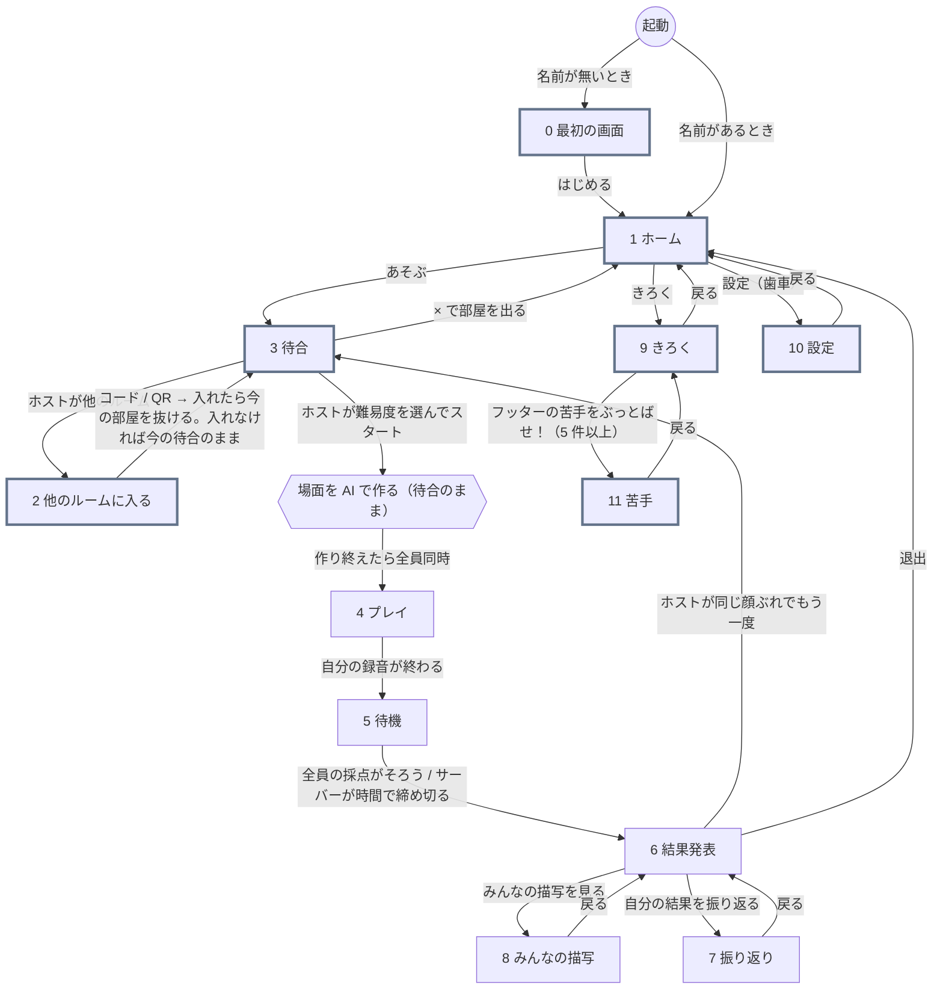

# 画面の流れ

> Status: **合意済み**（2026-10-21。2026-11-11 に英検の級の難易度とチェックリストの採点に合わせて更新。2026-11-12 に、最初の画面・ホームの「あそぶ」・他のルーム・きろく・設定・苦手を足した。2026-11-13 に、レビューで確定し、画像を実装（PR #114・#116・#119・PR 4）の画面に替えた）。各画面の状態（実装済み・確定）は、画面の一覧の表と [`ui/screens/`](./ui/screens/) の各画面に書く。[`usecase.md`](./usecase.md) の決定から組み立てたもの。「推測」と書いた箇所は確認していない。

## 前提（usecase.md で決めたこと）

- 各自の iPhone で同じ 3D シーンを見て、同時に英語で描写する。順番には遊ばない。
- 共有の画面は持たない。全員が同じプレイヤー画面を使う。
- 部屋を作った人（以下「ホスト」）が難易度を選んでスタートする（2026-11-11 に変更。前はシーンを選んでいた）。他の人はコードか QR で入る。
- 2026-11-12 から（PR #116）、ホームのボタンは「あそぶ」の 1 つ。押すと誰でもまず自分の部屋を作ってホストになり、ほかの人の部屋へは待合の「他のルーム」でコードか QR を入れて移る。
- 場面は AI で作り置いたもの（`scenenglish.scene/2`）だけで遊ぶ。手作りの 6 場面は外した（2026-11-11）。
- 採点は英検の二次試験の観点に沿わせた 3 つの軸: 内容 50%（場面のチェックリストの F1）、表現 25%、話し方 25%（2026-11-11）。
- 結果は、全員の採点がそろってから全員の画面に一斉に出す（2026-10-21）。そろわないときはサーバーが時間で締め切る（2026-11-11 に変更。前はホストが締め切った）。
- よく見る画面（録音・待機・結果発表・みんなの描写）はシンプルにして文字を書かず、具体的な情報（3 つの軸・チェックリスト）は、たまに見る振り返りに置く（2026-11-11 のレビュー）。
- 順位の見せ方と待ち方は、チームの別作品 ThatsFight（`TEIKOTA/ThatsFight`）の結果発表を参考にする（2026-10-21）。

## 画面の一覧

| # | 画面 | 見る人 | 状態（2026-11-13） | 主な中身 |
| --- | --- | --- | --- | --- |
| 0 | 最初の画面 | 初めて開いた人 | 確定（実装: #116） | 名前を保存していないときだけ出る。ジオラマ、「ScenEnglish」、「あなたの名前を決めよう」、名前の欄、「はじめる」。色は 6 色から自動で決める。決めたらホームへ、2 回目からは出ない。機能の案内（オンボーディング）は作らない（[`ui/screens/first.md`](./ui/screens/first.md)） |
| 1 | ホーム | 全員 | 確定（実装: #116） | 「あそぶ」（自分の部屋を作って待合へ）、きろくへの入口、右上に設定。名前と色の欄と「部屋を作る」「部屋に入る」は無くした。2026-11-13 に案 B で確定: 大きなジオラマの下にタイトル（まとまりは空きの中の少し上）、下の方に「あそぶ」（塗り）と「きろく」（枠だけ、同じ大きさ、文字だけ）を縦に並べる（[`ui/screens/home.md`](./ui/screens/home.md)） |
| 2 | 他のルームに入る（シート） | ホスト | 確定（実装: #116） | 待合の「他のルーム」で開く。QR の読み取り、コードの入力。4 桁そろうと、先に確かめる通信はせずに入りにいき、入れたら今の部屋を抜ける。自分の部屋にほかの人がいれば、シートの上で「やめる／入る」を確かめる。入れなければ今の待合のまま、シートに理由を出す（2026-11-13）。前はホームの「部屋に入る」で開く画面だった（[`ui/screens/join.md`](./ui/screens/join.md)） |
| 3 | 待合（ロビー） | 全員 | 確定（実装: #116。難易度とスタートは実装済み） | 部屋のコードと QR（ホストには、その下に「他のルーム」）、参加者の一覧。ホストだけ、難易度（かんたん＝英検3級・ふつう＝準2級・むずかしい＝2級）を選んで「スタート」。場面はスタートまで見せない（2026-11-11 に変更。サムネイル付きの一覧と「おまかせ」は外した）。場面を AI で作っている間は全員ここで待つ |
| 4 | プレイ | 全員 | 実装済み | 3D シーン（最初に自動で 1 周）、カウントダウン、録音中の残り時間、音量メーター、「話し終えた」ボタン。ライブ字幕は出さない（お題の帯と注意書きは 2026-11-11 に検討して出さないことにした） |
| 5 | 待機 | 話し終えた人 | 実装済み | 答えた場面と正答例（場面の級の見本の答え）、参加者ごとの状態（「残り N 人」の表示は 2026-10-24 にモックで外した。[`ui/screens/waiting.md`](./ui/screens/waiting.md)）。点数は発表まで伏せる。「締め切って発表する」は 2026-11-11 に外し、サーバーが時間で締め切る |
| 6 | 結果発表（順位） | 全員 | 実装済み | 最下位から 1 行ずつ順位・名前・合計の点を開き、最後に優勝を出す。全員の画面で同じ盤面（3 つの軸やチェックの数は出さない。2026-11-11 に確かめた） |
| 7 | 振り返り | 各自 | 実装済み | 3 つの軸の点、下線を引いた自分の描写、場面のチェック、場面と合わない描写、次の一つ、見本の答え、言い直し、話し方の一言（2026-11-11 に変更。前の講評と模範表現は無くなった。[`ui/screens/review.md`](./ui/screens/review.md)） |
| 8 | みんなの描写 | 全員 | 実装済み | 全員の文字起こしを点数順に並べ、各行に合計の点を添える（2026-11-11 に変更。講評の一言は無くなった） |
| 9 | きろく | 各自 | 確定（実装: #114） | 全幅の 3D の横の並び（カードに入れない。隣ののぞきも無し）と場面の名前と、選んだ場面を遊んだ回の振り返り（7 と同じ中身。順位は無い）を新しい順に縦に続ける。下へスクロールすると、小さくした 3D と名前だけが上に止まり、名前のすぐ下で中身がぼかしの壁に溶ける。苦手の入口は下に固定したフッター。2026-11-13 に案 B 改に確定（[`ui/screens/records.md`](./ui/screens/records.md)） |
| 10 | 設定 | 各自 | 確定（実装: #116） | 名前と色（2026-11-13 に、重ねる画面をやめて、前のホームの欄をこの画面の中に移すと確定）、きろくと録音をすべて消す（#114。オレンジ、回数つきの確かめ）。今はこの 2 つだけ。プライバシーポリシー・問い合わせの窓口・ライセンスの表示・アプリの版は後で足す（[`ui/screens/settings.md`](./ui/screens/settings.md)） |
| 11 | 苦手 | 各自 | 確定（実装: #119、AI の分析は PR 4） | 入口はきろくのフッター「苦手をぶっとばせ！」（内容の内訳のある記録が 5 件以上のときだけ出る）。直近 10 件から AI が出す「次はここ」（次の 1 回で試すこと）→ くり返す癖 最大 3 件（0 件なら「くり返す癖は見つかりませんでした」）（観点・見出し・自分の文・直し方）→ 良くなった点 → 「くわしく」（点の推移・どれだけ言えたか・間違いの種類）。AI を作っている間は前回の分析か数えた結果を出す。点の推移は、合計の線 1 本と 3 つの軸の今の点と伸び（2026-11-13 に案 C に決定）。数え方と AI の呼び方は `docs/design/weak-point-analysis.md`（branch docs/weak-point-analysis。2026-11-13。[`ui/screens/weak.md`](./ui/screens/weak.md)） |

## 遷移

凡例: 灰色の太い枠は確定（実装は PR #114・#116・#119 と AI の分析の PR 4 にあり、まだ main に入っていない）、枠の無い画面は実装済み。画像つきの遷移図は `docs/design/ui/build/ui-spec.html`（`python3 scripts/ui-spec/build.py` で作る。[`ui/README.md`](./ui/README.md)）。

初めて開いたとき（名前を保存していないとき）は、ホームの代わりに最初の画面が出る。名前を決めるとホームになり、2 回目からは出ない。

ほかの人の部屋に入るときも、まず「あそぶ」で自分の部屋に入る。待合（ホスト）の「他のルーム」でコードか QR を入れると、自分の部屋にほかの人がいれば「この部屋を抜けて、別のルームに入りますか？」と聞き、先に確かめる通信はせずに移る先に入り、入れてから今の部屋を抜ける。入れなければ今の待合のまま、シートに理由を出す（ホームには戻らない。2026-11-13）。残った人は、ホストを引き継いでそのまま遊べる。参加者の待合には「他のルーム」を出さない（[`ui/screens/lobby.md`](./ui/screens/lobby.md)）。

きろくと設定は、部屋に入らずにホームから開く。中身は端末に残した記録（`docs/design/play-record.md`。きろくの PR #114 で足す）で、通信しない。きろくの中の振り返りには、順位を出さない。

## 1 ラウンドの流れ（推測を含む）

1. ホームの「あそぶ」を押すと自分の部屋ができて待合に入り、ほかの人の部屋には待合の「他のルーム」から移る（2026-11-12。PR #116。前はホストが「部屋を作る」、ほかの人が「部屋に入る」）。ホストが待合で難易度（かんたん＝英検3級・ふつう＝準2級・むずかしい＝2級）を選び、「スタート」を押す。場面は部屋が AI で作り置いた場面から、その部屋でまだ出ていないものを選び、名前も絵もスタートまで見せない。場面を作っている間は全員が待合で待つ（2026-11-11 に変更。前はサムネイル付きの一覧からシーンを選び、「おまかせ」でランダムも選べた。ホストだけが場面を知って有利になるのを防ぐため）。
2. 全員の端末に同じ 3D シーンが同時に出て、自動で 1 周（360 度、約 3 秒）回る。回っている間は操作できない（2026-10-21 に決定）。回る 3 秒はカウントダウンを兼ね、「3, 2, 1」を重ねて出す（推測）。
3. 1 周し終えたら、全員一斉に録音が始まる。最長 20 秒。録音中は指で 3D を回して見られる。録音の画面に文字は足さない（2026-11-11 に、難易度ごとのお題の帯と「場面にいない物を言うと、正しさが下がります」を検討して、出さないことにした）。
4. 録音中はライブ字幕を出さず、マイクが音を拾っていることを示す音量メーターだけ出す（2026-10-21 に決定）。理由: 字幕を見て「間違えたから言い直す」のは、現実の会話では起きない状況で、本質的な英語学習にならないため。あわせて、字幕を読むと 3D から注意がそれる（推測）。文字起こしは結果の画面で見せる。
5. 話し終えた人は「話し終えた」ボタンで自分の録音を止められる（2026-10-21 に決定）。止めた人、または 20 秒たった人から待機の画面に移る。他の人の進み具合（話している / 採点中 / 完了 / 切断中）は見えるが、点数は伏せる。待つ間は、答えた場面と正答例（場面の級の見本の答え）を見比べられる。
6. 全員の採点がそろったら、すぐ自動で結果発表に移る。そろわないときはサーバーが時間で締め切る（2026-11-11 に変更。前はホストが「締め切って発表する」を押した）: 録音が終わるはずの時刻から 15 秒たっても音声を送っていない人（2026-11-11 に 10 秒から変更）は「採点できませんでした」とする。送った人の採点はその時刻から 30 秒まで待ち、そろったらすぐ発表する。30 秒たっても採点が終わらない人も「採点できませんでした」として発表に進む（バックエンドの実装どおり）。
7. 結果発表では、最下位から順に約 0.9 秒ごとに 1 行ずつ、名前と点数をパタパタ（フラップ表示）で開く。1 位が止まったら優勝を出す。誰の画面でも同じ盤面にするため、自分の行に印は付けない。「発表をとばす」で一気に開ける。3 つの軸・チェックの数・重みは出さない（2026-11-11 に確かめた。中身は振り返りで見る。重みの説明は、将来「採点方法について」の画面に置く）。
8. 発表の後、「みんなの描写を見る」で全員の文字起こしを点数順に読み比べる（2026-10-21 に決定）。順位の発表は短く盛り上げ、読み比べはその後で落ち着いて行うため、画面を分ける。
9. 各自は「自分の結果を振り返る」で、3 つの軸の点、下線を引いた自分の描写、場面のチェック（言えた重み / 満点）、場面と合わない描写（正しさ）、次の一つ、見本の答え、言い直し、話し方の一言を見る（2026-11-11 に変更。前は点数の内訳と講評）。振り返りから同じ場面でやり直す口（「もう一度この場面で話す」）は作らず、結果発表に戻るだけ。ホストは「同じ顔ぶれでもう一度」で待合に戻せ、難易度を選び直して次のラウンドを始める。

作り置きの場面と新しい採点が本番に入ったら（2026-10-25 に決定。2026-11-11 に本番に入れることにし、上の 1 に書き込んだ）、1 の選び方を変える。ホストは難易度（かんたん・ふつう・むずかしい）だけを選び、場面はその部屋でまだ出ていないものからランダムに出る。名前もサムネイルもスタートまで見せない。手作りの 6 場面は、そのときに外す。[`scene-protocol.md`](./scene-protocol.md) の「AI で場面を作り置く」。

ThatsFight から取り入れたもの: 待機の画面（残り人数、点数を伏せる、ホストの締め切り。ホストの締め切りは 2026-11-11 にサーバーの時間の締め切りに替えた）、最下位からの順位発表とフラップ表示、優勝の表示、発表をとばすボタン、発表の後の振り返り、同じ顔ぶれでもう一度、切断中も直前の画面を残して復帰を待つ作り。

## 1 台だけのとき

同時プレイが間に合わなかった場合、1 人がプレイし、結果発表に事前に録っておいたチームメンバーの回答と点数を並べる（usecase.md で決定済み）。

## Open Questions

- なし。
