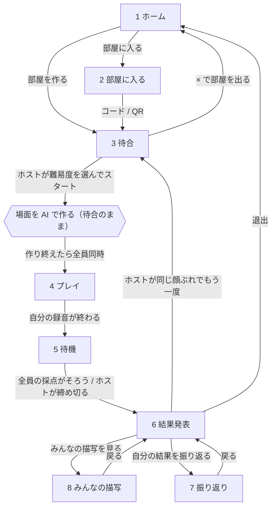

# 画面の流れ

> Status: **合意済み**（2026-10-21。2026-11-11 に英検の級の難易度とチェックリストの採点に合わせて更新）。[`usecase.md`](./usecase.md) の決定から組み立てたもの。「推測」と書いた箇所は確認していない。

## 前提（usecase.md で決めたこと）

- 各自の iPhone で同じ 3D シーンを見て、同時に英語で描写する。順番には遊ばない。
- 共有の画面は持たない。全員が同じプレイヤー画面を使う。
- 部屋を作った人（以下「ホスト」）が難易度を選んでスタートする（2026-11-11 に変更。前はシーンを選んでいた）。他の人はコードか QR で入る。
- 場面は AI で作り置いたもの（`scenenglish.scene/2`）だけで遊ぶ。手作りの 6 場面は外した（2026-11-11）。
- 採点は英検の二次試験の観点に沿わせた 3 つの軸: 内容 50%（場面のチェックリストの F1）、表現 25%、話し方 25%（2026-11-11）。
- 結果は、全員の採点がそろってから全員の画面に一斉に出す（2026-10-21）。
- 順位の見せ方と待ち方は、チームの別作品 ThatsFight（`TEIKOTA/ThatsFight`）の結果発表を参考にする（2026-10-21）。

## 画面の一覧

| # | 画面 | 見る人 | 主な中身 |
| --- | --- | --- | --- |
| 1 | ホーム | 全員 | 名前の入力、「部屋を作る」「部屋に入る」 |
| 2 | 部屋に入る | 参加者 | コードの入力、QR の読み取り |
| 3 | 待合（ロビー） | 全員 | 部屋のコードと QR、参加者の一覧。ホストだけ、難易度（かんたん＝英検3級・ふつう＝準2級・むずかしい＝2級）を選んで「スタート」。場面はスタートまで見せない（2026-11-11 に変更。サムネイル付きの一覧と「おまかせ」は外した）。場面を AI で作っている間は全員ここで待つ |
| 4 | プレイ | 全員 | 3D シーン（最初に自動で 1 周）、カウントダウン、録音中の残り時間、お題の帯（難易度ごとの段階）、音量メーター、「話し終えた」ボタンと「場面にいない物を言うと、正しさが下がります」。ライブ字幕は出さない |
| 5 | 待機 | 話し終えた人 | 答えた場面と正答例（場面の級の見本の答え）、参加者ごとの状態（「残り N 人」の表示は 2026-10-24 にモックで外した。[`ui/screens/waiting.md`](./ui/screens/waiting.md)）。点数は発表まで伏せる。ホストだけ「締め切って発表する」 |
| 6 | 結果発表（順位） | 全員 | 人ごとのカード（順位・名前・合計、内容・表現・話し方の細い棒、「チェック n つ ・ 一部 n つ ・ 合わない n つ」）を最下位から 1 枚ずつ開き、最後に優勝を出す。自分のカードに「あなた」の札（2026-11-11 に変更） |
| 7 | 振り返り | 各自 | 3 つの軸の点、下線を引いた自分の描写、場面のチェック、場面と合わない描写、次の一つ、見本の答え、言い直し、話し方の一言（2026-11-11 に変更。前の講評と模範表現は無くなった。[`ui/screens/review.md`](./ui/screens/review.md)） |
| 8 | みんなの描写 | 全員 | 全員の文字起こしを点数順に並べ、各行に合計点とチェックの数を添える（2026-11-11 に変更。講評の一言が無くなったため。推測、iOS の担当の決定待ち） |

## 遷移

## 1 ラウンドの流れ（推測を含む）

1. ホストが待合で難易度（かんたん＝英検3級・ふつう＝準2級・むずかしい＝2級）を選び、「スタート」を押す。場面は部屋が AI で作り置いた場面から、その部屋でまだ出ていないものを選び、名前も絵もスタートまで見せない。場面を作っている間は全員が待合で待つ（2026-11-11 に変更。前はサムネイル付きの一覧からシーンを選び、「おまかせ」でランダムも選べた。ホストだけが場面を知って有利になるのを防ぐため）。
2. 全員の端末に同じ 3D シーンが同時に出て、自動で 1 周（360 度、約 3 秒）回る。回っている間は操作できない（2026-10-21 に決定）。回る 3 秒はカウントダウンを兼ね、「3, 2, 1」を重ねて出す（推測）。
3. 1 周し終えたら、全員一斉に録音が始まる。最長 20 秒。録音中は指で 3D を回して見られる。3D の上に「お題」の帯を出し、難易度ごとの段階を矢印でつないで見せる（かんたん「誰が何をしている？」、ふつう「→ なぜ？」まで、むずかしい「→ つなげよう」まで。2026-11-11）。例の文は出さない。録音ボタンの下に小さく「場面にいない物を言うと、正しさが下がります」。
4. 録音中はライブ字幕を出さず、マイクが音を拾っていることを示す音量メーターだけ出す（2026-10-21 に決定）（お題の帯は 2026-11-11 に足した。字幕ではないので、この決定は変わらない）。理由: 字幕を見て「間違えたから言い直す」のは、現実の会話では起きない状況で、本質的な英語学習にならないため。あわせて、字幕を読むと 3D から注意がそれる（推測）。文字起こしは結果の画面で見せる。
5. 話し終えた人は「話し終えた」ボタンで自分の録音を止められる（2026-10-21 に決定）。止めた人、または 20 秒たった人から待機の画面に移る。他の人の進み具合（話している / 採点中 / 完了 / 切断中）は見えるが、点数は伏せる。待つ間は、答えた場面と正答例（場面の級の見本の答え）を見比べられる。
6. 全員の採点がそろったら、自動で結果発表に移る。採点が遅れた・失敗した人がいるときは、ホストが「締め切って発表する」を押せる。その人は「採点できませんでした」として扱う（推測）。
7. 結果発表では、最下位から順に約 0.9 秒ごとに 1 枚ずつ、人ごとのカード（順位・名前・合計、内容・表現・話し方の細い棒、チェックの数）を開く。1 位が止まったら優勝を出す。「発表をとばす」で一気に開ける。自分のカードは紫の枠と「あなた」の札で目立たせる（2026-11-11 に変更。前は誰の画面でも同じ盤面にするため、自分の行に印を付けなかった）。カードの下に小さく「内容 50% ・ 表現 25% ・ 話し方 25%」。開く動きとボタンを新しい画面にも残すかは iOS の担当が決める途中で、ここでは残す前提で書いた。
8. 発表の後、「みんなの描写を見る」で全員の文字起こしを点数順に読み比べる（2026-10-21 に決定）。順位の発表は短く盛り上げ、読み比べはその後で落ち着いて行うため、画面を分ける。
9. 各自は「自分の結果を振り返る」で、3 つの軸の点、下線を引いた自分の描写、場面のチェック（言えた重み / 満点）、場面と合わない描写（正しさ）、次の一つ、見本の答え、言い直し、話し方の一言を見る（2026-11-11 に変更。前は点数の内訳と講評）。振り返りから同じ場面でやり直す口（「もう一度この場面で話す」）は作らず、結果発表に戻るだけ。ホストは「同じ顔ぶれでもう一度」で待合に戻せ、難易度を選び直して次のラウンドを始める。

作り置きの場面と新しい採点が本番に入ったら（2026-10-25 に決定。2026-11-11 に本番に入れることにし、上の 1 に書き込んだ）、1 の選び方を変える。ホストは難易度（かんたん・ふつう・むずかしい）だけを選び、場面はその部屋でまだ出ていないものからランダムに出る。名前もサムネイルもスタートまで見せない。手作りの 6 場面は、そのときに外す。[`scene-protocol.md`](./scene-protocol.md) の「AI で場面を作り置く」。

ThatsFight から取り入れたもの: 待機の画面（残り人数、点数を伏せる、ホストの締め切り）、最下位からの順位発表とフラップ表示、優勝の表示、発表をとばすボタン、発表の後の振り返り、同じ顔ぶれでもう一度、切断中も直前の画面を残して復帰を待つ作り。

## 1 台だけのとき

同時プレイが間に合わなかった場合、1 人がプレイし、結果発表に事前に録っておいたチームメンバーの回答と点数を並べる（usecase.md で決定済み）。

## Open Questions

- なし。
