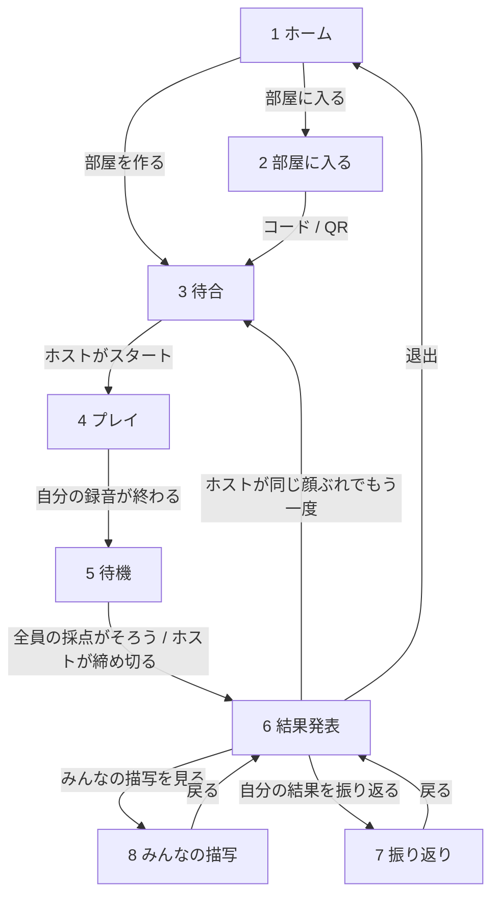

# 画面の流れ

> Status: **合意済み**（2026-10-21）。[`usecase.md`](./usecase.md) の決定から組み立てたもの。「推測」と書いた箇所は確認していない。

## 前提（usecase.md で決めたこと）

- 各自の iPhone で同じ 3D シーンを見て、同時に英語で描写する。順番には遊ばない。
- 共有の画面は持たない。全員が同じプレイヤー画面を使う。
- 部屋を作った人（以下「ホスト」）がシーンを選んでスタートする。他の人はコードか QR で入る。
- 結果は、全員の採点がそろってから全員の画面に一斉に出す（2026-10-21）。
- 順位の見せ方と待ち方は、チームの別作品 ThatsFight（`TEIKOTA/ThatsFight`）の結果発表を参考にする（2026-10-21）。

## 画面の一覧

| # | 画面 | 見る人 | 主な中身 |
| --- | --- | --- | --- |
| 1 | ホーム | 全員 | 名前の入力、「部屋を作る」「部屋に入る」 |
| 2 | 部屋に入る | 参加者 | コードの入力、QR の読み取り |
| 3 | 待合（ロビー） | 全員 | 部屋のコードと QR、参加者の一覧。ホストだけ、サムネイル付きの一覧からシーンを選ぶ（「おまかせ」でランダムも可）と「スタート」 |
| 4 | プレイ | 全員 | 3D シーン（最初に自動で 1 周）、カウントダウン、録音中の残り時間、音量メーター、「話し終えた」ボタン。ライブ字幕は出さない |
| 5 | 待機 | 話し終えた人 | 参加者ごとの状態（「残り N 人」の表示は 2026-10-24 にモックで外した。[`ui/screens/waiting.md`](./ui/screens/waiting.md)）。点数は発表まで伏せる。ホストだけ「締め切って発表する」 |
| 6 | 結果発表（順位） | 全員 | 最下位から 1 行ずつ順位を開き、最後に優勝を出す。全員の画面で同じ盤面 |
| 7 | 振り返り | 各自 | 自分の点数の内訳（内容・表現・話し方）、講評（できたこと・次はこれ・こう言い換える・話し方のコツ。[`usecase.md`](./usecase.md)） |
| 8 | みんなの描写 | 全員 | 全員の文字起こしを点数順に並べ、各行に講評の一言（できたこと）を添える |

## 遷移

## 1 ラウンドの流れ（推測を含む）

1. ホストが待合で、サムネイル付きの一覧からシーンを選び（「おまかせ」でランダムも可。2026-10-21 に決定）、「スタート」を押す。発表のデモで見せたいシーンを確実に選べるようにするため。
2. 全員の端末に同じ 3D シーンが同時に出て、自動で 1 周（360 度、約 3 秒）回る。回っている間は操作できない（2026-10-21 に決定）。回る 3 秒はカウントダウンを兼ね、「3, 2, 1」を重ねて出す（推測）。
3. 1 周し終えたら、全員一斉に録音が始まる。最長 20 秒。録音中は指で 3D を回して見られる（推測）。
4. 録音中はライブ字幕を出さず、マイクが音を拾っていることを示す音量メーターだけ出す（2026-10-21 に決定）。理由: 字幕を見て「間違えたから言い直す」のは、現実の会話では起きない状況で、本質的な英語学習にならないため。あわせて、字幕を読むと 3D から注意がそれる（推測）。文字起こしは結果の画面で見せる。
5. 話し終えた人は「話し終えた」ボタンで自分の録音を止められる（2026-10-21 に決定）。止めた人、または 20 秒たった人から待機の画面に移る。他の人の進み具合（話している / 採点中 / 完了 / 切断中）は見えるが、点数は伏せる。
6. 全員の採点がそろったら、自動で結果発表に移る。採点が遅れた・失敗した人がいるときは、ホストが「締め切って発表する」を押せる。その人は「採点できませんでした」として扱う（推測）。
7. 結果発表では、最下位から順に約 0.9 秒ごとに 1 行ずつ、名前と点数をパタパタ（フラップ表示）で開く。1 位が止まったら優勝を出す。誰の画面でも同じ盤面にするため、自分の行に印は付けない。「発表をとばす」で一気に開ける。
8. 発表の後、「みんなの描写を見る」で全員の文字起こしを点数順に読み比べる（2026-10-21 に決定）。順位の発表は短く盛り上げ、読み比べはその後で落ち着いて行うため、画面を分ける。
9. 各自は「自分の結果を振り返る」で点数の内訳と講評を見る。ホストは「同じ顔ぶれでもう一度」で待合に戻せる。

ThatsFight から取り入れたもの: 待機の画面（残り人数、点数を伏せる、ホストの締め切り）、最下位からの順位発表とフラップ表示、優勝の表示、発表をとばすボタン、発表の後の振り返り、同じ顔ぶれでもう一度、切断中も直前の画面を残して復帰を待つ作り。

## 1 台だけのとき

同時プレイが間に合わなかった場合、1 人がプレイし、結果発表に事前に録っておいたチームメンバーの回答と点数を並べる（usecase.md で決定済み）。

## Open Questions

- なし。
